- Definitions and the format of a book map is described in
  `.claude/skills/book_map.rules.md`

# All prompts

| **Prompt** | **Comment** |
| :--------- | :---------- |
| `book_scripts/prompt.create_lesson_slides.common.md` | Steps shared by the two lesson prompts |
| `book_scripts/prompt.create_lesson_slides_from_chap_toc.md` | Lesson slides from a chapter TOC |
| `book_scripts/prompt.create_lesson_slides_from_topic.md` | Lesson slides from an ad-hoc topic list |
| `book_scripts/prompt.create_latex_book_chap_from_lesson_slides.md` | LaTeX book chapter from lesson slides |
| `book_scripts/prompt.create_typst_book_chap_from_lesson_slides.md` | Typst book chapter from lesson slides |
| `book_scripts/prompt.expand_skeleton_slides.md` | Skeleton slides expanded from background files |
| `book_scripts/prompt.extract_skeleton_slides_from_lesson_slides.md` | Skeleton slides and TOC from lesson slides |
| `book_scripts/prompt.find_references_to_chap_toc.md` | References for a chapter in `map.md` |
| `book_scripts/prompt.inline_lesson_slides_from_skeleton_slides.md` | Slide content copied into a skeleton |
| `book_scripts/prompt.update_book_chap_from_lesson_slides.md` | Typst chapter updated after its slides change |
| `book_scripts/prompt.slides_and_book_flow.md` | Slides reviewed and book chapter generated |

# Flow of Prompts and Files

- Each box is a prompt, an intermediate file, or an external input
  - A prompt is named without the `prompt.` prefix and the `.md` suffix
    - E.g., `create_lesson_slides.common` is
      `book_scripts/prompt.create_lesson_slides.common.md`
- A solid arrow means that the source feeds the target
- A dashed arrow means that the source updates a file or is reused by the target
- A double-headed arrow means that the prompt reads the file and writes it back

```graphviz
digraph PromptFlow {
  // prompt : blue | file : orange | external input : violet
  bgcolor="transparent";
  pad="0.15";
  splines=spline;
  nodesep=0.25;
  ranksep=0.45;
  rankdir=TB;
  compound=true;

  node [shape=box,
        style="rounded,filled",
        penwidth=1.8,
        fontname="Helvetica",
        fontsize=12,
        margin="0.22,0.14",
        height=0.50];

  edge [color="#A3B1C0",
        penwidth=1.3,
        arrowhead=vee,
        arrowsize=0.75,
        fontname="Helvetica",
        fontsize=10,
        fontcolor="#7B8794"];

  // External inputs (violet)
  Topics [label="Ad-hoc topic list", fillcolor="#E9E1F7", color="#A88FD9", fontcolor="#45296B"];
  Resources [label="resources.md", fillcolor="#E9E1F7", color="#A88FD9", fontcolor="#45296B"];
  Background [label="Background files", fillcolor="#E9E1F7", color="#A88FD9", fontcolor="#45296B"];

  // Files (orange)
  BookMap [label="book_map.md", fillcolor="#FBEBD4", color="#D9A85F", fontcolor="#6B4517"];
  Source [label=<<b>*.smd</b><br/><font point-size="10" color="#6B4517">existing lessons</font>>, fillcolor="#FBEBD4", color="#D9A85F", fontcolor="#6B4517"];
  Skeleton [label=<<b>*.smd</b><br/><font point-size="10" color="#6B4517">skeleton with // From:</font>>, fillcolor="#FBEBD4", color="#D9A85F", fontcolor="#6B4517"];
  Lesson [label=<<b>*.smd</b><br/><font point-size="10" color="#6B4517">new lesson slides</font>>, fillcolor="#FBEBD4", color="#D9A85F", fontcolor="#6B4517"];
  Notebook [label=<<b>*.ipynb, *.png</b><br/><font point-size="10" color="#6B4517">notebook and figures</font>>, fillcolor="#FBEBD4", color="#D9A85F", fontcolor="#6B4517"];
  Typ [label="*.typ", fillcolor="#FBEBD4", color="#D9A85F", fontcolor="#6B4517"];
  Tex [label="*.tex", fillcolor="#FBEBD4", color="#D9A85F", fontcolor="#6B4517"];

  // Prompts (blue)
  FindRefs [label="find_references_to_chap_toc", fillcolor="#D3E3F3", color="#7CA6CE", fontcolor="#1F4E79"];
  Extract [label="extract_skeleton_slides_from_lesson_slides", fillcolor="#D3E3F3", color="#7CA6CE", fontcolor="#1F4E79"];
  Inline [label="inline_lesson_slides_from_skeleton_slides", fillcolor="#D3E3F3", color="#7CA6CE", fontcolor="#1F4E79"];
  Expand [label="expand_skeleton_slides", fillcolor="#D3E3F3", color="#7CA6CE", fontcolor="#1F4E79"];
  FromToc [label="create_lesson_slides_from_chap_toc", fillcolor="#D3E3F3", color="#7CA6CE", fontcolor="#1F4E79"];
  FromTopic [label="create_lesson_slides_from_topic", fillcolor="#D3E3F3", color="#7CA6CE", fontcolor="#1F4E79"];
  Common [label="create_lesson_slides.common", fillcolor="#D3E3F3", color="#7CA6CE", fontcolor="#1F4E79"];
  Typst [label="create_typst_book_chap_from_lesson_slides", fillcolor="#D3E3F3", color="#7CA6CE", fontcolor="#1F4E79"];
  Latex [label="create_latex_book_chap_from_lesson_slides", fillcolor="#D3E3F3", color="#7CA6CE", fontcolor="#1F4E79"];
  Update [label="update_book_chap_from_lesson_slides", fillcolor="#D3E3F3", color="#7CA6CE", fontcolor="#1F4E79"];
  Flow [label="slides_and_book_flow", fillcolor="#D3E3F3", color="#7CA6CE", fontcolor="#1F4E79"];

  subgraph cluster_plan {
    label     = "Book plan";
    labelloc  = "t";
    fontname  = "Helvetica-Bold";
    fontsize  = 12.5;
    fontcolor = "#3A4A5C";
    style     = "rounded,filled";
    fillcolor = "#F7F9FB";
    color     = "#C7D0DA";
    penwidth  = 1.0;
    margin    = 16;

    BookMap; FindRefs;
  }

  subgraph cluster_slides {
    label     = "Lesson slides";
    labelloc  = "t";
    fontname  = "Helvetica-Bold";
    fontsize  = 12.5;
    fontcolor = "#3A4A5C";
    style     = "rounded,filled";
    fillcolor = "#F7F9FB";
    color     = "#C7D0DA";
    penwidth  = 1.0;
    margin    = 16;

    Extract; Skeleton; Inline; Expand; FromToc; FromTopic; Common; Notebook; Lesson;
  }

  subgraph cluster_book {
    label     = "Book chapter";
    labelloc  = "t";
    fontname  = "Helvetica-Bold";
    fontsize  = 12.5;
    fontcolor = "#3A4A5C";
    style     = "rounded,filled";
    fillcolor = "#F7F9FB";
    color     = "#C7D0DA";
    penwidth  = 1.0;
    margin    = 16;

    Typst; Latex; Update; Flow; Typ; Tex;
  }

  // Book plan
  BookMap -> FindRefs [dir=both, label="  Reads chapter,\n  adds references  "];

  // Skeleton route
  BookMap -> Extract [label="  Goals, topics  "];
  Source -> Extract;
  Extract -> Skeleton;
  Extract -> BookMap [style=dashed, constraint=false, label="  Updates topics, goals  "];
  Skeleton -> Inline;
  Source -> Inline [label="  // From:  "];
  Inline -> Lesson;
  Skeleton -> Expand;
  Background -> Expand [label="  // From:  "];
  Expand -> Lesson;

  // Create-from-scratch route
  BookMap -> FromToc;
  Resources -> FromToc;
  Source -> FromToc [label="  Avoid repetition  "];
  Topics -> FromTopic;
  Source -> FromTopic [label="  Avoid repetition  "];
  FromToc -> Common [label="  Executes  "];
  FromTopic -> Common [label="  Executes  "];
  Common -> Lesson;
  Common -> Notebook;
  Notebook -> Lesson [label="  Figures  "];

  // Book chapter route
  Lesson -> Typst;
  Lesson -> Latex;
  Typst -> Typ;
  Latex -> Tex;
  Lesson -> Update [label="  git diff  "];
  Typ -> Update [dir=both, label="  Reads hash,\n  updates  "];
  Typst -> Update [style=dashed, label="  Rules reused  "];
  Lesson -> Flow [dir=both, label="  Reviews  "];
  Flow -> Typ [label="  gen_book_chapter.py  "];

  // Legend
  subgraph cluster_legend {
    label     = "Legend";
    labelloc  = "t";
    fontname  = "Helvetica-Bold";
    fontsize  = 12.5;
    fontcolor = "#3A4A5C";
    style     = "rounded,filled";
    fillcolor = "#FBFBFD";
    color     = "#C7D0DA";
    penwidth  = 1.0;
    margin    = 14;

    node [shape=box, style="rounded,filled", fontsize=10, height=0.32, margin="0.14,0.08"];
    LegendPrompt   [label="Prompt", fillcolor="#D3E3F3", color="#7CA6CE", fontcolor="#1F4E79"];
    LegendFile     [label="Intermediate file", fillcolor="#FBEBD4", color="#D9A85F", fontcolor="#6B4517"];
    LegendExternal [label="External input", fillcolor="#E9E1F7", color="#A88FD9", fontcolor="#45296B"];
    { rank=same; LegendPrompt; LegendFile; LegendExternal; }
  }
}
```


label=fig:prompt-flow
caption=How the prompts feed each other through book_map.md, *.smd, *.typ, and *.tex files, with prompts in blue, intermediate files in orange, and external inputs in violet.

# Prompts

## Create `lesson_slides` from a chapter TOC

- **Prompt**:
  ```text
  claude> Execute book_scripts/prompt.create_lesson_slides_from_chap_toc.md
  ```
- **Input**:
  - Chapter `CHAP` (H2) in `<DIR>/<BOOK>/book_map.md`
  - Its `### Goals`, `### Topics`, and `### Lesson Materials`
  - Its `### Papers` and `### Books`
  - `<DIR>/<BOOK>/resources.md`, if present
- **Output**: `<DIR>/<BOOK>/lectures_source/Lesson<CHAP_NUM>.<ID>_<TITLE>.smd`
- **Workflow**:
  - Read the book map and the chapter `CHAP`
  - Read the material in `### Lesson Materials`, `### Papers`, and `### Books`
  - Read the existing lessons in `<BOOK>/lectures_source/` to avoid repetition
  - Execute `book_scripts/prompt.create_lesson_slides.common.md`
- **Examples**:
  - For the agentic AI book, a chapter TOC exists, so its `lesson_slides` are
    created with this prompt
  - E.g., `CHAP="## 14, GitHub Projects and Workflows"` in
    `book_AI_Software_Engineering`

## Create `lesson_slides` from a topic list (with book_map.md)

- **Prompt**:
  ```text
  claude> Execute book_scripts/prompt.create_lesson_slides_from_topic.md
  ```
- **Input**:
  - Ad-hoc list of topics in the `## Topics` section of the prompt
  - Optional file to align the content with
- **Output**: `<DIR>/<BOOK>/lectures_source/Lesson<CHAP_NUM>.<ID>_<TITLE>.smd`
- **Workflow**:
  - Read the topics and the optional alignment file
  - Read the existing lessons in `<DIR>/<BOOK>/lectures_source/`
  - Execute `book_scripts/prompt.create_lesson_slides.common.md`
- **Examples**:
  - Useful when the book map does not have the chapter yet
  - Useful for a course such as `msml610`
  - E.g., `BOOK="msml610"`, `CHAP_NUM="09"`, `TITLE="Classical_Search_Algorithms"`

## Common steps to create `lesson_slides`

- **Prompt**:
  ```text
  claude> Execute book_scripts/prompt.create_lesson_slides.common.md
  ```
- **Input**:
  - Topics and material read by the calling prompt
  - Variables `<DIR>`, `<BOOK>`, `<CHAP_NUM>`, `<ID>`, and `<TITLE>`
- **Output**:
  - Slides: `<DIR>/<BOOK>/lectures_source/Lesson<CHAP_NUM>.<ID>_<TITLE>.smd`
  - Notebook and figures: `<DIR>/<BOOK>/tutorials/`, if a figure needs data or code
- **Workflow**:
  - Create a skeleton of 30-35 slide titles
  - Get user approval of the skeleton
  - Call `/slides.write` for 30-35 slides
  - Create a notebook for the figures that need data or code
    - Save each figure with `hmatplo.save_fig()`
  - Save the slides as `Lesson<CHAP_NUM>.<ID>_<TITLE>.smd`
- **Examples**:
  - Not run alone: the two lesson prompts above call it

## Find material

- **Prompt**:
  ```text
  claude> Execute book_scripts/prompt.find_references_to_chap_toc.md
  ```
- **Input**: Chapter `CHAP` (H2) in `<DIR>/<BOOK>/map.md`
- **Output**: Updated `### Local Material`, `### Books`, `### Papers`, and
  `### Internet resources` in `map.md`
- **Workflow**:
  - Read the chapter `CHAP` and find related books, papers, and web resources
  - Prefer recent sources and free-access versions, e.g., arXiv
  - Add a working URL for each reference when possible
  - Format books and papers following `.claude/skills/references.rules.md`
- **Examples**:
  - E.g., `CHAP="## 02: AI Pair Programming Workflows"` in
    `book_AI_Software_Engineering`

## Create `skeleton_slides` from `book_map` and `slides_tutorials`

- **Prompt**:
  ```text
  claude> Execute book_scripts/prompt.extract_skeleton_slides_from_lesson_slides.md
  ```
- **Input**:
  - Chapter `CHAP` in `<DIR>/<BOOK>/map.md`, with its `### Goals` and `### Topics`
  - Lesson slides listed in `### Lesson Materials` of `CHAP`
- **Output**:
  - Skeleton slides in `<BOOK>/lectures_source/Lesson0<num>.01_<name>.txt`
  - Updated `### Topics` and `### Goals` of `CHAP`
- **Workflow**:
  - Extract the TOC of each lesson file with `extract_toc_from_text.py`
  - Write the skeleton with `#` H1, `##` H2, and one `* <slide title>` per slide
  - Add a `// From:` line after each slide with its source file, line, and title
  - Update `### Topics` with the H1 and H2 headers
  - Update `### Goals` with 3 short bullets, each under 100 characters
- **Examples**:
  - E.g., `CHAP="## 08: Causal Data Pipelines"` in `book_springer`
  - The skeleton has around 30-35 slides

## Inline slides in a skeleton slide

- **Prompt**:
  ```text
  claude> Execute book_scripts/prompt.inline_lesson_slides_from_skeleton_slides.md
  ```
- **Input**: Skeleton file `<FILE>` whose `// From: <file>:<line num> '<title>'`
  lines point to source slides
- **Output**: The same `<FILE>`, with the source slide content inlined under each
  slide
- **Workflow**:
  - Find the source slide for each `// From:` line
  - Copy its content under the slide title
  - Keep the `// From:` line in place
  - Leave a bare `// From:` and report an error if the title is missing
- **Examples**:
  - E.g.,
    ```text
    claude> Execute /Users/saggese/src/notes1/book_scripts/prompt.inline_lesson_slides_from_skeleton_slides.md on book_springer/lectures_source/Lesson05.1_Probabilistic_ML.txt
    ```
  - Mechanical copy in a Python script, since it is a mechanical operation:
    ```bash
    > class_scripts/inline_content_in_skeleton_slides.py
    > vi $(grep -riL "Score:" *.md | while IFS= read -r f; do stat -f "%m%t%N" "$f"; done | sort -n | head -10 | cut -f2- | tr '\n' '\0' | xargs -0)
    ```
  - Check that the result is correct:
    ```bash
    > gen_slides.py book_springer/05.1
    ```

## Expand a skeleton whose slides point to background files

- **Prompt**:
  ```text
  claude> Execute book_scripts/prompt.expand_skeleton_slides.md
  ```
- **Input**: Skeleton file in `$DIR/$BOOK/CHAP`, whose `// From:` names a whole
  background file (e.g., a rules doc)
- **Output**: Slides for each skeleton section, generated from the background files
- **Workflow**:
  - Read each background file named by a `// From:` line
  - Write the slides from that reading instead of copying verbatim
  - Follow `.claude/skills/text.rules.md`, `.claude/skills/markdown.rules.md`, and
    `.claude/skills/slides.rules.md`
  - Ask questions instead of writing the slides if there are doubts
- **Examples**:
  - Same shape as "Inline slides in a skeleton slide" above, but the `// From:`
    names a whole file, not one slide
  - E.g., `// From: helpers_root/.claude/skills/coding.rules.md`

// TODO(gp): Likely a near-duplicate of "Inline slides in a skeleton slide"
// above (same skeleton -> full-slides direction, different `// From:`
// semantics); consider merging as a documented variant of that prompt.

## Generate lectures commentary
- To generate a commentary in `$DIR/lectures_commentary`
  ```
  > gen_lecture_commentary.py book_springer/04.1 --image_type jpg

  > for_loop_lessons.py --class data605 --action generate_lecture_commentary --lectures "01.1-02"

  > publish_class_links.py --dir book_springer --out_file ./links.html --do_not_fail_on_warnings --use_master

  > open book_springer/lecture_commentary/Lesson04.1_Knowledge_Representation.book_chapter.html
  ```

- Check
  ```
  > ls -1 book_springer/lectures_commentary/Lesson*.{pdf,md,html}
  book_springer/lectures_commentary/Lesson02.1_From_Data_Science_To_Decision_Science.book_chapter.html
  book_springer/lectures_commentary/Lesson02.1_From_Data_Science_To_Decision_Science.book_chapter.md
  book_springer/lectures_commentary/Lesson02.1_From_Data_Science_To_Decision_Science.book_chapter.pdf
  book_springer/lectures_commentary/Lesson04.1_Knowledge_Representation.book_chapter.md
  book_springer/lectures_commentary/Lesson05.1_Probabilistic_ML.book_chapter.md
  ```

## Convert Slides to a Typst Book Chapter

- **Prompt**:
  ```text
  claude> Execute book_scripts/prompt.create_typst_book_chap_from_lesson_slides.md
  ```
- **Input**: Lesson slides in `<BOOK>/lectures_source/`, e.g.,
  `msml610/lectures_source/Lesson10.2-Causal_Inference_for_Time_Series.txt`
- **Output**: Typst file `<BOOK>/book/<FILE>.typ`, with the same name as the slides
- **Workflow**:
  - Map each slide level to the document structure:
    - H1 to a chapter with `#chapter`
    - H2 to a section with `==`
    - H3 and deeper to a subsection with `===`
  - Expand each slide into prose for undergraduate and early graduate students
  - Start the file with the `aima-style` template
  - Add `// git_hash=<GIT_HASH>, timestamp=<TIMESTAMP>` as the first line
- **Examples**:
  - E.g., `msml610/book/Lesson10.2-Causal_Inference_for_Time_Series.typ`
  - Keep it in sync with `book_scripts/prompt.update_book_chap_from_lesson_slides.md`

## Convert Slides to a Typst Book Chapter with `gen_book_chapter.py`

- **Command**:
  ```bash
  > gen_book_chapter.py -i msml610/01.2 --mode typst_aima --llm_backend hllm_cli_exec --model openrouter/anthropic/claude-opus-4.6 --no_incremental
  ```
- **Input**: Lesson slides `<SMD_FILE>`, specified as `msml610/01.2` or as
  `msml610/lectures_source/<FILE>.smd`
- **Output**: Typst file `<BOOK>/book/<FILE>.typ`, with the same name as the slides
  (the same output as the prompt above)
- **Workflow**:
  - Python builds the document header (`#import`, `#chapter`) and the headings
  - Python extracts the diagrams, figures, and tables and puts them back after the
    LLM call
  - The LLM is called once per slide, with
    `class_scripts/prompt.generate_typst_book_chapter_slide.md`
    - The LLM turns the prose of one slide into Typst
    - The LLM sees placeholders like `@@FIGURE_1@@`, not raw figure markup
  - Python adds safety nets: it checks that every figure is referenced, fixes stray
    markdown bold, and adds the provenance tag
  - The default actions then run: `lint` (`typstyle`), `fix_typst_code` (Claude Code
    via `ccp`), and `render_pdf` (`run_typst.py`)
  - `git_add` and `open_pdf` are off by default, and are selected with `--action`
- **Flags**:
  - `--llm_backend hllm_cli_exec`: shell out to simonw's `llm` CLI (text-only)
  - `--model openrouter/anthropic/claude-opus-4.6`: use Opus 4.6 through OpenRouter
  - `--no_incremental`: regenerate even if the `.typ` file already exists
    - By default the script skips generation if the output exists
- **Difference from the prompt `book_scripts/prompt.create_typst_book_chap_from_lesson_slides.md`**:
  - **Control**:
    - Prompt: Claude Code does the whole job in one agentic session
    - Script: Python controls the flow and the LLM is a text-only function
  - **Reliability**:
    - Prompt: structure and figures depend on the LLM following the rules
    - Script: headings and figures are deterministic, so the LLM cannot invent images
  - **Model**:
    - Prompt: the model that Claude Code runs
    - Script: any model, chosen with `--model`
  - **Cost and resume**:
    - Prompt: one big session
    - Script: many small LLM calls, and incremental mode skips finished work
  - **Prompt files**:
    - The script uses `class_scripts/prompt.generate_*.md`, not the files in
      `book_scripts/`
    - The two sets of prompts are separate and can drift apart
- **Examples**:
  - The lesson checklist below records the exact command used for each lesson
  - `book_scripts/prompt.update_book_chap_from_lesson_slides.md` follows the prompt
    route, not this script

## Convert Slides to a LaTeX Book Chapter

- **Prompt**:
  ```text
  claude> Execute book_scripts/prompt.create_latex_book_chap_from_lesson_slides.md
  ```
- **Input**: Lesson slides in `<BOOK>/lectures_source/`
- **Output**: LaTeX file `<BOOK>/book/<FILE>.tex`, with the same name as the slides
- **Workflow**:
  - Map each slide level to the document structure:
    - H1 to a chapter with `\chapter`
    - H2 to a section with `\section`
    - H3 and deeper to a subsection with `\subsection`
  - Expand each slide into prose for a textbook chapter
  - Use the Springer SNmono `\documentclass` to match `book_springer/book`
- **Examples**:
  - Check the output:
    ```bash
    > ls -1 book_springer/book/Lesson*.tex
    book_springer/book/Lesson02.01_From_Data_Science_To_Decision_Science.tex
    book_springer/book/Lesson02.02_Integrating_Causality_And_Probability_in_ML.tex
    book_springer/book/Lesson04.01_Knowledge_Representation.tex
    ```

## Update a Typst Book Chapter When the Corresponding `lesson_slides` Are Updated

- **Prompt**:
  ```text
  claude> Execute book_scripts/prompt.update_book_chap_from_lesson_slides.md
  ```
- **Input**:
  - File name `<FILE>`, e.g., `Lesson10.2-Causal_Inference_for_Time_Series`
  - Typst chapter `msml610/book/<FILE>.typ`
  - Lesson slides `msml610/lectures_source/<FILE>.txt`
- **Output**: Updated `msml610/book/<FILE>.typ`
- **Workflow**:
  - Read `<GIT_HASH>` from the first line of the `.typ` file
  - Save the slide changes since that commit in `changes.txt` with `git diff`
  - Apply `changes.txt` to the `.typ` file following
    `book_scripts/prompt.create_typst_book_chap_from_lesson_slides.md`
- **Examples**:
  - E.g.,
    ```bash
    > git diff 382e0cdf HEAD -- msml610/lectures_source/Lesson10.2-Causal_Inference_for_Time_Series.txt >changes.txt
    ```
  - Related prompt: `book_scripts/prompt.springer.add_references.md`

// TODO(gp): This prompt currently only follows the Typst variant of the
// "Convert Slides to a Typst Book Chapter" prompt above; update it to branch on
// the chapter file's extension (`.typ` -> typst prompt, `.tex` -> latex
// prompt) now that a LaTeX variant also exists.

## Review / Update Slides and Generate book

- **Prompt**:
  ```text
  claude> Execute book_scripts/prompt.slides_and_book_flow.md msml610/lectures_source/Lesson05.2-Overfitting.smd
  ```
- **Input**: Lesson slides `<SMD_FILE>`, e.g.,
  `msml610/lectures_source/Lesson05.2-Overfitting.smd`
- **Output**:
  - Reviewed slides `<SMD_FILE>`
  - Book chapter `msml610/book/<NAME>.typ`
- **Workflow**:
  - Create a plan file to track the steps
  - Read the conventions for books, slides, and Typst code
  - Review and improve the slides with `/slides.review`
  - Render the slides with `gen_slides.py -i <SMD_FILE>` and fix any problem
  - Add visuals and references with `/slides.add_visuals` and
    `/slides.add_references`
  - Generate the book chapter with `gen_book_chapter.py`
  - Humanize the chapter with `/text.humanize`
  - Check that the Typst code compiles with `run_typst.py`
- **Examples**:
  - The lesson checklist below records the commands run for each lesson

### Checklist

// From msml610/book_map.md
```
claude> Execute book_scripts/prompt.slides_and_book_flow.md msml610/lectures_source/Lesson05.2-Overfitting.smd
```

- [x] 5.1
- [x] 5.2
- [x] 5.3

- [x] 6.1
- [x] 6.2

- [ ] 7.1
- [ ] 7.2

LID=06.2; gen_slides.py -i msml610/$LID --daemon
LID=06.2; render_book_chapter.py -i msml610/$LID --daemon

/slides.review            05.1
/slides.add_visuals       .
/slides.add_references    .
/slides.lint              .
/slides.fix_rendered_pdf  .

Edit slides               .

Not needed
/slides.fix_errors
/slides.reduce_text
/slides.fix_formatting
/slides.add_tutorial_links

lint_text.py              .
> lint_text.py -i msml610/lectures_source/Lesson02.1*.smd

gen_slides.py             .
> gen_slides.py -i msml610/01.3
> grep "^* " msml610/lectures_source/*.smd | wc -l

tutorials

gen_book_chapter          .
gen_book_chapter.py -i msml610/01.2 --mode typst_aima --llm_backend hllm_cli_exec --model openrouter/anthropic/claude-opus-4.6 --no_incremental

run_typst.py              .
> run_typst.py --input msml610/book/Lesson01.2-AI_and_Machine_Learning.typ

> /text.humanize          .
> /book_chapter.fix_headings      .
> /book_chapter.improve_text_tags .

Edit book chapter

run_typst.py --compress_pdf .
> compress_pdf.py --input msml610/book/Lesson01.3*.pdf
