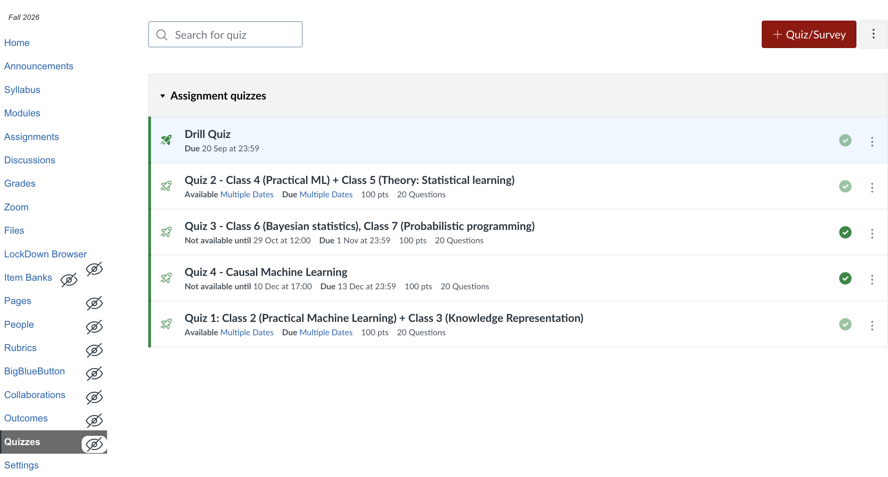
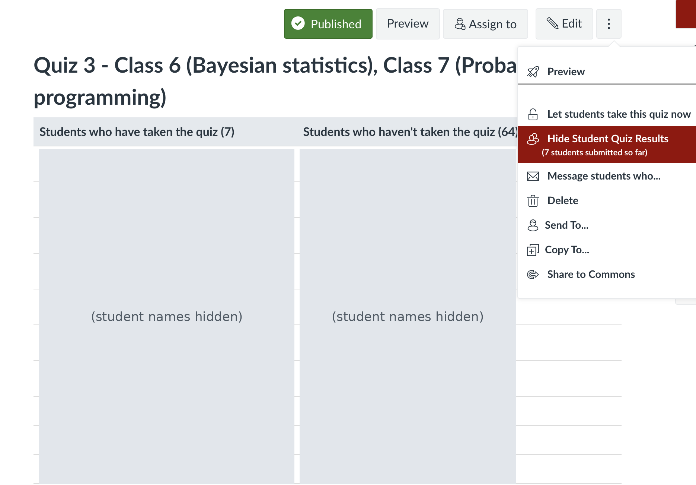
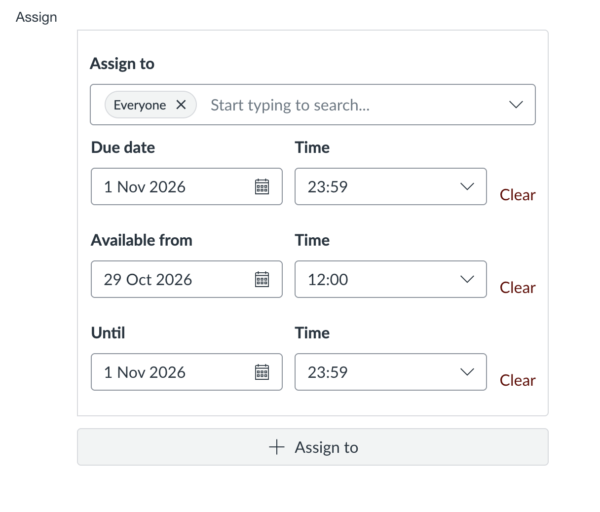

# MSML610: TA User Guide

- This guide collects the process rules for Teaching Assistants (TAs) in MSML610
  (Advanced Machine Learning)
- Contents:
  - Optional assignments
  - Quiz retakes
  - Emailing students
  - ELMS questions
  - GPU access on Zaratan

## 1. Optional Assignments

- Policy decided by Prof. GP:
  - All assignments are optional
  - Each submitted assignment earns 5 out of 5 points

## 2. Quiz Retakes

### Goal

- Give students who missed a quiz another chance
- Do not change the scores of students who already took the quiz

### Key Idea

- Do not create a new quiz
- Use the same quiz and add a new "Assign to" card only for the students who
  missed it
- Students who already took the quiz are not in the new card, so nothing changes
  for them

### Rules

- **Who gets a retake**: any student who missed the quiz
- **Who approves**:
  - The TA talks with Prof. GP about when to assign the retake and when it starts
  - Tell Prof. GP the plan, then assign it
- **When**: only after the original quiz has ended
- **Same quiz**: the retake uses the original quiz
  - Same questions
  - Same points, time limit, and attempts
- **Do not edit any of these**:
  - The quiz title
  - The instructions at the top of the edit page
  - The questions
  - The original "Everyone" card and its dates

### Part A: Find the Students Who Missed the Quiz

1. Open the course in ELMS and click **Quizzes** in the left menu to see all quizzes

   

2. Click the quiz you want a retake for
   - E.g., Quiz 2
3. Click the three dots on the right side of the **Edit** button
   - A menu opens
4. Click **Show student quiz results**
   - The menu line shows how many students submitted
   - After the click, the same line changes to **Hide Student Quiz Results**
5. A results page opens with two columns:
   - **Left column**: "Students who have taken the quiz", with the count in
     brackets
   - **Right column**: "Students who haven't taken the quiz", with the count in
     brackets

   

6. Do this only after the original quiz has ended
   - While the quiz is open, the right column also lists students who can still
     take it
7. The names in the right column are the students who missed the quiz
   - Write down every name and the count
   - You need both in Part B

### Part B: Add a Retake for Only Those Students

1. Go back to the quiz page and click **Edit**
2. Scroll to the bottom of the page
   - The **Assign** section has one card named **Everyone**
   - The card shows the original Due date, Available from, and Until

   

3. Do not change this card
4. Click the **+ Assign to** button just below it
   - A new empty card opens

   

5. In the **Assign to** search box, type each missed student's name or University
   ID (UID) and select them
6. Add every student from your Part A list
   - Do not miss anyone
7. Fill in the dates on the new card:
   - **Available from**: the start of the retake
   - **Due date**: the end of the retake
   - **Until**: the same date and time as the Due date
   - Due date and Until are always the same
8. Click **Save**

### Check After Saving

- The number of students in the new card matches your Part A count
- The original "Everyone" card still has its original dates
- The title, instructions, and questions are unchanged
- For every new retake, use a new "+ Assign to" card: never reuse or edit an old
  card

## 3. Emailing Students

- **Rule**: Prof. GP must be in CC (Carbon Copy) on every email a TA sends to
  students
  - Announcements
  - Course updates
  - Any other email to students
- **Send from**: UMD email only, not a personal email
- **CC**: Prof. GP ([gsaggese@umd.edu](mailto:gsaggese@umd.edu))
- **If you forget**: send a short follow-up email with Prof. GP added

## 4. ELMS Questions

- **Who to ask**: Michele Haver ([mhaver@umd.edu](mailto:mhaver@umd.edu))
- Send her any question about ELMS:
  - Trouble creating or editing quizzes
  - Trouble sending announcements
  - Any other problem with ELMS

## 5. GPU Access on Zaratan

- Source document:
  [Zaratan GPU access (Google Doc)](https://docs.google.com/document/u/0/d/1fRRodP76K-IO5AjV2ASnxavBrJqk6OwFfG7iKiy6yI8/mobilebasic)
- This section explains how TAs grant GPU (Graphics Processing Unit) access to
  course project teams on the University of Maryland (UMD) Zaratan
  High-Performance Computing (HPC) cluster

### 5.1 Class Allocation and Policy

- The course has a dedicated allocation on Zaratan named `msml610-class`
- **Quota**:
  - 50 kSU (thousand Service Units)
  - 0.1 TB scratch storage
  - 1 TB SHELL storage
- **Hardware**:
  - NVIDIA A100 (40 GB)
  - NVIDIA H100
  - A100 MIG (Multi-Instance GPU) slice resources
- **Access policy**:
  - Do not request access for all enrolled students
  - The cluster and the allocation are shared
  - Give access only on request, to project teams that need GPU acceleration
    - E.g., training diffusion models or language models

### 5.2 How TAs Grant Access

- There are two methods
- **Method 1: Ask IT Support directly**
  - Email IT Support ("DIT Support and Requests (SHARED)") at
    [hpcc-help@umd.edu](mailto:hpcc-help@umd.edu)
  - Ask them to add the students to the group
- **Method 2: Student request workflow**
  - Use this when a student or project team asks for Zaratan GPU access by:
    - Email
    - GitHub issue
    - Office hours
  - **Step 1**: Log the request in the internal GPU Access Tracking Sheet (a
    Google Sheet)
    - Capture:
      - Full name
      - UMD Directory ID (username)
      - UMD email address
      - Course project topic or reason for GPU access
  - **Step 2**: Send the request to Zaratan IT Support
    - To add new students to the `msml610-class` allocation:
      1. Send an email to [hpcc-help@umd.edu](mailto:hpcc-help@umd.edu)
      2. Put the list of student names and Directory IDs or emails in the body of
         the email
      3. Ticket rule: do not reply to old or closed tickets
         - Always send a brand-new email to
           [hpcc-help@umd.edu](mailto:hpcc-help@umd.edu) for each new batch of
           students
  - **Step 3**: Confirm and tell the students
    - When IT Support confirms the students are added, account setup takes about
      2 hours
    - Reply to the students with the cluster login details and the links in
      Sec. 5.3
    - Send this email from your UMD email with Prof. GP in CC (see Sec. 3)

### 5.3 Student Onboarding and Login

- Give students these connection details when their access is granted
- **Command line (CLI, Command Line Interface)**:
  - SSH (Secure Shell) host: `login.zaratan.umd.edu`
  - Command to connect:
    ```bash
    > ssh <directory_id>@login.zaratan.umd.edu
    ```
  - Documentation:
    [UMD HPCC CLI Quick Start](https://hpcc.umd.edu/getting-started/quick-start-cli)
- **OpenOnDemand web portal**:
  - Portal: [portal.zaratan.umd.edu](https://portal.zaratan.umd.edu)
  - Documentation: [UMD HPCC OpenOnDemand Guide](https://hpcc.umd.edu/kb/ood)

### 5.4 Common Problems and Fixes

- **ColdFront and VPN 403 error on macOS**:
  - Problem: a Mac user gets a "403 Forbidden" error when opening
    `coldfront.zaratan.umd.edu` on the UMD VPN (Virtual Private Network)
  - Fix: apply the extra GlobalProtect VPN configuration described in UMD
    Knowledge Base article
    [KB0020829](https://itsupport.umd.edu/itsupport?id=kb_article_view&sysparm_article=KB0020829)
- **Data rules**:
  - Everything processed or stored on Zaratan must stay within Moderate (Level 2)
    data classification
  - Do not use data above that level
