// type=ADIA_slides
// course_title=Abu Dhabi Investment Authority
// lesson_title=Building on The Theory Store: From Finance Papers to Testable Hypotheses
// Authors=GP, Rui, Emanuele (FA), ...
// slides_engine=typst

* Roadmap

- @Why the Theory Store@
  - Most finance papers make only associational claims, and don't build causal and
    falsifiable theories

- @What the Theory Store is@
  - Goals, constraints, non-goals, applications, and limitations

- @How to build the Theory Store@:
  - From papers to claims
  - Building and validating the causal graph
  - From graph to verified code
  - Model evaluation

- @When it can be available@:
  - A pilot, its metrics
  - Milestones to deliver value incrementally
  - The open research questions

- @Related work@
  - What causal inference, finance, and LLM research already give

# Why the Theory Store

* The Theory Store: Motivation
// From: papers/Causal_Analysis_for_Finance/notes.md:1 '# Goal'
// From: papers/Causal_Analysis_for_Finance/notes.md:335 '## Causality in Finance'

- @Problem@: most papers make **associational** claims
  - They state _no causal graph_ and run _no falsification test_ (Lopez de Prado,
    2023)
  - Replication studies check the numbers, but none tests the causal specification
    (Hou et al., 2020; Jensen et al., 2023)

- @Problem@: **1000s of alpha / factors** were tested (Lopez de Prado, 2024)
  - _Multiple testing_ leads to a high rate of false discovery (Harvey et al., 2016)
  - The _replication record_ is contested: some anomalies fail (Hou et al., 2020),
    some factors replicate (Jensen et al., 2023)

- @Remark@:
  - A paper should be a _causal theory_ + _one empirical test_ of the theory
  - Formalize the theory $\implies$ theory can be reproduced, challenged, falsified

- @Question@
  - Can a machine read the literature and return theories that humans can test,
    understand, and falsify?

# What the Theory Store?

* The Theory Store: Goals
// From: papers/Causal_Analysis_for_Finance/notes.md:1 '# Goal'
// From: papers/Causal_Analysis_for_Finance/notes.md:10 '- Target: automate 80-90% of the effort'

- Turn a corpus of finance and economics papers into @testable and auditable@
  hypotheses
- @Count the hypotheses@ tested to account for data mining and overfitting

::: columns
:::: {.column width=60%}
- @Automate@ the repetitive stages, but keep humans in control
  - _Humans_: choose papers, approve DAGs, pass the final gate
  - _AI / Tools_: parse, extract, normalize, map to data, bookkeeping
  - The target is to automate 80-90% of the total effort
  - Human gates bound the speed up $S$, as in Amdahl's law

::::
:::: {.column width=40%}

$$
S \triangleq \frac{T_{manual}}{T_{tool}} \le \frac{1}{1 - p}
$$

```{=typst}
#styled-table(
  headers: ("Automated fraction p", "Max speed up S"),
  rows: (
    ("50%", "2x"),
    ("80%", "5x"),
    ("90%", "10x"),
    ("95%", "20x"),
  ),
  bold-first-col: false,
  width: 100%,
)
```

::::
:::

- Build a @comprehensive understanding@ of economic / financial systems that can
  be queried, reasoned about (by humans and machines), actioned, ...

* Constraints
// From: papers/Causal_Analysis_for_Finance/notes.md:26 '- Constraints'

- The @Theory Store@ must:
  - Follow and enforce all the @rules of our research process@
    - Split the data before any test
    - Generate hypotheses, then try to falsify them
    - Rest hypotheses and models on economic reasoning, not on black-box or
      gray-box machine learning
    - Deflate the Sharpe ratio
    - Use an embargo between data splits
    - ...
  - @Be modular@
    - Generate and validate causal hypotheses
    - Let users falsify / evaluate performance of a theory with their own flow
  - @Integrate@ with other ADIA systems
    - Atlas
    - Signal store
    - ...

* Non-Goals
// From: papers/Causal_Analysis_for_Finance/notes.md:31 '- Non-goals'

- @Key idea@: the Theory Store **tests theories**, it **does not mine** for them

```{=typst}
#styled-table(
  headers: ("The Theory Store does", "The Theory Store does not"),
  rows: (
    ("Use backtests to falsify theories", "Use backtests to find trading strategies"),
    ("Test the causal structure stated in papers", "Discover causality from data alone"),
    ("Weigh the evidence across papers", "Treat agreement between papers as causal truth"),
    ("Check that the estimand is identifiable", "Read an identified DAG as proof of causality"),
    ("Augment the intuition of the researcher", "Replace the intuition of the researcher"),
  ),
  bold-first-col: false,
  width: 95%,
)
```

* Non-Obvious Applications
// From: papers/Causal_Analysis_for_Finance/notes.md:42 '## Applications'

::: columns
:::: {.column width=60%}
1. @Literature meta-analysis@: compare the causal structures of papers to find which
   papers agree or disagree
2. @Questions over a corpus@: e.g., _"What drives inflation expectations?"_
3. @Gap finding@: list the variable pairs that no paper tests, a map of open
   questions
4. @Replication@: build the financial models that papers and books describe
5. @Economic prior for ML@: use the reduced DAG to pick features, set lags, and
   regularize
   - A model that follows a causal story can overfit less, if the DAG is right
   - It searches a smaller space of models, fixed before it sees the data
::::
:::: {.column width=40%}

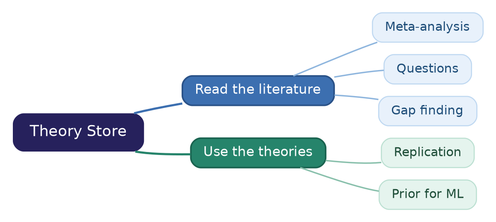
label=fig:applications
caption=The applications split into `#text(fill: rgb("#3C6FB0"), weight: "bold")[reading the literature]`{=typst} and `#text(fill: rgb("#26846B"), weight: "bold")[using the extracted theories]`{=typst}.

::::
:::

* Limitations and Risks
// From: papers/Causal_Analysis_for_Finance/notes.md:90 '## Extract Causal Claims'
// From: papers/Causal_Analysis_for_Finance/notes.md:289 '## Pilot and Evaluation'

// TODO(gp): Check the risks and mitigations: derived from the notes, not stated there as a list
```{=typst}
#styled-table(
  headers: ("Risk", "Effect", "Mitigation"),
  rows: (
    ("LLM extraction errors", "Hallucinated or inferred edges", "Provenance pointer, stated vs inferred status, human gates"),
    ("Publication bias", "Agreement between papers is weak evidence", "Regime edges, evidence labels, no vote as causal truth"),
    ("Untested DAG assumptions", "Identification is not proof of causality", "Implied independence tests, factor mirage diagnostic"),
    ("PDF parsing errors", "Wrong equations and tables in the generated code", "Prefer LaTeX format"),
    ("No gold graph", "Extraction quality cannot be measured", "Build one for the pilot (open)"),
    ("Human gates", "Speed up bounded, as in Amdahl's law", "Compact artifacts with provenance"),
  ),
  col-widths: (1fr, 1.3fr, 1.6fr),
  width: 95%,
)
```

- @Key idea@: every risk has a mitigation in the pipeline, except the gold graph,
  which is still open

# How to build the Theory Store?

* Pipeline Overview
// From: papers/Causal_Analysis_for_Finance/notes.md:57 '# Workflow'
// From: papers/Causal_Analysis_for_Finance/notes.md:277 '## Human Review Gates and Metrics'

```graphviz[width=80%]
digraph TheoryStorePipeline {
  // automated stage : blue | stage ending in a human gate : rose
  bgcolor="transparent";
  pad="0.15";
  splines=spline;
  nodesep=0.30;
  ranksep=0.30;
  rankdir=TB;
  newrank=true;
  compound=true;

  node [shape=box,
        style="rounded,filled",
        fillcolor="#FFFFFF",
        color="#9AA9B8",
        penwidth=1.8,
        fontname="Helvetica",
        fontcolor="#243B53",
        fontsize=14,
        margin="0.18,0.10",
        height=0.48,
        width=2.0];

  edge [color="#A3B1C0",
        penwidth=1.3,
        arrowhead=vee,
        arrowsize=0.75,
        fontname="Helvetica",
        fontsize=10,
        fontcolor="#7B8794"];

  subgraph cluster_claims {
    label     = "Papers to claims";
    labelloc  = "t";
    fontname  = "Helvetica-Bold";
    fontsize  = 12.5;
    fontcolor = "#3A4A5C";
    style     = "rounded,filled";
    fillcolor = "#F7F9FB";
    color     = "#C7D0DA";
    penwidth  = 1.0;
    margin    = 16;

    Bank    [label=<<b>Build paper bank</b><br/><font point-size="10">Parse, filter</font>>,
             fillcolor="#B8467A", color="#8C3159", fontcolor="#FFFFFF"];
    Extract [label=<<b>Extract claims</b><br/><font point-size="10">Stated or inferred</font>>,
             fillcolor="#3C6FB0", color="#2A5288", fontcolor="#FFFFFF"];
    Bank -> Extract;
  }

  subgraph cluster_graph {
    label     = "Causal graph";
    labelloc  = "t";
    fontname  = "Helvetica-Bold";
    fontsize  = 12.5;
    fontcolor = "#3A4A5C";
    style     = "rounded,filled";
    fillcolor = "#F7F9FB";
    color     = "#C7D0DA";
    penwidth  = 1.0;
    margin    = 16;

    Normalize [label=<<b>Normalize variables</b><br/><font point-size="10">Canonical ids</font>>,
               fillcolor="#B8467A", color="#8C3159", fontcolor="#FFFFFF"];
    MakeDag   [label=<<b>Create DAG</b><br/><font point-size="10">Lags, regime edges</font>>,
               fillcolor="#B8467A", color="#8C3159", fontcolor="#FFFFFF"];
    MapData   [label=<<b>Map nodes to data</b><br/><font point-size="10">Point-in-time series</font>>,
               fillcolor="#3C6FB0", color="#2A5288", fontcolor="#FFFFFF"];
    Merge     [label=<<b>Merge DAGs</b><br/><font point-size="10">Literature graph</font>>,
               fillcolor="#3C6FB0", color="#2A5288", fontcolor="#FFFFFF"];
    Normalize -> MakeDag -> MapData -> Merge;
  }

  subgraph cluster_valid {
    label     = "Graph validation";
    labelloc  = "t";
    fontname  = "Helvetica-Bold";
    fontsize  = 12.5;
    fontcolor = "#3A4A5C";
    style     = "rounded,filled";
    fillcolor = "#F7F9FB";
    color     = "#C7D0DA";
    penwidth  = 1.0;
    margin    = 16;

    Reduce [label=<<b>Reduce DAG</b><br/><font point-size="10">Identification, CI tests</font>>,
            fillcolor="#B8467A", color="#8C3159", fontcolor="#FFFFFF"];
    Proxy  [label=<<b>Optimize vs proxy</b><br/><font point-size="10">E.g., order flow</font>>,
            fillcolor="#3C6FB0", color="#2A5288", fontcolor="#FFFFFF"];
    Prior  [label=<<b>Formalize hypotheses</b><br/><font point-size="10">Bayesian prior</font>>,
            fillcolor="#3C6FB0", color="#2A5288", fontcolor="#FFFFFF"];
    Reduce -> Proxy -> Prior;
  }

  subgraph cluster_code {
    label     = "Verified code";
    labelloc  = "t";
    fontname  = "Helvetica-Bold";
    fontsize  = 12.5;
    fontcolor = "#3A4A5C";
    style     = "rounded,filled";
    fillcolor = "#F7F9FB";
    color     = "#C7D0DA";
    penwidth  = 1.0;
    margin    = 16;

    Code     [label=<<b>Generate code</b><br/><font point-size="10">Simulator, replication</font>>,
              fillcolor="#3C6FB0", color="#2A5288", fontcolor="#FFFFFF"];
    Verify   [label=<<b>Verify vs paper</b><br/><font point-size="10">Match its tables</font>>,
              fillcolor="#3C6FB0", color="#2A5288", fontcolor="#FFFFFF"];
    Validate [label=<<b>Backtest + final OOS</b><br/><font point-size="10">Deflated by the ledger</font>>,
              fillcolor="#B8467A", color="#8C3159", fontcolor="#FFFFFF"];
    Code -> Verify -> Validate;
  }

  // Columns flow left to right, stages flow top to bottom inside a column
  { rank=same; Bank; Normalize; Reduce; Code; }
  { rank=same; Extract; MakeDag; Proxy; Verify; }
  { rank=same; MapData; Prior; Validate; }

  // Arrows between columns go cluster to cluster along the top row
  Bank -> Normalize [ltail=cluster_claims, lhead=cluster_graph, penwidth=1.8];
  Normalize -> Reduce [ltail=cluster_graph, lhead=cluster_valid, penwidth=1.8];
  Reduce -> Code [ltail=cluster_valid, lhead=cluster_code, penwidth=1.8];
}
```
label=fig:theory-store-pipeline
caption=The Theory Store pipeline: `#text(fill: rgb("#B8467A"), weight: "bold")[rose stages]`{=typst} end in a human gate, `#text(fill: rgb("#3C6FB0"), weight: "bold")[blue stages]`{=typst} are automated.

- @Key idea@: every stage reads and writes a typed **Theory Spec**: one per
  paper until the merge, then one literature graph

// TODO(gp): Check the gate list against notes.md:279, which lists a gate before the proposal
- @Definition@: a **human gate** is a point where a human sees a compact
  artifact with provenance and accepts, edits, or rejects it
  - Gates follow the paper list, normalization, DAG, and reduction, and
    validation includes a vote and the final gate

## From papers to claims

* The Theory Spec
// From: papers/Causal_Analysis_for_Finance/notes.md:231 '## Theory Spec'

::: columns
:::: {.column width=62%}
- @Definition@: a **Theory Spec**
  - Represents a causal theory
  - Is one typed object that every pipeline stage reads and writes
  - A bare DAG lacks "data recipes", estimators, and timing, so it is not enough to
    generate code

- @Components@:
  - `nodes`: name, observed or latent, data recipe, unit, time index, level
  - `edges`: sign, lag, functional form, confidence, provenance, status
  - `assumptions`: e.g., no unobserved confounding
  - `estimand`: e.g., ATE of a characteristic on next-month return
  - `empirical_spec`: regressions, sorts, controls, fixed effects, sample
::::
:::: {.column width=38%}

// TODO(gp): Check the example Theory Spec: self-made illustration, the data recipe is simplified
```{=typst}
#set text(size: 0.75em)
```

```yaml
nodes:
  - id: book_to_market
    recipe: ceq / me
    level: firm
  - id: ret_next_month
edges:
  - source: book_to_market
    target: ret_next_month
    sign: "+"
    lag: 1 month
    provenance: p. 12
    status: stated
assumptions:
  - no_unobserved_confounding
estimand: ATE
empirical_spec: decile_sort
```

_For illustration purposes only_

::::
:::

* Build the Paper Bank
// From: papers/Causal_Analysis_for_Finance/notes.md:59 '## Build Paper Bank'

::: columns
:::: {.column width=65%}

- @Goal@: collect the papers, books, and reports that the pipeline reads
  - A human guides the search and approves the final list

- @Algorithm@: filter the candidates, label each paper by its evidence, then a
  human approves the list

::::
:::: {.column width=35%}

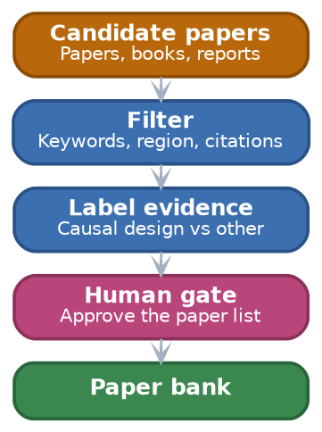
label=fig:paper-bank
caption=`#text(fill: rgb("#B8680A"), weight: "bold")[Candidate papers]`{=typst} pass `#text(fill: rgb("#3C6FB0"), weight: "bold")[automated filters]`{=typst} and a `#text(fill: rgb("#B8467A"), weight: "bold")[human gate]`{=typst} before they enter the `#text(fill: rgb("#3A874F"), weight: "bold")[paper bank]`{=typst}.

::::
:::

- @Techniques@: filter the candidates by:
  - Evidence label (main filter): causal design, association, ...
  - Keywords (e.g., microeconomic, macroeconomic)
  - Region (e.g., APAC, EMEA, US)
  - Citations and the quality of the researchers and institution, only as tie
    breakers
    - Citations lag and favor known authors

* Parse Into One Representation
// From: papers/Causal_Analysis_for_Finance/notes.md:59 '## Build Paper Bank'
// From: papers/Causal_Analysis_for_Finance/notes.md:308 '- Input format ablation'

- @Problem@: papers come as LaTeX, Markdown, or PDF

- @Solution@: one front end per format, all writing one **normalized document**
  - Sections, equations, tables, bibliography, and source anchors
  - Later stages read only this representation, so they are format agnostic

```{=typst}
#styled-table(
  headers: ("Format", "Front end", "Tool", "Fidelity"),
  rows: (
    ("LaTeX", "Parse the source", "None", "Exact equations and tables"),
    ("Markdown", "Parse the AST", "pandoc", "Depends on the converter that made the Markdown"),
    ("PDF", "Layout and OCR extraction", "Nougat, Marker, GROBID", "Equation and table errors possible"),
  ),
  col-widths: (0.7fr, 1.6fr, 1.3fr, 1.8fr),
  width: 95%,
)
```

// TODO(gp): Check that most finance and economics papers are only available as PDF
- @Remark@: LaTeX > Markdown > PDF in fidelity
  - Tables become verification targets for the generated code
  - Most finance and economics papers are only available as PDF (e.g., SSRN,
    NBER, journals), so PDF is the main path in practice
  - The pilot measures how parsing errors propagate (format ablation)

* Extract Causal Claims
// From: papers/Causal_Analysis_for_Finance/notes.md:90 '## Extract Causal Claims'

::: columns
:::: {.column width=58%}
- @Definition@: a **causal claim** is one record per relationship in a paper
  - `(cause, effect, sign, lag, region, period, design)`
  - Status:
    - `stated` (the paper says it)
    - `inferred` (the LLM deduced it)
  - Context and a reference, for human analysis

- @Definition@: a **provenance pointer** locates the claim in its source
  - A provenance pointer on every item is the main defense against hallucinated edges
  - A human checks a claim in seconds by opening the pointer
::::
:::: {.column width=42%}

// TODO(gp): Check the example claim: self-made illustration of a value-premium claim
```{=typst}
#set text(size: 0.85em)
```

```yaml
cause: book_to_market
effect: ret_next_month
sign: "+"
lag: 1 month
region: US
period: 1963-1990
design: portfolio_sort
status: stated
context: "high book-to-market
  firms earn higher returns"
provenance:
  format: pdf
  page: 12
  span: [431, 618]
```

_For illustration purposes only_

::::
:::

* Stated vs Inferred Claims
// From: papers/Causal_Analysis_for_Finance/notes.md:90 '## Extract Causal Claims'
// From: papers/Causal_Analysis_for_Finance/notes.md:355 '## Causal Structure From Text'

::: columns
:::: {.column width=60%}
- @Problem@: LLMs are unreliable when they _infer_ causal relations
  - Near random when they infer causation from correlation
    (Jin et al., 2023)
  - They may recite causal knowledge instead of reasoning
    (Zecevic et al., 2023)

// TODO(gp): Check the accruals example: self-made illustration
- @Example@: _"high-accrual firms earn low returns"_ is `stated`, but
  _"accruals cause low returns"_ is `inferred`

- @Solution@:
  - No stage depends _silently_ on an `inferred` claim
  - A human sees every use of one at the next gate
::::
:::: {.column width=40%}

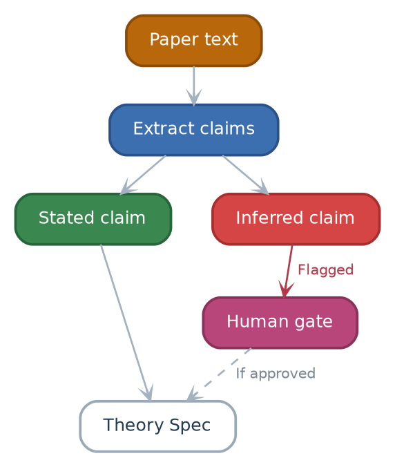
label=fig:stated-inferred
caption=`#text(fill: rgb("#3A874F"), weight: "bold")[Stated claims]`{=typst} enter the Theory Spec directly, while `#text(fill: rgb("#D64545"), weight: "bold")[inferred claims]`{=typst} pass a `#text(fill: rgb("#B8467A"), weight: "bold")[human gate]`{=typst} first.

::::
:::

## Building the causal graph

* Normalize Variables
// From: papers/Causal_Analysis_for_Finance/notes.md:108 '## Normalize Variables'

::: columns
:::: {.column width=58%}
- @Problem@: papers name the same variable in different ways
  - E.g., _"monetary tightening"_, _"policy rate hike"_, _"increase in the
    federal funds rate"_

- @Solution@: map each variable to a **canonical id** in a small finance
  ontology
  - E.g., `value`, `size`, `momentum`, `accruals`, `leverage`
  - Express changes with **operators** (e.g., `increase`, `delay`)
  - Canonical ids let graphs from different papers merge

- @Techniques@: a specialized LLM, trained on finance literature, proposes the
  mapping, and a human reviews it
  - Human gate: approve the canonical names and operators
::::
:::: {.column width=42%}

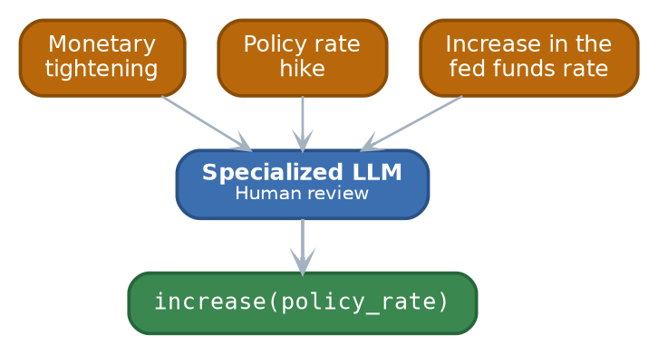
label=fig:normalize
caption=`#text(fill: rgb("#B8680A"), weight: "bold")[Three phrases from different papers]`{=typst} map to `#text(fill: rgb("#3A874F"), weight: "bold")[one canonical id with an operator]`{=typst}.

- @Remark@: normalization can over-merge: _"monetary tightening"_ also covers
  balance-sheet reduction and forward guidance, so the human gate checks each
  mapping

::::
:::

* Create the DAG
// From: papers/Causal_Analysis_for_Finance/notes.md:119 '## Create DAG'

::: columns
:::: {.column width=58%}
- @Definition@: the **DAG** of a paper has
  - Economic / financial variables as nodes
  - Claimed causal relationships as edges (with operators such as delays, ...)

- @Problem@: theories can contain feedback loops, but a DAG has no cycle

- @Solution@:
  - Lagged feedback: unroll in time ($X_t \to Y_{t+1}$, $Y_t \to X_{t+1}$)
  - Contemporaneous feedback (equilibrium): open research problem, route these
    papers to a structural-equations and solver path, not to a DAG
::::
:::: {.column width=42%}

// TODO(gp): Check the fund flows and returns example: self-made illustration of a feedback loop
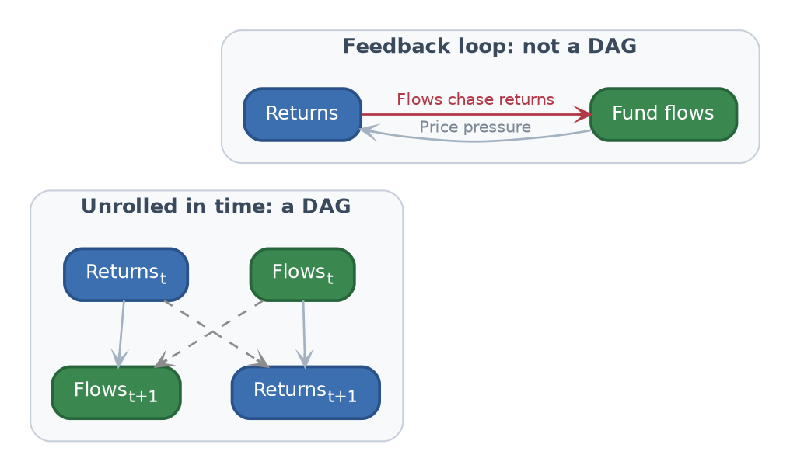
label=fig:unroll
caption=A feedback loop between `#text(fill: rgb("#3A874F"), weight: "bold")[fund flows]`{=typst} and `#text(fill: rgb("#3C6FB0"), weight: "bold")[returns]`{=typst} becomes a DAG once each variable is indexed by time.

::::
:::

* Map Nodes to Data
// From: papers/Causal_Analysis_for_Finance/notes.md:138 '## Map Nodes to Data'

- @Goal@: map each node to a time series in a data store (e.g., ADIA Atlas, ...)
  - Assess the quality of each series: coverage, time span, gaps

- @Problem@: the data source must handle look-ahead and survivorship bias

  ```{=typst}
  #styled-table(
    headers: ("Source of bias", "Example", "Fix"),
    rows: (
      ("Revisions", "Macro series (e.g., GDP) change after the first release", "Use point-in-time vintages"),
      ("Release timing", "A series comes out weeks after its period ends", "Encode the availability timing of each series"),
      ("Reporting lag", "Annual reports come out months after the fiscal year ends", "Use firm data only after its filing date"),
      ("Fiscal-year alignment", "Firms end their fiscal year in different months", "Align firms on availability, not on period end"),
      ("Survivorship", "Firms that delist drop out of the sample", "Use a point-in-time universe with delisting returns"),
    ),
    col-widths: (1fr, 2fr, 1.8fr),
    width: 95%,
  )
  ```

* Merge DAGs Across Papers
// From: papers/Causal_Analysis_for_Finance/notes.md:150 '## Merge DAGs'
// From: papers/Causal_Analysis_for_Finance/notes.md:369 '- **Zhang et al. (2024)**: LACR, RAG over papers, the LLM extracts associations'

::: columns
:::: {.column width=64%}
- @Goal@: combine the per-paper DAGs into one **literature-level graph**

- @Techniques@: vote, union, weighted average, condition over the edges, as in
  ensemble learning where the "models" are papers

- @Example@: **LACR** takes a majority vote across documents, and builds the
  skeleton before it orients the edges (Zhang et al., 2024)

- @Limitations@:
  - A union can create cycles and paths no paper claims (e.g.,
    $X \to Z \to Y$): check for cycles, flag new paths as `inferred`
  - A strong vote is not causal truth: publication bias can make many papers
    repeat one error
::::
:::: {.column width=36%}

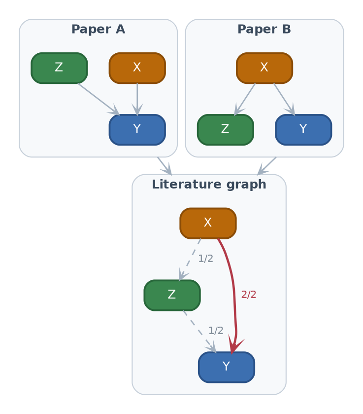
label=fig:merge-dags
caption=Two paper DAGs merge into a literature graph whose edge labels count the votes: the `#text(fill: rgb("#B23A48"), weight: "bold")[bold red edge]`{=typst} has the support of both papers, and the two dashed edges create a path from X to Z to Y that no paper claims.

::::
:::

* Conflicts Between Papers
// From: papers/Causal_Analysis_for_Finance/notes.md:119 '## Create DAG'

::: columns
:::: {.column width=62%}
- @Problem@: papers disagree on the sign, region, and period of an edge
  - How to merge DAGs?

- @Naive Solution@: keep the majority sign, drop the other claims
  - Cons: loses the conditions under which each effect holds

- @Solution@: turn a sign conflict into a **conditional** or **regime** edge
  - The sign of $X \to Y$ depends on a regime variable (e.g., region,
    period)
  - Keep every claim with its provenance

- @Example@: $X \to Y$ is positive in the US (paper A) and negative in Japan
  (paper B)
  - One edge whose sign is conditional on $Region$
::::
:::: {.column width=38%}

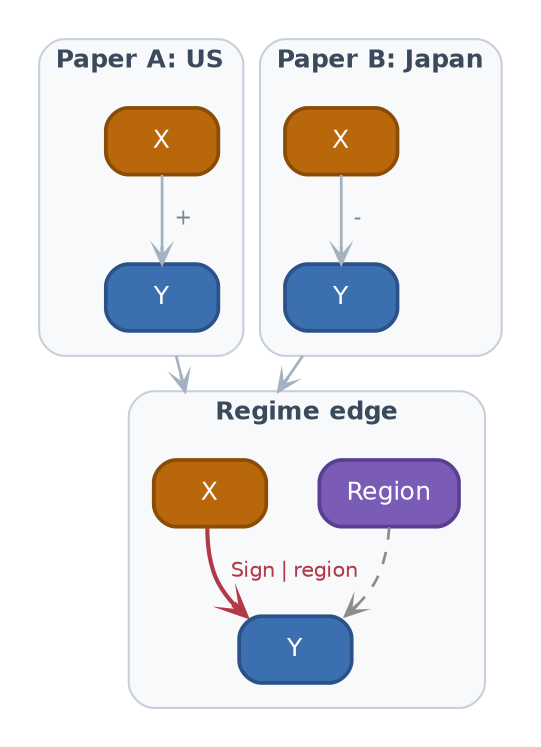
label=fig:conflict
caption=Two papers with opposite signs on X to Y merge into one regime edge whose sign depends on the region

::::
:::

## Validating the graph

* Reduce the DAG
// From: papers/Causal_Analysis_for_Finance/notes.md:154 '## Reduce DAG'

::: columns
:::: {.column width=58%}
- @Problem@: the merged DAG is large and potentially (partly) wrong
  - Not every edge is meaningful
  - Not every node is predictive or has high-quality data

- @Solution@: **DAG reduction**
  - Test if the data is consistent with each edge (e.g., conditional
    independence, usual causal battery of tests)
  - Drop the nodes with poor data or no predictive power
  - Propose missing nodes and edges from an LLM or a human

::::
:::: {.column width=42%}

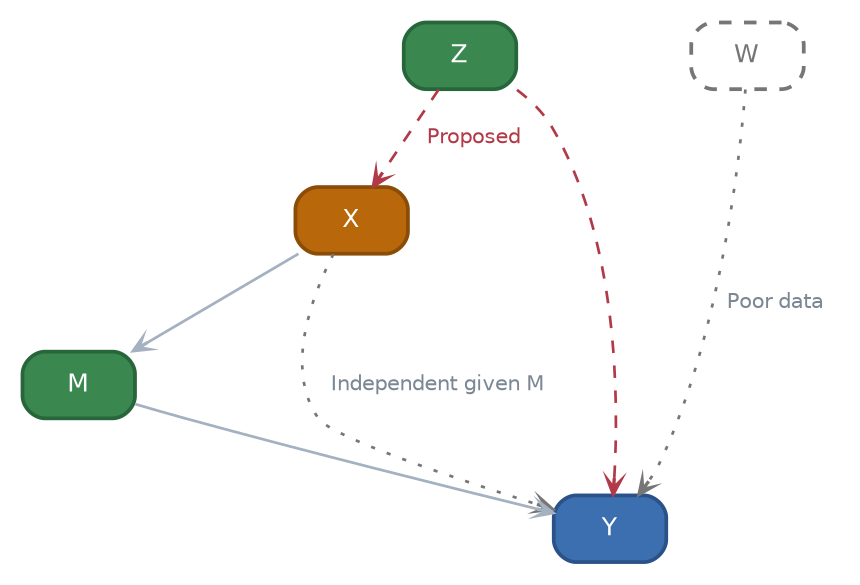
label=fig:reduce
caption=Reduction keeps the solid edges, drops the `#text(fill: rgb("#767676"), weight: "bold")[dotted gray node W and edges]`{=typst} (X to Y is independent given M, W has poor data), and adds the `#text(fill: rgb("#B23A48"), weight: "bold")[dashed red edges]`{=typst} proposed by an LLM or a human.

::::
:::

* Identification of the Estimand
// From: papers/Causal_Analysis_for_Finance/notes.md:162 '- Causal validation'
// From: papers/Causal_Analysis_for_Finance/notes.md:321 '## Causal Inference Foundations'

::: columns
:::: {.column width=62%}
- @Definition@: an estimand is **identifiable** from a DAG if it is a
  function of the distribution of the observed variables
  - E.g., if $Z$ satisfies the backdoor criterion for $X \to Y$:
    $$
    \Pr(y | do(x)) = \sum_z \Pr(y | x, z) \Pr(z)
    $$

- @Key idea@: identification criteria are algorithmic, so the check can be
  automated (Huenermund and Bareinboim, 2025)
  - Tools: DoWhy (Sharma and Kiciman, 2020), pgmpy, y0

- @Remark@: identification is not proof of causality, since the assumptions
  of the DAG stay untested
::::
:::: {.column width=38%}

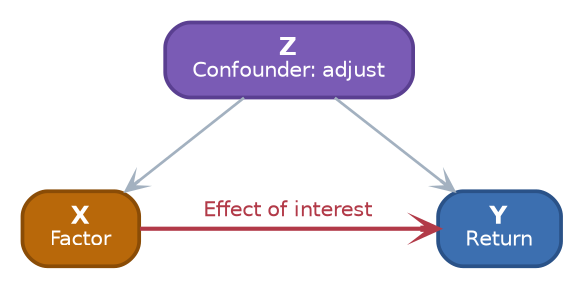
label=fig:backdoor
caption=Adjusting for the confounder `#text(fill: rgb("#7A5BB5"), weight: "bold")[Z]`{=typst} blocks the backdoor path and identifies the effect of the factor X on the return Y.

::::
:::

* Testable Implications
// From: papers/Causal_Analysis_for_Finance/notes.md:168 '  - List the conditional independencies implied by the DAG, then test them'

- @Problem@: identification takes the DAG as given, but part of the DAG can
  still be checked against data

- @Key idea@: every missing edge is a claim that the data must satisfy
  - d-separation lists the conditional independencies that the DAG implies

```{=typst}
#styled-table(
  headers: ("Structure", "Graph", "Implied by the DAG", "Example"),
  rows: (
    ([Chain], [$X -> M -> Y$], [$X perp Y | M$], [A mediator carries the whole effect]),
    ([Fork], [$X <- Z -> Y$], [$X perp Y | Z$], [A confounder explains the whole association]),
    ([Collider], [$X -> C <- Y$], [$X perp Y$, dependent given $C$], [Do not control for $C$]),
  ),
  col-widths: (0.8fr, 1fr, 1.4fr, 2fr),
  width: 95%,
)
```

- @Techniques@: test each implied independence on the discovery split (e.g.,
  partial correlation)
  - Log each test in the ledger

- @Remark@: a failed test falsifies part of the theory, but a passed test does
  not prove it

* The Factor Mirage Diagnostic
// From: papers/Causal_Analysis_for_Finance/notes.md:164 '  - Compare the theory DAG with the empirical specification of the paper'
// From: papers/Causal_Analysis_for_Finance/notes.md:339 '- **Lopez de Prado and Zoonekynd (2026)**: "Correcting the Factor Mirage", a'

::: columns
:::: {.column width=60%}
// TODO(gp): Check the definition of "factor mirage" against the abstract of Lopez de Prado and Zoonekynd
- @Definition@: a **factor mirage** is a factor whose estimated effect comes
  from a misspecified regression, not from a causal effect (Lopez de Prado and
  Zoonekynd, 2026)
  - Confounder and collider bias are the usual causes (Lopez de Prado and
    Zoonekynd, 2025)

- @Solution@: compare the theory DAG with the regression of the paper
  - Flag **collider** or **mediator** controls
  - Flag **omitted confounders**

- @Example@: regress the return $Y$ on the factor $X$, controlling for $C$,
  where $X \to C \leftarrow Y$
  - Conditioning on $C$ opens the path $X \to C \leftarrow Y$
  - $X$ looks predictive even if it has no effect on $Y$
::::
:::: {.column width=40%}

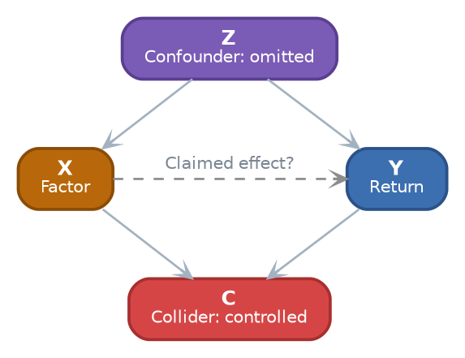
label=fig:mirage
caption=Two sources of a factor mirage: an omitted confounder `#text(fill: rgb("#7A5BB5"), weight: "bold")[Z]`{=typst} and a controlled collider `#text(fill: rgb("#D64545"), weight: "bold")[C]`{=typst} both create an association between X and Y.

::::
:::

* Proxy Targets and Bayesian Priors (Research idea)
// From: papers/Causal_Analysis_for_Finance/notes.md:177 '## Optimize Against Proxy'
// From: papers/Causal_Analysis_for_Finance/notes.md:183 '## Formalize Hypotheses'

- @Problem@: some targets are hard to model directly (e.g., prices)

// TODO(gp): Check the proxy examples: self-made, notes.md:179 suggests supply and demand
- @Solution@: optimize against an observable **proxy**
  - E.g., predict order flow imbalance or fund flows, instead of prices
  - Regularize to trade complexity against predictive power

- @Definition@: **formalize** the reduced DAG as a set of hypotheses with a
  **Bayesian prior** on each edge
  - Build the prior of each edge from its evidence: number of supporting
    papers, quality of the identification design, agreement on the sign
  - Fit the model, then estimate the uncertainty of each effect

// TODO(gp): Check the prior formula: self-made illustration, not in the notes
- @Example@: a prior on the coefficient $\beta_e$ of edge $e$
  $$
  \beta_e \sim \mathcal{N}(s_e \mu_e, \sigma_e^2)
  $$
  - $s_e \in \{-1, +1\}$ = sign on which the papers agree
  - $\sigma_e$ shrinks as the number of papers and the design quality grow

## From graph to verified code

* Generate Code: Three Artifacts
// From: papers/Causal_Analysis_for_Finance/notes.md:194 '## Generate Code'

::: columns
:::: {.column width=58%}
- @Goal@: generate three artifacts from each Theory Spec
  1. **Simulator**: an SCM with known effects
  2. **Replication module**: the data construction plus the estimator of the
     paper
  3. **Causal estimator**: the identified estimate of the estimand

- @Intuition@: the simulator gives a ground truth
  - If an estimator cannot recover a known effect on simulated data, do not
    trust it on real data

- @Key idea@: boilerplate is a tested library that the LLM composes but does
  not rewrite
  - E.g., CRSP and Compustat merges, portfolio sorts, Newey-West
::::
:::: {.column width=42%}

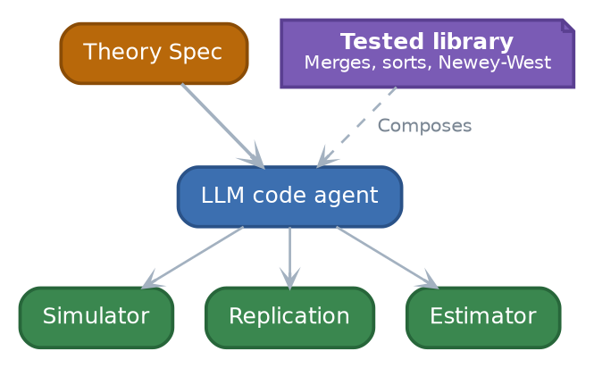
label=fig:codegen
caption=`#text(fill: rgb("#3C6FB0"), weight: "bold")[An LLM code agent]`{=typst} composes `#text(fill: rgb("#7A5BB5"), weight: "bold")[a tested library]`{=typst} to turn `#text(fill: rgb("#B8680A"), weight: "bold")[a Theory Spec]`{=typst} into `#text(fill: rgb("#3A874F"), weight: "bold")[three artifacts]`{=typst}.

::::
:::

* Verify Against the Source Paper
// From: papers/Causal_Analysis_for_Finance/notes.md:203 '## Verify Against Source Paper'

::: columns
:::: {.column width=55%}
- @Goal@: check that the generated code reproduces the paper
  - Run the code in a sandbox
  - Compare its output $\hat{\theta}$ with the tables of the paper

- @Solution@: route each mismatch back to the stage that caused it
  - Wrong data recipe
  - Missing confounder
  - Bug
  - ...

- @Applications@: this stage delivers reproducible code for each paper
  - The base for replication on new samples and specifications

::::
:::: {.column width=45%}

// TODO(gp): Check the routing of "Wrong data recipe": notes.md:208 sends it to Extract Causal Claims
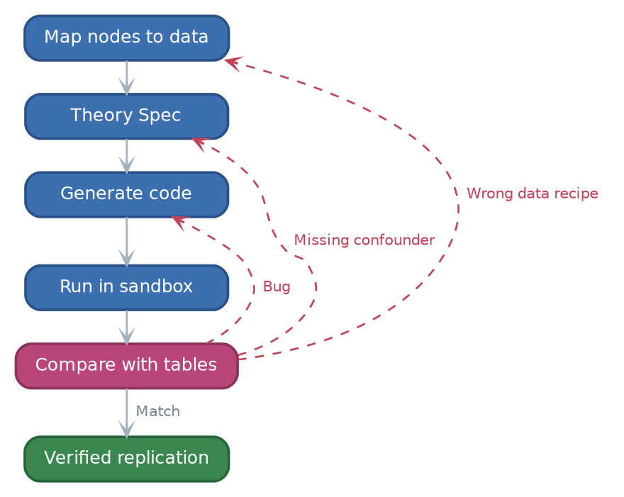
label=fig:verify
caption=`#text(fill: rgb("#B8467A"), weight: "bold")[Each mismatch with the tables of the paper]`{=typst} is routed back, along `#text(fill: rgb("#C0455B"), weight: "bold")[a dashed red edge]`{=typst}, to the stage that caused it.

::::
:::

## Model evaluation

* Data Splits and Deflation
// From: papers/Causal_Analysis_for_Finance/notes.md:258 '## Hypothesis Ledger and Data Splits'

- @Problem@: a backtest that ignores the earlier tests overstates its
  significance
  - DAG reduction tests edges, then the backtest reuses the same data
  - A new factor needs $t \ge 3.0$ because of multiple testing
    (Harvey et al., 2016)
  - The seven-step protocol of Lopez de Prado and Zoonekynd (2026) ends with a
    multiple testing adjustment

- @Solution@: three data splits, each with one use, with an embargo between them
  - _Discovery_: DAG reduction and proxy choice
  - _Validation_: deflated backtest
  - _Final OOS_: touched once, at the final gate

// TODO(gp): Check the split design against the sample periods of the source papers: proposed here, not in the notes
- @Remark@: the validation and final OOS splits should start after the sample
  end of the source papers
  - Published predictors earn lower returns out-of-sample and after publication
    (McLean and Pontiff, 2016)

* The Hypothesis Ledger
// From: papers/Causal_Analysis_for_Finance/notes.md:258 '## Hypothesis Ledger and Data Splits'

::: columns
:::: {.column width=60%}

- @Definition@: the **hypothesis ledger** holds one record per test
  - Edge tests, edges proposed by an LLM or a human, proxy choices, and prior
    fits

- @Interpretation@: the backtest is deflated by the number of tests in the
  ledger: "backtesting overfitting" becomes "research overfitting"

- @Remark@: the ledger counts only our tests, but the papers already survived
  data mining on the same samples
  - Keep the $t \ge 3.0$ bar (Harvey et al., 2016) or add the trials of the
    literature to the count

- @Remark@: long term, price each decision in bits (Minimum Description Length)
::::
:::: {.column width=40%}

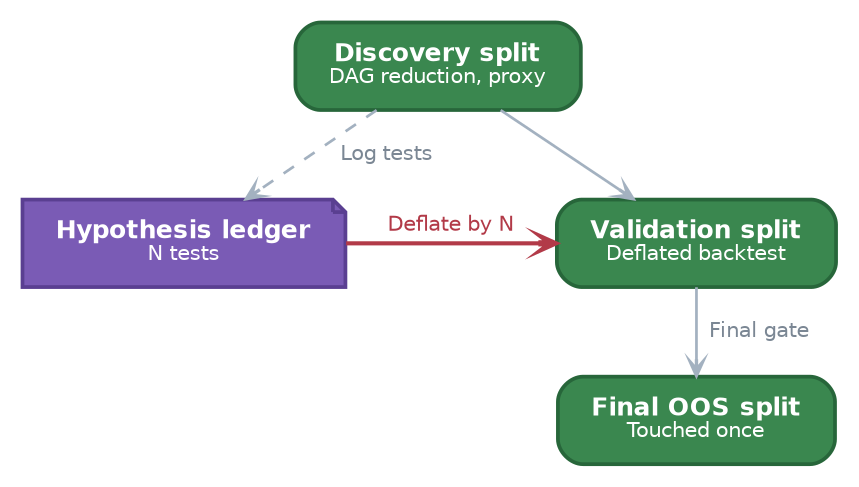
label=fig:ledger-splits
caption=`#text(fill: rgb("#3A874F"), weight: "bold")[Green data splits]`{=typst} are used in order, and the `#text(fill: rgb("#7A5BB5"), weight: "bold")[violet ledger]`{=typst} counts every test to deflate the backtest.

::::
:::

* Validation and Human Gates
// From: papers/Causal_Analysis_for_Finance/notes.md:213 '## Validation'
// From: papers/Causal_Analysis_for_Finance/notes.md:277 '## Human Review Gates and Metrics'

::: columns
:::: {.column width=60%}
- @Algorithm@: validate a proposal
  1. Propose formalized hypotheses from the Theory Store
  2. Researchers vote on the proposal (a human gate)
  3. Backtest on the validation split, deflated by the ledger
  4. Final gate: run on the final OOS split, untouched until now

- @Remark@: log every human decision, since the acceptance rate per gate is a
  pilot metric
::::
:::: {.column width=40%}

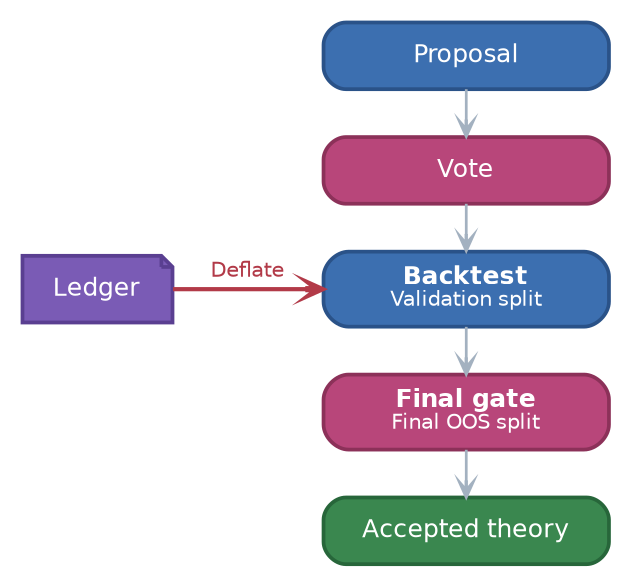
label=fig:validation
caption=A proposal passes `#text(fill: rgb("#B8467A"), weight: "bold")[a vote and a final gate]`{=typst} around a backtest deflated by `#text(fill: rgb("#7A5BB5"), weight: "bold")[the ledger]`{=typst}.

::::
:::

# When can the Theory Store be available?

* Pilot and Evaluation
// From: papers/Causal_Analysis_for_Finance/notes.md:289 '## Pilot and Evaluation'

- @Goal@: run a pilot on cross-sectional anomaly papers, with public ground
  truth
  - Chen and Zimmermann (2022): code and data for 319 characteristics
  - Reproduce some paper end-to-end
  - Reproduce some of the research we already have in production
  - Detect and flag papers with a factor mirage

- @Challenges@: no gold set of causal graphs for finance papers exists
  - Building it is an open requirement

- @Techniques@: baselines and ablation
  - Baseline: direct paper-to-code without a DAG
  - Baseline: the pipeline without the causal validation step
  - Ablation: run the same papers as PDF, LaTeX, and Markdown, and measure how
    parsing errors propagate to the extraction and replication metrics

// TODO(gp): Check the later targets: notes.md:24 leaves open whether macro nodes stay in this paper
- @Remark@: microeconomic and macroeconomic papers come later

* Evaluation Metrics
// From: papers/Causal_Analysis_for_Finance/notes.md:296 '- Extraction metrics (ReCITE style)'
// From: papers/Causal_Analysis_for_Finance/notes.md:277 '## Human Review Gates and Metrics'

```{=typst}
#styled-table(
  headers: ("Stage", "Metric"),
  rows: (
    ("Extraction", "Normalized structural Hamming distance (SHD), edge precision and recall, per-node and per-edge LLM judging (ReCITE style)"),
    ("Code", "Correlation with the published signal, matching t-statistics, rubric score"),
    ("Validation", "Share of papers with a flagged factor mirage"),
    ("Human gates", "Minutes per stage vs a manual baseline, acceptance rate per stage"),
  ),
  col-widths: (1fr, 4fr),
  width: 95%,
)
```

- @Remark@: edge precision and recall need the gold graph of the pilot

* Milestones

// TODO(gp): Check the phases, deliverables, and success metrics: self-made proposal, not in the notes
- @Key idea@: build incrementally, so that each phase delivers value on its own

```{=typst}
#styled-table(
  headers: ("Phase", "Stages", "Deliverable", "Success metric"),
  rows: (
    ("1", "Paper bank, claims, normalization", "Searchable claims with provenance", "Edge precision and recall on the gold graph"),
    ("2", "DAG, merge, reduction, mirage diagnostic", "Literature graph, meta-analysis, gap finding, flagged papers", "Share of papers with a flagged mirage"),
    ("3", "Code generation and verification", "Reproducible code for each paper", "Correlation with the published signal, matching t-statistics"),
    ("4", "Ledger, proxy, hypotheses, validation", "Deflated backtest of a proposal", "Final OOS result, acceptance rate per gate"),
  ),
  col-widths: (0.5fr, 1.6fr, 1.8fr, 1.8fr),
  width: 95%,
)
```

* Many Open Research Questions
// From: papers/Causal_Analysis_for_Finance/notes.md:390 '# Open research questions'

- @Questions@:
  - How to represent concepts, e.g., with knowledge graphs?
  - How to handle equilibrium papers that do not fit a DAG?
  - What objective should the reduced DAG optimize?
    - E.g., out-of-sample fit, number of untestable assumptions, agreement with
      the literature-level graph
  - Who builds the gold graph of causal claims?
  - How to verify against tables that code generates and the paper includes as
    external files, since they are absent from the source text?
  - How to extend the pipeline to macro nodes, time unrolling, and point-in-time
    macro data?
  - ...

# Related work

* Related Work: Causality and Finance
// From: papers/Causal_Analysis_for_Finance/notes.md:321 '## Causal Inference Foundations'
// From: papers/Causal_Analysis_for_Finance/notes.md:335 '## Causality in Finance'

```{=typst}
#styled-table(
  headers: ("Work", "What it gives the Theory Store"),
  rows: (
    ("Pearl (2009)", "SCMs, do-calculus, backdoor and frontdoor identification: the formal base for the DAG and the estimand check"),
    ("Peters et al. (2017)", "A free and code-friendly treatment of causal models"),
    ("Imbens (2020)", "A bridge between DAGs and the potential outcomes that finance papers use"),
    ("Huenermund and Bareinboim (2025)", "Identification criteria are algorithmic, so the check can be automated"),
    ("Sharma and Kiciman (2020)", "DoWhy, the library for the identification and estimation steps"),
    ("Lopez de Prado (2023)", "Factor papers make associational claims, with no causal graph: the gap to fill"),
    ("Lopez de Prado et al. (2024, 2025)", "The correct specification needs the causal graph; confounder and collider bias give test cases"),
    ("Lopez de Prado and Zoonekynd (2026)", "Seven-step protocol for causal factor investing: a checklist for the validator"),
    ("Harvey et al. (2016)", "Multiple testing: a new factor needs a t-statistic of at least 3.0"),
    ("McLean and Pontiff (2016)", "Published predictors earn lower returns out-of-sample and after publication: the validation data must start after the source samples"),
    ("Hou et al. (2020), Jensen et al. (2023)", "Replication benchmarks: none tests the causal specification"),
    ("Chen and Zimmermann (2022)", "Code and data for 319 characteristics: ground truth for code generation"),
  ),
  col-widths: (1.5fr, 3fr),
  size: 0.65em,
  width: 100%,
)
```

* Related Work: LLMs, Text, and Code
// From: papers/Causal_Analysis_for_Finance/notes.md:355 '## Causal Structure From Text'
// From: papers/Causal_Analysis_for_Finance/notes.md:377 '## Paper-to-Code and LLM Quant Agents'

```{=typst}
#styled-table(
  headers: ("Work", "What it gives", "Gap or role for the Theory Store"),
  rows: (
    ("FinCausal (Mariko et al., 2020)", "Cause and effect spans in finance text", "Builds no graph"),
    ("Kiciman et al. (2023)", "LLMs do well on causal reasoning tasks", "No finance papers"),
    ("Corr2Cause, Causal Parrots (2023)", "Failure modes of LLM causal inference", "Why inferred claims are flagged"),
    ("LACR (Zhang et al., 2024)", "RAG, majority vote, skeleton before orientation", "Reusable in Merge DAGs"),
    ("Garg and Fetzer (2025)", "Evidence-labeled claim graphs of economics papers", "No identification or estimation"),
    ("ReCITE (Saklad et al., 2025)", "Graph benchmark with SHD, precision, recall", "Few finance papers"),
    ("R&D-Agent-Quant (Li et al., 2025)", "Hypotheses, then code, then backtests", "Closest finance analogue"),
    ("FactorEngine (Lin et al., 2026)", "Financial reports to executable factors", "No causal graph"),
    ("Paper2Code, PaperBench (2025)", "Agents replicate ML papers, graded by rubric", "Target ML papers"),
    ("Nougat (Blecher et al., 2023)", "PDF to markup with equations", "A front end for PDF input"),
  ),
  col-widths: (1.7fr, 2fr, 1.3fr),
  size: 0.62em,
  width: 100%,
)
```

* Summary

// TODO(gp): Check the next steps and the ask
- @Key idea@: the Theory Store reads finance papers and returns causal theories
  that humans can test, understand, and falsify

- **Pipeline**: parse papers, extract claims, build and merge DAGs, validate the
  graph, generate and verify code, and run a deflated backtest

- **Guardrails**: a provenance pointer on every claim, human gates between the
  stages, and a ledger that counts every test

- **Limits**: LLM errors, publication bias, and the lack of a gold graph, which
  the pilot measures

- **Next steps**: pilot on cross-sectional anomaly papers with public data, then
  build incrementally

- **Long term**: machines, supervised by humans, reason about economic and
  financial systems, and create and falsify theories automatically

* References

```{=typst}
#set text(size: 0.5em)
```

::: columns
:::: {.column width=50%}

- **Lopez de Prado et al.** (2026): _"Correcting the Factor Mirage: A Research
  Protocol for Causal Factor Investing"_, The Journal of Portfolio Management
  52(3) (https://doi.org/10.3905/jpm.2025.1.794)

- **Lin et al.** (2026): _"FactorEngine: A Program-level Knowledge-Infused Factor
  Mining Framework for Quantitative Investment"_ (https://arxiv.org/abs/2603.16365)

- **Lopez de Prado et al.** (2025): _"Causality and Factor Investing: A Primer"_
  (https://doi.org/10.2139/ssrn.5277078)

- **Huenermund et al.** (2025): _"Causal Inference and Data Fusion in
  Econometrics"_, The Econometrics Journal 28(1) (https://arxiv.org/abs/1912.09104)

- **Garg et al.** (2025): _"Causal Claims in Economics"_
  (https://arxiv.org/abs/2501.06873)

- **Saklad et al.** (2025): _"Can Large Language Models Infer Causal
  Relationships from Real-World Text?"_ (https://arxiv.org/abs/2505.18931)

- **Li et al.** (2025): _"R&D-Agent-Quant: A Multi-Agent Framework for
  Data-Centric Factors and Model Joint Optimization"_
  (https://arxiv.org/abs/2505.15155)

- **Starace et al.** (2025): _"PaperBench: Evaluating AI's Ability to Replicate
  AI Research"_ (https://arxiv.org/abs/2504.01848)

- **Seo et al.** (2025): _"Paper2Code: Automating Code Generation from
  Scientific Papers in Machine Learning"_ (https://arxiv.org/abs/2504.17192)

- **Lopez de Prado et al.** (2024): _"The Case for Causal Factor Investing"_
  (https://doi.org/10.2139/ssrn.4774522)

- **Zhang et al.** (2024): _"Causal Graph Discovery with Retrieval-Augmented
  Generation based Large Language Models"_ (https://arxiv.org/abs/2402.15301)

- **Lopez de Prado** (2023): _"Causal Factor Investing: Can Factor Investing
  Become Scientific?"_ (https://doi.org/10.1017/9781009397315)

- **Jensen et al.** (2023): _"Is There a Replication Crisis in Finance?"_, The
  Journal of Finance 78(5) (https://doi.org/10.1111/jofi.13249)

::::
:::: {.column width=50%}

- **Jin et al.** (2023): _"Can Large Language Models Infer Causation from
  Correlation?"_ (https://arxiv.org/abs/2306.05836)

- **Zecevic et al.** (2023): _"Causal Parrots: Large Language Models May Talk
  Causality But Are Not Causal"_ (https://arxiv.org/abs/2308.13067)

- **Kiciman et al.** (2023): _"Causal Reasoning and Large Language Models:
  Opening a New Frontier for Causality"_ (https://arxiv.org/abs/2305.00050)

- **Blecher et al.** (2023): _"Nougat: Neural Optical Understanding for
  Academic Documents"_ (https://arxiv.org/abs/2308.13418)

- **Chen et al.** (2022): _"Open Source Cross-Sectional Asset Pricing"_,
  Critical Finance Review 11(2) (https://doi.org/10.1561/104.00000112)

- **Imbens** (2020): _"Potential Outcome and Directed Acyclic Graph Approaches
  to Causality: Relevance for Empirical Practice in Economics"_, Journal of
  Economic Literature 58(4) (https://doi.org/10.1257/jel.20191597)

- **Hou et al.** (2020): _"Replicating Anomalies"_, The Review of Financial
  Studies 33(5) (https://doi.org/10.1093/rfs/hhy131)

- **Sharma et al.** (2020): _"DoWhy: An End-to-End Library for Causal
  Inference"_ (https://arxiv.org/abs/2011.04216)

- **Mariko et al.** (2020): _"Financial Document Causality Detection Shared
  Task (FinCausal 2020)"_ (https://arxiv.org/abs/2012.02505)

- **Peters et al.** (2017): _"Elements of Causal Inference: Foundations and
  Learning Algorithms"_ (https://mitpress.mit.edu/9780262037310/)

- **Harvey et al.** (2016): _"... and the Cross-Section of Expected Returns"_,
  The Review of Financial Studies 29(1) (https://doi.org/10.1093/rfs/hhv059)

- **McLean et al.** (2016): _"Does Academic Research Destroy Stock Return
  Predictability?"_, The Journal of Finance 71(1) (https://doi.org/10.1111/jofi.12365)

- **Pearl** (2009): _"Causality: Models, Reasoning, and Inference"_
  (https://bayes.cs.ucla.edu/BOOK-2K)

::::
:::
