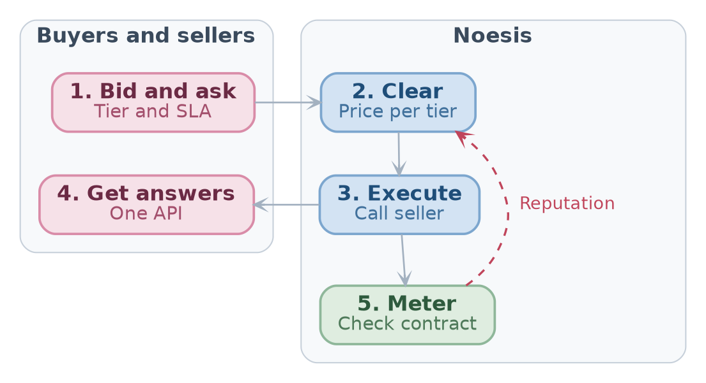
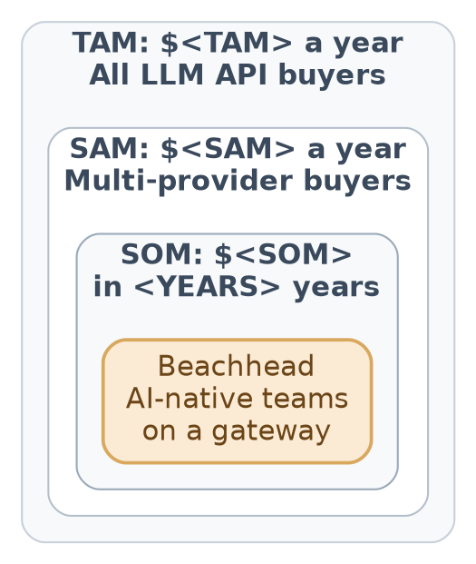
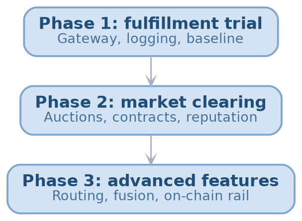

// type=UMD_slides
// course_title=Pre-Seed Investment
// lesson_title=Noesis: An Exchange for AI Tokens
// logo=assets/images/Noesis_logo_placeholder.png
// slides_engine=typst

// Generated by `.claude/skills/vc_pitch.write_slides/SKILL.md`

* Elevator Pitch

- @Problem@: AI applications and agents buy LLM inference at **fixed prices** with no
  proof that they got the **quality they paid for**

- @Scenarios@:
  - AI product teams: _pay frontier-model prices for easy requests_
  - Agent builders: _cannot detect a silently downgraded model_
  - Inference sellers: _compete on price lists, not on delivered quality_

- @Solution@: Noesis is an exchange for AI inference that:
  - **Clears**: matches buyer bids and seller asks in a periodic auction, at
    one price per capability tier
  - **Meters**: checks each request for capability, latency, and reliability
  - **Enforces**: cuts the reputation and eligibility of sellers that
    under-deliver

- @Model@: a \<FEE\>% take rate, charged only on cleared volume

- Noesis is the only system that joins in one loop
  - Auction pricing
  - Metered fulfillment
  - Reputation feedback 

* Problem

- @Problem@:
  1) today buyers pay for **compute consumed**, not for **intelligence delivered**
     - E.g., an agent platform pays the same price after a silent model downgrade

  2) inference is like **a commodity**, but there is **no market**
    - _No price discovery_: a few providers post static, incompatible prices
    - _No quality guarantee_: a token price says nothing about capability,
      latency, or reliability
    - _No verified fulfillment_: model nerfing and outages go undetected
    - _No accountability_: a seller that under-delivers keeps its price

- @\$12.5B a year at stake@: enterprise spend on foundation model APIs in 2025
  (Menlo Ventures, 2025)

* Solution and Product

- @Today@: buyers call one provider (e.g., Anthropic, OpenAI) or a gateway (e.g.,
  OpenRouter) and trust it on quality

::: columns
:::: {.column width=55%}
- @With Noesis@:
  1) **Bid**: on tier, latency, and reliability
     - E.g., 10,000 tasks, frontier, 2 s, 99.9%
  2) **Clear**: NoesisMarket prices each tier
     - E.g., low-reputation sellers cannot match
  3) **Verify**: NoesisServer meters contracts
     - E.g., a missed promise cuts reputation
::::
:::: {.column width=45%}


label=fig:noesis-flow
caption=Rose: customer steps, blue: Noesis steps, green: metering

::::
:::

- @Advantages@:
  - **Verified, not trusted**: fulfillment is measured, not assumed
  - **Market price**: competing sellers set the price, not one provider
  - **Pay for what is needed**: each request goes to the cheapest capable model
  - **One API**: many sellers behind a single integration

* Traction

// TODO(gp): Provide commercial traction (revenue, paying customers, letters of
// intent) : not in the input, the paper says the design is not yet tested on
// real traffic
- @Research@: Noesis protocol paper, August 2026
  - **Market**: the clearing problem reduces to a finite set of linear
    programs, with a proof that a clearing price exists
  - **Fulfillment**: a statistical test separates a seller's shortfall from
    sampling noise

// TODO(gp): Provide <STATUS> : the paper names an auction simulator and a
// logging gateway as the first pieces to build
- @Prototype@: \<STATUS\> of the auction simulator and the logging gateway

// TODO(gp): Provide <N_REQ>, <N_BUYERS>, and <N_PAID> : not in the input
- @Observed funnel@: \<N_REQ\> requests logged $\to$ \<N_BUYERS\> active
  buyers $\to$ \<N_PAID\> paying buyers

// TODO(gp): Provide <N_PILOTS>, <BUYER_TYPE>, and <MONTH_YEAR> : not in the
// input
- @Paid pilots@: \<N_PILOTS\> pilots with \<BUYER_TYPE\> as of \<MONTH_YEAR\>

// TODO(gp): Provide <LAUNCH_DATE> : not in the input
- @Product@: Phase 1 gateway (NoesisServer) in production by \<LAUNCH_DATE\>

* Market Size

::: columns
:::: {.column width=65%}
// TODO(gp): Provide <TAM>, <N_BUY>, and <SPEND> : not in the input, find a
// cited source for the number of LLM API buyers and their spend
- @TAM \$\<TAM\> a year@: \<N_BUY\> companies buying LLM APIs $\times$
  \$\<SPEND\> of inference a year each $\times$ \<FEE\>% take rate

// TODO(gp): Provide <SAM> and <N_SAM> : not in the input
- @SAM \$\<SAM\> a year@: \<N_SAM\> buyers that already route traffic across
  several providers through a gateway

// TODO(gp): Provide <SOM>, <SHARE>, and <YEARS> : not in the input
- @SOM \$\<SOM\> in \<YEARS\> years@: \<SHARE\>% of SAM, starting from the
  beachhead of AI-native teams on a gateway

- @Cross-check \$12.5B a year@: enterprise spend on foundation model APIs in
  2025, within \$37B of generative AI spend, up 3.2x from 2024 (Menlo
  Ventures, 2025)
  - **\$0.69B a year**: \$12.5B of volume at OpenRouter's 5.5% fee
    (OpenRouter, 2026)
::::
:::: {.column width=35%}


label=fig:market-size
caption=Nested TAM, SAM, SOM, with the beachhead in orange

::::
:::

* Competition

```{=typst}
#styled-table(
  headers: ("Option", "Price set by", "Quality checked", "Penalty for shortfall"),
  rows: (
    ("Direct API (OpenAI, Bedrock)", "Provider price list", "No", "None"),
    ("Gateways (OpenRouter, Portkey)", "Provider price + fee", "Uptime only", "None"),
    ("Routers (Martian, Not Diamond)", "Provider price list", "No", "None"),
    ("Compute markets (Akash, Vast.ai)", "Auction on GPU-hours", "No", "Partial"),
    ("Inference networks (Bittensor)", "Token emissions", "Validator scores", "Lower rewards"),
    ("Noesis", "Auction per tier", "Yes, per contract", "Lower reputation"),
  ),
  col-widths: (3.2fr, 1.7fr, 1.3fr, 1.3fr),
  bold-first-col: true,
  width: 100%,
)
```

// TODO(gp): Provide <FEE> and the price lists of direct APIs : not in the input
- @Noesis's position@: Noesis keeps the single API of a gateway and adds an
  auction price and a metered contract
  - A buyer pays \<FEE\>% on cleared volume vs. OpenRouter's 5.5% fee on every
    credit purchase (OpenRouter, 2026)

* Why Now, Moat, and IP

- @Why now@:
  - **2025, \$37B spend**: enterprise generative AI spend tripled in one year,
    and 76% of use cases are now bought, not built (Menlo Ventures, 2025)
  - **Sep 2025, agent payments**: Google's AP2 with Coinbase's x402 lets
    autonomous agents pay for services in code (Coinbase, 2025)
  - **Aug 2026, parts proven**: open compute auctions (Akash, Vast.ai),
    quality scoring (Bittensor), and answer fusion (OpenRouter) all run in
    production (Noesis paper, 2026)

- @Noesis's edge@:
  1. **Compounding data**: every metered request trains difficulty-aware
     routing and an opt-in distillation corpus, cutting cost as volume grows
  2. **Verification method**: a statistical test pins a shortfall on a seller,
     not on noise, so each penalty is defensible
// TODO(gp): Provide <IP_STATUS> : not in the input
     - **IP**: \<IP_STATUS\>
  3. **Liquidity**: more sellers give better cleared prices, which pull in
     more buyer volume, the base of the \<FEE\>% take rate

* Verified Exchange, Not Another LLM Gateway

- @Verified exchange@: Noesis prices and checks a contract, not a token
  - Sellers compete in an auction for each capability tier
  - Each contract is metered, and the result sets the seller's future
    eligibility

- @Not another LLM gateway@: a gateway passes through posted prices and checks
  only uptime
  - Noesis earns only on cleared volume, which grows when buyers trust the
    quality signal

```{=typst}
#styled-table(
  headers: ("Side", "Win", "What enforces it"),
  rows: (
    ("Buyer", "Market price and verified quality", "Metering and the statistical fulfillment test"),
    ("Seller", "Pooled demand, and a price that rewards reliable delivery", "Reputation score gates eligibility"),
    ("Noesis", "Fee on cleared volume", "The auction sets the price, not Noesis"),
  ),
  col-widths: (0.8fr, 2fr, 2fr),
  bold-first-col: true,
  width: 100%,
)
```

- @Result@: quality becomes a price signal, so reliable sellers win volume and
  buyers move more traffic onto Noesis

* Business Model and Financials

::: columns
:::: {.column width=55%}
// TODO(gp): Provide <FEE> and <IN_HOUSE> : not in the input
- @Pricing@: revenue = cleared volume $\times$ \<FEE\>%
  - **Unit**: dollar value of a cleared contract
  - **In-house**: \$\<IN_HOUSE\> a year to build it
  - **Data discount**: lower rate if data opt-in

// TODO(gp): Provide all cost sensitivity values : not in the input
```{=typst}
#styled-table(
  headers: ("Case", "Fee", "Metering", "Margin"),
  rows: (
    ("Plan", "<F>%", "<M>%", "<G>%"),
    ("Downside", "<F2>%", "<M2>%", "<G2>%"),
    ("Break-even", "<F3>%", "= fee", "0%"),
    ("OpenRouter", "5.5%", "n/a", "n/a"),
  ),
  col-widths: (1.5fr, 1fr, 1.3fr, 1fr),
  bold-first-col: true,
  width: 100%,
)
```
::::
:::: {.column width=45%}
// TODO(gp): Provide unit economics : not in the input
```{=typst}
#styled-table(
  headers: ("Price", "Cost", "Margin", "LTV:CAC"),
  rows: (
    ("<F>%", "<C>%", "<G>%", "<L>"),
  ),
  col-widths: (1fr, 1fr, 1fr, 1.2fr),
  bold-first-col: false,
  width: 100%,
)
```

// TODO(gp): Provide <M_OBS> : not in the input
- @Cost driver@: metering cost = verifier cost per check $\times$ share of
  requests checked
  - **Observed**: \<M_OBS\>% of volume
::::
:::

// TODO(gp): Provide <ACV>, <CAC>, <DROP>, and the ARR values : not in the input
- @Assumptions@: \$\<ACV\> fees per buyer a year, \$\<CAC\> CAC, prices down
  \<DROP\>% a year

- @Revenue path@: ARR \$\<ARR1\> (Y1), \$\<ARR2\> (Y2), \$\<ARR3\> (Y3)

* Go-to-Market (GTM) Strategy

::: columns
:::: {.column width=60%}
// TODO(gp): Check the beachhead : a self-made choice, not in the input
- @Beachhead@: AI-native teams on a multi-model gateway
  - **Buyer**: owner of the inference bill
  - **Motion**: drop-in API, self-serve first
  - **Supply**: Together AI, Fireworks AI, Groq

// TODO(gp): Provide <M1>, <M2>, and the milestone values : not in the input
- @Months 0-\<M1\>@: gateway trial
  - **\<N_BUYERS\> buyers**: traffic metered

- @Months \<M1\>-\<M2\>@: first auctions
  - **\<N_SELLERS\> sellers**: reputation live

- @Months \<M2\>+@: routing and fusion
  - **\$\<GMV\> a month**: cleared volume
::::
:::: {.column width=40%}


label=fig:gtm-phases
caption=The three GTM phases from gateway to full exchange

::::
:::

* Team

// TODO(gp): Provide <ROLE> and a prior role tied to markets or AI
// infrastructure : not in the input
- **GP Saggese**: \<ROLE\>
  - University of Maryland; author of the Noesis protocol paper (2026)

// TODO(gp): Provide co-founders : not in the input
- **\<FOUNDER_2\>**: \<ROLE_2\>
  - \<CREDENTIAL_2\>

// TODO(gp): Provide the names of first hires and advisors : not in the input
- @First hires and advisors@:
  - **Market design advisor**: to harden the auction against bid shading and
    collusion, an open question in the paper
  - **Privacy lead**: to set PII scrubbing and consent before logging real
    traffic
  - **Founding engineer**: to build the gateway and the metering pipeline

* The Ask

::: columns
:::: {.column width=60%}
// TODO(gp): Provide <ASK>, <ROUND>, <MONTHS>, and <BURN> : not in the input
- @The round@: \$\<ASK\> \<ROUND\>, \<MONTHS\> months of runway,
  \$\<BURN\> net burn a month

// TODO(gp): Provide <N_BUYERS>, <N_SELLERS>, and <GMV> : not in the input
- @Milestones@:
  1. Metered traffic from \<N_BUYERS\> buyers
  2. First auctions with \<N_SELLERS\> sellers
  3. \$\<GMV\> cleared a month, for the next round
::::
:::: {.column width=40%}
// TODO(gp): Check the shares : a self-made split, not in the input
- @Use of funds@:

```{=typst}
#styled-table(
  headers: ("Area", "Share", "Amount"),
  rows: (
    ("Engineering", "55%", "$<A1>"),
    ("Onboarding", "20%", "$<A2>"),
    ("GTM", "15%", "$<A3>"),
    ("G&A", "10%", "$<A4>"),
  ),
  col-widths: (1.8fr, 1fr, 1fr),
  bold-first-col: true,
  width: 100%,
)
```
::::
:::

- @Why invest@:
  - **Open gap**: only system with auction, verification, and reputation
    (Competition)
  - **Exchange economics**: a fee on volume in a \$12.5B API market (Market)
  - **Compounding data**: each request improves routing (Moat)

* Sources

```{=typst}
#set text(size: 0.7em)
```

::: columns
:::: {.column width=50%}
- **Menlo Ventures**: _"2025: The State of Generative AI in the Enterprise"_
  (2025),
  https://menlovc.com/perspective/2025-the-state-of-generative-ai-in-the-enterprise/

- **OpenRouter**: _"Pricing"_ (2026), https://openrouter.ai/pricing
::::
:::: {.column width=50%}
- **Coinbase**: _"Google Agentic Payments Protocol + x402: Agents Can Now
  Actually Pay Each Other"_ (2025),
  https://www.coinbase.com/developer-platform/discover/launches/google_x402

- **Saggese**: _"Noesis: A Protocol for Trading and Fulfilling Machine
  Intelligence as a Commodity"_ (2026), working paper
::::
:::
