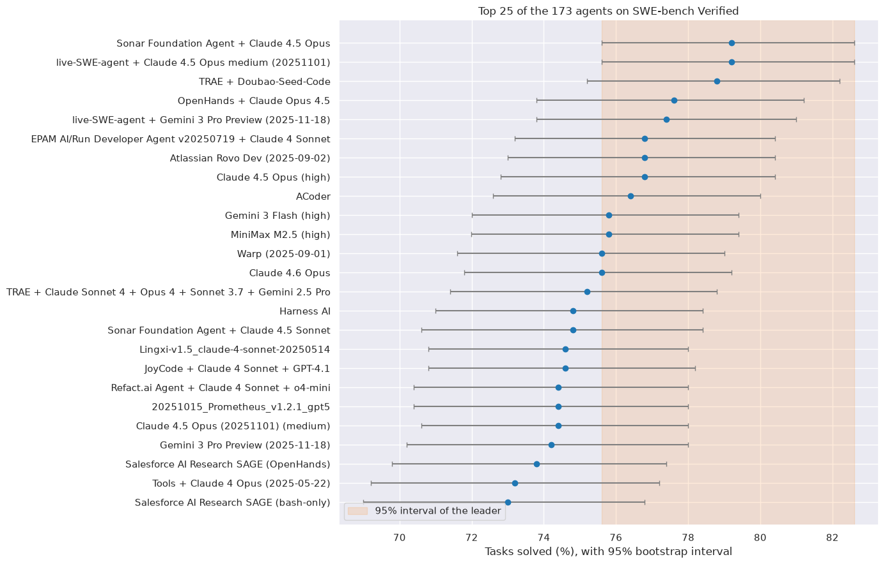
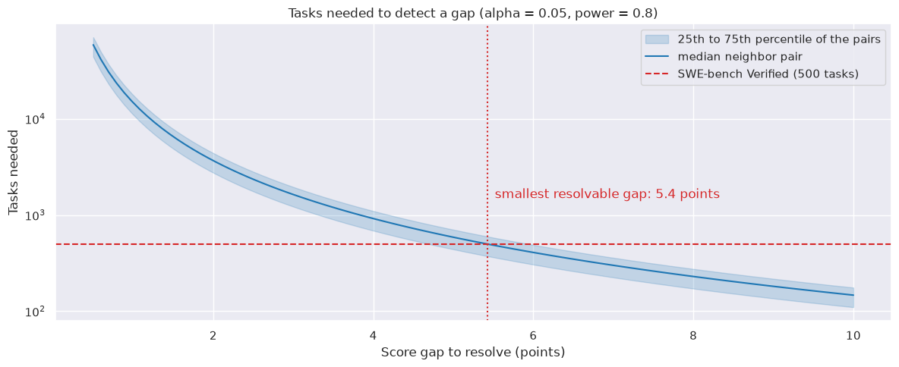
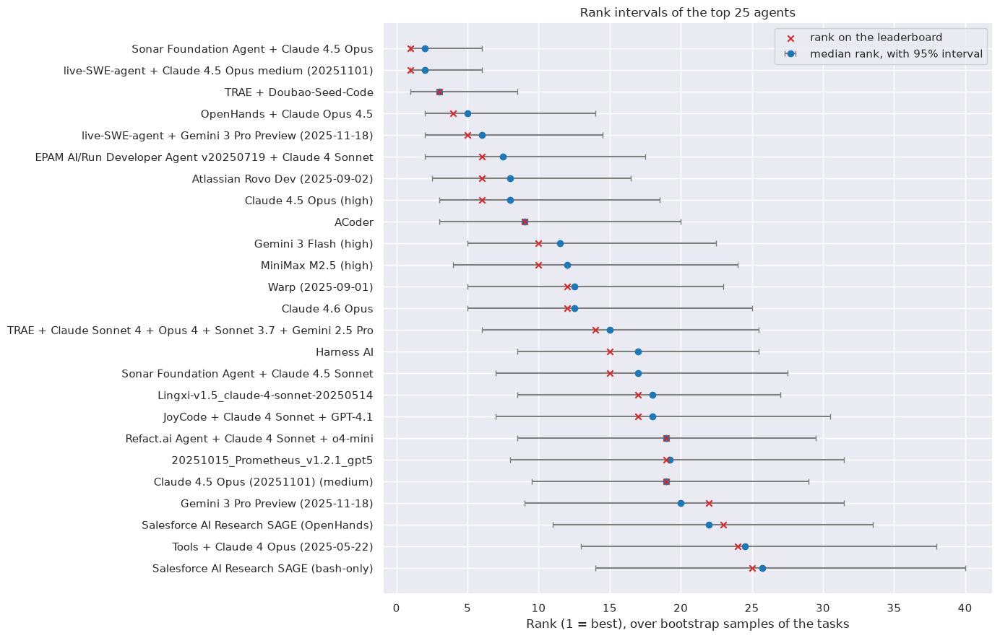
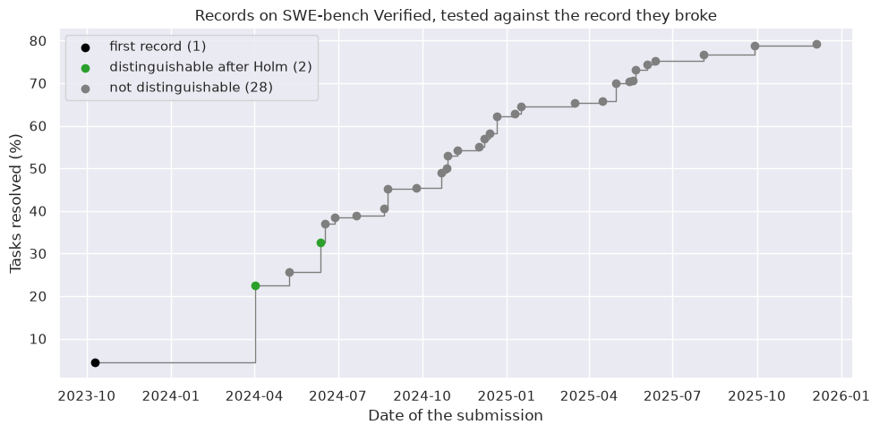
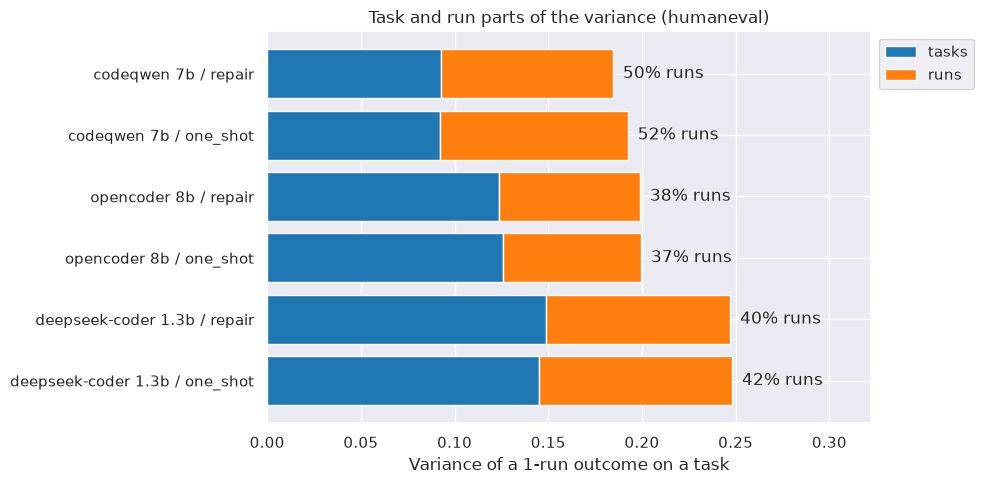
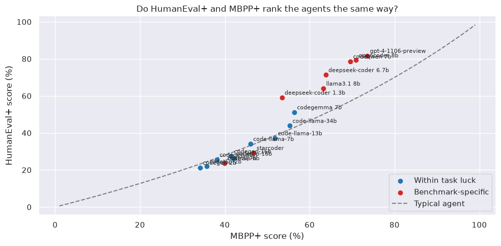
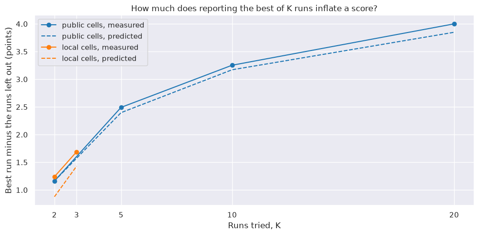
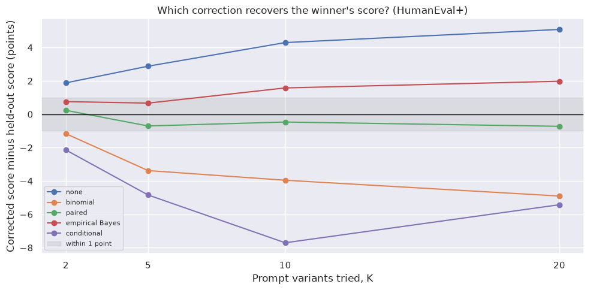

# Introduction

Leaderboards are the main way coding agents are compared. SWE-bench Verified
[@jimenez2024swebench; @openai2024verified] ranks more than a hundred agent
submissions by the share of 500 tasks they resolve, and new records are
announced for gains of a few tenths of a point. Each score comes from a single
run on a fixed sample of tasks, and the reported agent is often the best of
many scaffolds, prompts, or checkpoints that its authors tried. A gap between
two agents can therefore come from skill, or from three kinds of luck: the
tasks that happen to be in the benchmark, the run that happens to be
reported, and the variant that happens to be picked.

Prior work addresses parts of this problem. Error bars for language model
evaluations treat the questions as a sample from a larger population
[@miller2024errorbars], and seed variance has been measured across language
model benchmarks [@madaan2024variance] and machine learning benchmarks
[@bouthillier2021variance]. Item response theory (IRT) has been used to weigh
examples by difficulty [@rodriguez2021informative] and to shrink benchmarks
to a small informative subset [@polo2024tinybenchmarks]. Statistical power is
known to be low for many natural language processing test sets
[@card2020power]. Selection effects are studied in finance, as backtest
overfitting [@bailey2017backtest] and as luck versus skill in fund returns
[@fama2010luck], and in econometrics, as inference on winners
[@andrews2024winners]. None of these studies measures all three kinds of luck
on agent leaderboards, and none ends in a protocol for reporting agent scores.

This paper measures task luck on the public per-task results of SWE-bench
Verified, run luck on our own repeated runs of open coding models on
HumanEval+ and MBPP+ [@liu2023evalplus], and selection luck on the best of K
runs and of K prompt variants, scored against tasks or runs that the selection
never saw. The analysis rests on these assumptions:

- **Tasks are a sample.** The tasks of a benchmark are treated as a random
  sample from a larger population of similar tasks, so a score estimates an
  expected success rate.
- **Runs are independent.** Two runs of an agent on the same task differ only
  through sampling, given the agent and the task.
- **Variants are scored on the same tasks.** The candidates of a selection are
  scored on the same tasks, so their scores are correlated and paired methods
  apply.

The contributions are:

- A decomposition of the luck in an agent score into a task part and a run
  part, with intervals, paired tests, and minimum-N curves, applied to 173
  SWE-bench Verified submissions and to 6 local models (Sections IV and V).
- An audit of the records of SWE-bench Verified, a test of whether rankings
  transfer between HumanEval+ and MBPP+, and the effective size of each
  benchmark under a two-parameter logistic (2PL) IRT model (Section V).
- A measurement of the winner's curse on the best of K runs and on 20 real
  prompt variants, and a comparison of five corrections against held-out
  scores, including the conditional estimator of Andrews, Kitagawa, and
  McCloskey (Section V).
- A reporting protocol that combines these tools into one table per
  leaderboard (Section VI).

Section II reviews related work, Section III states the problem, Section IV
describes the data and the methods, Section V gives the results, Section VI
describes the protocol, Section VII discusses the limitations, and Section VIII
concludes.

# Related Work

**Error bars for evaluations.** Miller treats evaluation questions as a sample
from a population and gives standard errors, clustered errors, and paired
comparisons for model evaluations [@miller2024errorbars]. Madaan et al.
measure the seed variance and the monotonicity of language model benchmarks
during training [@madaan2024variance]. Bouthillier et
al. decompose the variance of machine learning benchmarks into data sampling,
initialization, and hyperparameter choice [@bouthillier2021variance]. This
paper applies the same ideas to a whole agent leaderboard, separates task luck
from run luck, and moves from pairs of agents to the ranking.

**Power and benchmark size.** Card et al. show that many experiments in
natural language processing are underpowered for the gains they report
[@card2020power]. This paper gives minimum-N curves for agent benchmarks and
shows that the median gap between SWE-bench neighbors is far below what 500
tasks can resolve.

**Item response theory.** Rodriguez et al. fit Bayesian IRT models to natural
language processing leaderboards [@rodriguez2021informative], and Maia Polo et
al. use IRT to pick about 100 anchor examples that estimate a full benchmark
[@polo2024tinybenchmarks]. This paper uses a 2PL model [@embretson2000irt]
fitted in NumPyro [@phan2019numpyro] to ask how many equally informative tasks
a benchmark is worth for the agents at its top.

**Ranking under uncertainty.** Hall and Miller study the bootstrap for
empirical rankings and show that the standard bootstrap can misjudge the
uncertainty of ranks when the underlying values are close
[@hall2009ranking]. This paper reports standard bootstrap rank intervals and
the chance of each agent to come out first, and checks how often the true
order is recovered on simulated benchmarks with known abilities.

**Selection effects.** Bailey et al. measure how often the best of many
backtested strategies underperforms out of sample [@bailey2017backtest], and
Fama and French separate skill from luck in mutual fund returns
[@fama2010luck]. Andrews, Kitagawa, and McCloskey give estimates and intervals
for the mean of the option that scored best among many, conditional on it
having won [@andrews2024winners]. This paper compares their estimates with
simpler corrections on real runs and prompt variants, against held-out
scores.

# Problem Formulation

## Notation and Setup

Let $s_{a,i,r} \in \{0, 1\}$ be the outcome of agent $a$ on task $i$ in run
$r$, for $N$ tasks and $R$ runs. The reported score is the mean
$\hat{\theta}_a = \frac{1}{NR} \sum_{i,r} s_{a,i,r}$. Its variance has a task
part and a run part,

$$
\mathrm{Var}(\hat{\theta}_a) = \frac{\sigma^2_{task}}{N}
+ \frac{\sigma^2_{run}}{N R},
$$

where $\sigma^2_{task}$ is the variance of the expected outcome across tasks
and $\sigma^2_{run}$ is the mean variance of the outcome across runs of the
same task. The run share is $\sigma^2_{run} / (\sigma^2_{task} +
\sigma^2_{run})$, the part of the variance of a single outcome that is run
luck.

## Problem 1: Which Gaps Are Real?

For two agents scored on the same tasks, the paired difference has standard
deviation $\sigma_{pair}$ per task. Resolving a gap $\Delta$ at level $\alpha$
and power $1 - \beta$ requires about

$$
N \geq \frac{(z_{1 - \alpha / 2} + z_{1 - \beta})^2 \, \sigma^2_{pair}}{\Delta^2}
$$

tasks. The question is how many of the gaps on a leaderboard clear this bar,
and how many tasks a benchmark would need to resolve the gaps it reports.

## Problem 2: Do Rankings Persist and Transfer?

If a leaderboard measures skill, the ranking on one half of the tasks should
agree with the ranking on the other half, and the ranking on one benchmark
should agree with the ranking on a related one once task luck is taken into
account. The question is how much of each ranking survives.

## Problem 3: How Much Does Picking the Best of K Inflate a Score?

When the reported agent is the best of $K$ candidates scored on the same
tasks, its score is biased upward. For $K$ equal candidates with independent
noise of standard deviation $\sigma$, the expected inflation is
$\sigma \, \mathbb{E}[\max_K Z]$, where $Z$ is standard normal; the spec of
this project used the approximation $\sigma \sqrt{2 \ln K}$. The question is
how large the inflation is on real runs and variants, and which correction
removes it.

# Data and Methods

## Data

- **SWE-bench Verified.** The per-task results of 173 submissions on 500 tasks,
  at a pinned commit of the public `SWE-bench/experiments` repository, after
  dropping the submissions whose per-task results do not match their reported
  score. Each submission has 1 run per task.
- **Our coding runs.** DeepSeek Coder 1.3B, CodeQwen 7B, and OpenCoder 8B,
  served by Ollama on a laptop, on HumanEval+ (164 tasks) and MBPP+ (378 tasks)
  [@chen2021humaneval; @austin2021mbpp; @liu2023evalplus], with a one-shot
  scaffold and a repair scaffold that sees the error of a failed visible test.
  Each model has 1 greedy run and 5 runs at temperature 0.8 per task. A second
  phase adds 3 runs at temperature 0.2 and a second greedy run on HumanEval+
  for these models, and CodeGemma 7B, Llama 3.1 8B, and DeepSeek Coder 6.7B,
  each with 1 greedy run and 3 runs at temperature 0.8.
- **Public EvalPlus samples.** The code samples that the EvalPlus authors
  released for several models, including 200 samples per task at temperatures
  0.2 and 0.8 on HumanEval+, scored again with our scorer.
- **Prompt variants.** 20 variants of the prompt of DeepSeek Coder 1.3B (2
  system prompts, 2 instructions, and 5 lines of guidance), with 1 greedy
  one-shot answer per task on both benchmarks.

All answers are scored with the EvalPlus tests in a sandboxed container, twice
each to find flaky tests. On 5 public greedy sets, our scorer matches the
published EvalPlus scores to within 2 tasks.

## Pre-Registration

The design and the predictions of each phase were committed before the
analysis that tests them: 7 predictions for the first coding runs, 13 for the
second phase, and 15 for the last two milestones. Every prediction is
reported, whether or not it held, and every analysis that was not planned is
marked as an extra look.

## Statistical Tools

- **Intervals and tests.** Bootstrap intervals over tasks
  [@efron1993bootstrap], exact McNemar tests on paired outcomes
  [@mcnemar1947proportions] with the Holm correction for multiple pairs
  [@holm1979multiple], and Cochran's Q for many variants on the same tasks
  [@cochran1950matched].
- **Ranking.** Bootstrap rank intervals and the chance of coming out first,
  with tied ranks split, and the Kendall correlation between the rankings on 2
  random halves of the tasks.
- **Effective size.** A 2PL model fitted by stochastic variational inference
  and checked against the No-U-Turn sampler on a subset; the effective size is
  the participation ratio of the Fisher information of the tasks, averaged
  over a group of agents.
- **Transfer.** Kuder-Richardson reliability (KR-20) of each benchmark
  [@kuder1937reliability], the correlation between benchmarks corrected for
  the reliability of each [@spearman1904association], and a benchmark-specific
  residual per model on the logit scale, with bootstrap intervals over models
  and tasks.
- **Corrections of a winner's score.** For the best of $K$ candidates, scored
  on $n$ tasks, with winner score $p$:
  - Binomial: $p - \sqrt{p(1 - p)/n} \, \mathbb{E}[\max_K Z]$
  - Paired: $p - \sqrt{v/2} \, \mathbb{E}[\max_K Z]$, where $v$ is the mean
    over pairs of candidates of the variance of their score difference
  - Empirical Bayes: the mean of the $K$ scores plus
    $B (p - \text{mean})$, with $B = \max(0, 1 - (v/2) / \text{variance of the
    } K \text{ scores})$
  - Conditional: the median-unbiased estimate of the winner's mean given that
    it won [@andrews2024winners], with ties broken by a jitter of half a task
  - Hybrid (an extra look): the conditional estimate restricted to a
    projection interval that covers all the means with probability 0.995
    [@andrews2024winners]
  - Spec (an extra look): $p - \sqrt{p(1 - p)/n} \sqrt{2 \ln K}$

A correction is judged by its mean error and its root mean squared error
(RMSE) against the score of the winner on the runs or tasks that the selection
never saw. The pre-registered rule keeps the corrections whose mean error is
within 1 point of 0 in every setting, and recommends the one with the lowest
mean RMSE.

# Results

## How Precise Is One Leaderboard Score?

On SWE-bench Verified, the median 95% bootstrap interval of a score is 8.2
points wide, so a single score is known to about 4 points either way
(Fig. 1). The median gap between neighbors on the leaderboard is 0.2 points.
None of the 172 neighbor pairs differs after the Holm correction, and 18
agents, down to rank 19, cannot be told apart from the leader. At 80% power,
500 tasks resolve gaps of about 5.4 points, and a 1-point gap would need about
14,700 tasks (Fig. 2).

The ranking itself is uncertain. Over 2,000 bootstrap samples of the tasks,
the top 3 agents share about 94% of the first places and none of them is first
more than 34% of the time. A typical agent in the top 25 has a 95% rank
interval about 18 ranks wide (Fig. 3). In simulated benchmarks with 10 agents
and known abilities, the truly best agent comes out first about half the time
when it is 1 point ahead on 500 tasks, and more than 90% of the time only with
10,000 tasks.

## How Many Records Were Real?

Of the 30 records that took the top score of SWE-bench Verified from 4.4% to
79.2%, only 2 are distinguishable from the record they broke after the Holm
correction, and they carry 33% of the 74.8 points of progress (Fig. 4). Since
June 2024, 27 records in a row were each within the noise of the one before,
although together they added 46.6 points. The 31 records fall into 12
distinguishable levels, each 4 to 18 points above the one before.

## How Much of One Run Is Luck?

On our runs at temperature 0.8, run-to-run luck is 28% to 52% of the variance
of a 1-run outcome (Fig. 5). Only 18.5% of the random 1-run leaderboards of the
6 agents on HumanEval+, and 25.3% on MBPP+, keep the order of all 6, mostly
because a model with and without repair is nearly the same agent. CodeQwen 7B
and OpenCoder 8B cannot be told apart even with 5 runs per task; on HumanEval+
their gap in single runs goes from -2.4 to +6.1 points. At temperature 0.2 the
run share falls to 15% to 21%, and 2 greedy runs give the same result on every
task. With 3 more models, only 44.4% of the 1-run leaderboards keep the order
of the 6 models on MBPP+, and 3 models within 2.1 points of each other in the
published MBPP+ scores are 5 to 12 points apart in our runs. An estimator of
the run share from a single run, tuned on the public samples, came within 10
points of the truth for only 7 of 18 new cases.

## Do Rankings Persist and Transfer?

On 2 random halves of the SWE-bench Verified tasks, the rankings of all 173
agents agree (median Kendall 0.90), but among the top 20 they barely agree
(Kendall 0.25), in part because picking the top 20 on the total score pushes
the correlation down. The leader of one half scores 2.0 points less on the
other half. Under the 2PL fit, the 500 tasks are worth about 107 equally
informative tasks for the top 20 agents, and 39 tasks hold half of their
information.

HumanEval+ and MBPP+ rank 18 models almost the same way: both are reliable
(KR-20 0.986 and 0.980), the Spearman correlation is 0.983, and the correlation
corrected for task luck is 0.991, with a 95% interval of 0.921 to 1.004
(Fig. 6). The scale does not transfer: 6 of the 7 chat models score 14 to 21
HumanEval+ points more than a typical model with the same MBPP+ score, and 2
base models score 4 to 5 points less, so 8 of the 18 models are
benchmark-specific. HumanEval+ is worth about 119 equally informative tasks
(72% of 164) and MBPP+ about 214 (57% of 378).

## How Much Does Picking the Best of K Inflate a Score?

On the public samples, the best of K runs is above the runs left out by just
what $\sigma_{run} \, \mathbb{E}[\max_K Z]$ predicts, from 1.2 points for
$K = 2$ to 4.0 points for $K = 20$, with ratios of measured to predicted
inflation of 1.00 to 1.04 (Fig. 7). On our runs, with 3 or 5 runs per cell,
the inflation is 1.41 times the prediction at $K = 2$, since the plug-in
estimate of $p(1 - p)$ from few runs is too low; correcting for it brings the
ratio to 1.20.

The 20 prompt variants differ: they score 50.0% to 60.4% on HumanEval+ and
41.8% to 54.0% on MBPP+, and Cochran's Q rejects equal pass rates on both
benchmarks ($p = 0.002$ and about $10^{-33}$). A line asking the model to
handle edge cases costs 7 to 12 points. Picked on a random half of the tasks,
the best of $K$ variants scores less on the other half, from 1.9 points for
$K = 2$ to 5.1 points for $K = 20$ on HumanEval+, and from 0.6 to 2.5 points on
MBPP+.

Fig. 8 shows the mean error of each correction. The binomial rule corrects
too much, more as $K$ grows (-4.9 and -4.3 points at $K = 20$), and the
spec's $\sqrt{2 \ln K}$ rule corrects even more (-8.0 and -6.4 points).
Empirical Bayes corrects too little as $K$ grows (+2.0 and +1.6 points), since
the spread of the $K$ scores also holds the real differences between the
variants. The conditional estimate is right
on the median, but its mean error is -0.9 to -7.7 points and its RMSE reaches
31 points: when the winner only just won, it falls far below the observed
score, at times below 0. The paired rule stays within 1 point of the held-out
score in every setting of runs and variants (worst -0.97 points) and has the
lowest RMSE at $K = 20$ on both benchmarks, so the pre-registered rule
recommends it. The hybrid estimate cuts the RMSE of the conditional one by 1.5
to 3.8 times, but it still misses by up to 1.5 points.

These candidates are near-equal. On a leaderboard the candidates are far
apart, so the corrections were also tested on SWE-bench Verified, with the
leader picked on a random half of the tasks and scored on the other half
(1,000 splits, an extra look). The leader drops by 1.88 points, close to the
2.0 points of Section V-D, which uses other random splits and splits ties for
first. The rules that assume equal candidates correct too much: -4.95 points
for the binomial rule, -3.84 for the paired rule, and -6.25 for the spec.
Empirical Bayes leaves most of the drop (+1.56 points) but has the lowest RMSE
(3.70 points), and the hybrid estimate comes closest on average (-1.01 points,
RMSE 5.42), so no correction is within 1 point on the leaderboard.

## Which Predictions Held?

Of the 35 pre-registered predictions, 22 held: 4 of 7 for the first coding
runs, 8 of 13 for the second phase, and 10 of 15 for the last two milestones
(Table I). Among those that did not hold, the transfer between HumanEval+ and
MBPP+ was closer to perfect than predicted, the inflation of the local runs
was above its prediction because of the few runs per cell, and the
conditional estimate missed by more than 1 point on average.

: Pre-registered predictions that held.

| Phase | Studies | Held |
| :--- | :--- | ---: |
| Coding runs | Run luck, pairs, temperatures | 4 of 7 |
| Phase 2 | Records, 1-run estimator, temperature 0.2, more models | 8 of 13 |
| Milestones 3 and 4 | Transfer, best of K runs and variants | 10 of 15 |

# A Reporting Protocol

The function `report_agent_scores()` of the project combines the tools of
Section IV into one table per leaderboard. For each agent, best first, it
reports the score with its 95% bootstrap interval, the 95% rank interval and
the chance of coming out first, the gap to the next agent with the
Holm-adjusted p-value of the paired test, and the number of tasks that would
resolve that gap at 80% power. The leader also gets a score corrected for
having been picked first. On SWE-bench Verified, the two co-leaders solve 396
of 500 tasks (79.2%), rank from 1 to 6, and are each first in about a third of
the bootstrap samples. The paired correction takes the leader to 75.1%; the
other corrections range from 72.7% (conditional) to 79.0% (empirical Bayes).
For a variant picked among near-equal variants, the paired rule is the
recommended correction. For the leader of a leaderboard, no correction met the
1-point criterion in the split-half test of Section V-E, so the drop of the
leader on held-out halves of the tasks (1.88 points on SWE-bench Verified) is
a more direct guide to its inflation.

# Discussion and Limitations

**One run per SWE-bench submission.** The public SWE-bench results have 1 run
per agent, so their intervals hold task luck only; the run luck measured on
our coding runs would widen them further.

**Small open models.** Run luck was measured on open models of 1.3B to 8B
parameters on function-level coding tasks. Larger agents with long tool-use
trajectories may have a different run share.

**Two related benchmarks.** Transfer was measured between HumanEval+ and
MBPP+, two benchmarks of short Python functions. Transfer across benchmark
families, e.g., between SWE-bench and function-level tasks, was not tested,
since the same agents are not run on both.

**Prompt variants, not scaffolds.** The selection study uses 20 prompt variants
of one small model, with $K$ up to 20. Real scaffold searches change tools and
control flow, and can try hundreds of variants.

**Corrections depend on the setting.** The recommended paired rule assumes
near-equal candidates; on a leaderboard of very different agents it corrects
too much, and no correction was within 1 point there.

**Standard bootstrap for ranks.** The rank intervals use the standard
bootstrap, which can misjudge the uncertainty of ranks when agents are close
[@hall2009ranking]. The simulations of Section V-A check how often the true
order is recovered, but not the coverage of the rank intervals.

# Conclusion and Future Work

Most of the order at the top of SWE-bench Verified is within the noise of 500
tasks and 1 run, most records cannot be told apart from the one they broke,
and picking the best of many runs or prompts inflates a score by up to 5
points. For near-equal variants, the paired correction brings the score to
within 1 point of its held-out value, and the reporting protocol puts the
uncertainty of each score, rank, and gap in one table. All the analyses run offline in a Docker container, and every
prediction was committed before its test.

Future work:

1. Run a few agents several times on SWE-bench Verified, to measure run luck
   on real agents.
2. Test transfer across benchmark families with the same agents.
3. Replace prompt variants with real scaffold variants, and test the
   corrections for larger $K$.
4. Select tasks adaptively by their Fisher information, to reach the same
   power with fewer evaluations.
5. Audit the gains claimed in published papers against the noise floor of
   their benchmarks.
