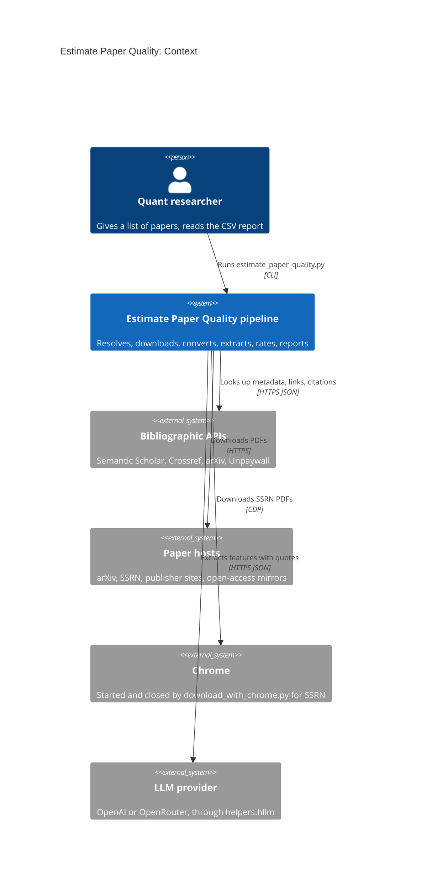
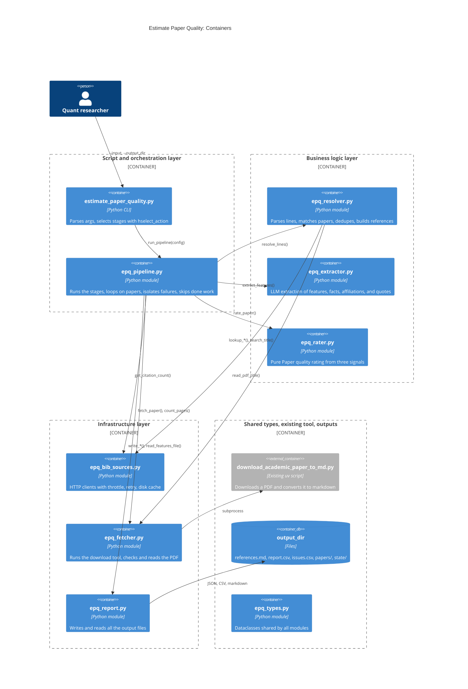

# Design: Architecture

## Goal

- Turn a loose list of papers into a CSV table of candidate trading strategies,
  with the full text and a set of extracted features per paper
- Where it fits: text file of papers from the user -> this pipeline -> CSV report
  that the quant researcher sorts to pick the next papers to replicate
- Requirements: `research/Estimate_academic_paper_quality/docs/prd.md`
- Decisions and alternatives, cited as `D-<N>`:
  `research/Estimate_academic_paper_quality/docs/decisions.md`
- Status: design only, no code exists yet
- Convention in all the design docs:
  - **Fact**: a statement about code that exists today, with its path
  - **Decision**: a choice of this design, with its `D-<N>` entry

## Diagram

### C1 (Context)

- The quant researcher runs one CLI script on a text file and reads the output dir
- The pipeline reads bibliographic facts and citation counts only from the lookup
  APIs, never from an LLM (PRD `R3`, `R16`)
- The LLM reads the markdown of each paper and returns the features, the facts, and
  the affiliations, each with a quote of the paper
- Chrome downloads the SSRN PDFs, since SSRN blocks scripted clients



### C2 (Container)

- One script, six modules of the project, one shared module of types, and the
  existing download tool
- Arrows are imports or calls: each one points down a layer, never up



## Files and Import Graph

- All code lives flat in `research/Estimate_academic_paper_quality/`, tests in
  `research/Estimate_academic_paper_quality/test/` (D-22)

  | File                       | Component     | Layer                     |
  | :------------------------- | :------------ | :------------------------ |
  | `estimate_paper_quality.py` | `pipeline`   | Script                    |
  | `epq_pipeline.py`          | `pipeline`    | Orchestration             |
  | `epq_resolver.py`          | `resolver`    | Business logic            |
  | `epq_extractor.py`         | `extractor`   | Business logic            |
  | `epq_extractor.prompt.md`  | `extractor`   | Data: the system prompt   |
  | `epq_rater.py`             | `rater`       | Business logic            |
  | `affiliation_tiers.yaml`   | `rater`       | Data: dated tier list     |
  | `epq_bib_sources.py`       | `bib_sources` | Infrastructure            |
  | `epq_fetcher.py`           | `fetcher`     | Infrastructure            |
  | `epq_report.py`            | `report`      | Infrastructure            |
  | `epq_types.py`             | shared        | Data model, no logic      |

- Allowed imports, checked by a test of the import graph:
  - `estimate_paper_quality.py` imports `epq_pipeline`
  - `epq_pipeline` imports every `epq_*` module
  - `epq_resolver` imports `epq_bib_sources`, `epq_fetcher`, `epq_types`
  - `epq_extractor`, `epq_rater`, `epq_report` import only `epq_types`
  - `epq_bib_sources`, `epq_fetcher` import only `epq_types` and `helpers`
  - `epq_types` imports nothing of the project
- External code that the design reuses:
  - **Fact**: `helpers_root/dev_scripts_helpers/download/download_academic_paper_to_md.py`
    downloads from arXiv, DOI, SSRN (through Chrome), a URL, or a local PDF, and
    converts the PDF to markdown with `convert_pdf_to_md.py`
  - **Fact**: `helpers_root/dev_scripts_helpers/download/download_utils.py` has
    `detect_doi()` and `get_ssrn_id()`
  - **Fact**: `helpers_root/helpers/hselect_action.py` selects the stages
  - **Fact**: `helpers_root/helpers/hllm.py` has `get_structured_completion()`, which
    parses the answer of the LLM into a given type, and
    `helpers_root/helpers/hllm_cost.py` has `LLMCostTracker`
  - **Fact**: `helpers_root/helpers/hcache_simple.py` has the `simple_cache()`
    decorator and the `--cache_mode` switch `add_cache_control_arg()`
  - **Decision**: move the private `_format_base_filename()` of the download tool to
    a public `download_utils.format_base_filename()` (D-7)

## Data Model

- `epq_types.py` holds the dataclasses that cross a module boundary: all are frozen
  - `InputLine`: line number, text, kind, key, author hints (`resolver`)
  - `BibRecord`: one record of one lookup source (`bib_sources`)
  - `Paper`: a resolved, deduped paper with its reference, base name, and download
    inputs (`resolver`)
  - `Issue`: an unresolved line or a failed paper, with stage, status, and reason
  - `Evidence`, `FeatureValue`, `LabeledFact`, `ExtractedFacts`: the output of
    `extractor`
  - `SignalScore`, `QualityRating`: the output of `rater`
  - `PaperFeatures`: everything that goes into one features file
- Shape of the core types:
  ```python
  @dataclasses.dataclass(frozen=True)
  class Evidence:
      # Text of the paper, or the value given by an external source.
      quote: str
      # E.g., "Sec. 4.2, p. 17", "Table 3, p. 21", "Semantic Scholar".
      location: str
      # True if the quote was found in the text of the PDF.
      verified: bool

  @dataclasses.dataclass(frozen=True)
  class FeatureValue:
      # Free text as the paper states it, or "unknown".
      value: str
      evidence: Optional[Evidence]
  ```

## One Request End to End

- The user runs:
  ```bash
  > research/Estimate_academic_paper_quality/estimate_paper_quality.py \
      --input research/Estimate_academic_paper_quality/paper_list.md \
      --output_dir ~/papers/run_2026_10 \
      --email me@umd.edu
  ```
- `resolve`: `resolver` parses 22 lines, looks up each one, writes 20 `Paper` and 2
  `Issue` to `<output_dir>/state/`
- `download`: `fetcher` runs the download tool for each paper with no PDF and no
  markdown yet, and records the failures
- `extract`: for each converted paper with no features file yet, `extractor` calls
  the LLM once, `rater` rates the paper, and `report` writes
  `<output_dir>/papers/<BASE>.features.json`
- `report`: `report` writes `references.md`, `report.csv`, and `issues.csv` from the
  state files and the features files
- Rerun with 5 new lines: `resolve` hits the HTTP cache for the 22 old lines,
  `download` and `extract` skip the 20 old papers, so only the new papers cost
  network time and LLM tokens (`R11`, `R17`)

## Requirements Map

| Req   | Component                       | How                                                       |
| :---- | :------------------------------ | :-------------------------------------------------------- |
| `R1`  | `resolver`                      | `parse_line()` classifies the 6 kinds of line             |
| `R2`  | `resolver`, `report`            | `format_reference()`, written to `references.md`          |
| `R3`  | `resolver`, `bib_sources`       | Canonical record from Semantic Scholar, Crossref, arXiv   |
| `R4`  | `resolver`, `bib_sources`       | Ordered download inputs, or the ` ???` mark               |
| `R5`  | `resolver`, `pipeline`          | `Issue` with status `unresolved` or `ambiguous` and candidates |
| `R6`  | `resolver`                      | `paper_key()` merges lines of the same paper              |
| `R7`  | `resolver`, `report`            | `sort_papers()`: year down, then author, then title       |
| `R8`  | `fetcher`                       | Runs the download tool into `<output_dir>/papers/`        |
| `R9`  | `resolver`, `fetcher`           | `format_base_filename()`, passed as `--output`            |
| `R10` | `fetcher`, `pipeline`           | `FetchResult` with the reason, the loop goes on           |
| `R11` | `fetcher`                       | `is_fetched()`: skip when `.pdf` and `.md` exist          |
| `R12` | `extractor`, `rater`            | Five features from the LLM and the record, plus the rating |
| `R13` | `extractor`                     | `unknown` value, no score except the rating               |
| `R14` | `extractor`                     | Quote, section from the LLM, page from the PDF text       |
| `R15` | `extractor`                     | `ExtractedFacts` with every labeled Sharpe ratio          |
| `R16` | `rater`, `bib_sources`, `fetcher` | Page count, affiliation tier, Semantic Scholar citations |
| `R17` | `pipeline`, `report`            | Skip when the features file exists, unless `--force_extract` |
| `R18` | `report`                        | `report.csv`, one row per paper with a features file      |
| `R19` | `report`                        | `issues.csv` from the issues of every stage               |
| `R20` | `report`                        | `<BASE>.features.json` next to the PDF                    |

## Configuration, Interfaces, and Known Limits

- Configuration: CLI flags of `estimate_paper_quality.py`, see
  `research/Estimate_academic_paper_quality/docs/design.pipeline.md`
- Interfaces: one CLI script, one output dir
  - Layout of the output dir:
    ```
    <output_dir>/
      references.md            R2, R7
      report.csv               R18
      issues.csv               R19
      papers/
        <BASE>.pdf             R8
        <BASE>.md              R8
        <BASE>.features.json   R20
      state/
        papers.json            output of resolve
        issues.<stage>.json    issues of resolve, download, extract
        cache/                 HTTP response cache
    ```
- Environment:
  - Network access, and Chrome for SSRN (PRD constraints)
  - Docker, since the conversion runs a Dockerized prettier: the PRD does not list
    it (see `research/Estimate_academic_paper_quality/docs/design.fetcher.md`)
  - The key of the LLM provider, as `helpers.hllm` reads it
  - Optional `SEMANTIC_SCHOLAR_API_KEY`, for a higher rate limit
- Known limits:
  - Stages run one paper at a time: about 100 papers take about an hour, mostly LLM
    and Chrome time
  - The user must pass the same `--output_dir` on a rerun, since the state lives
    there (D-18)

## Deliberately Not Built

- Search for papers outside the input list, backtests, a total score, a ranking
  (PRD Non-Goals)
- Parallel downloads or LLM calls: sequential is simple, and SSRN needs one Chrome
- An evaluation harness for the success metrics: it needs labeled sets, see Open
  Questions

## Open Questions

1. Who labels the input list for Resolution accuracy and the 20 papers for
   Extraction accuracy, and where do the labels live?
2. Which LLM is the default: pick it after the Extraction accuracy test on the 20
   labeled papers, and log the cost per paper
