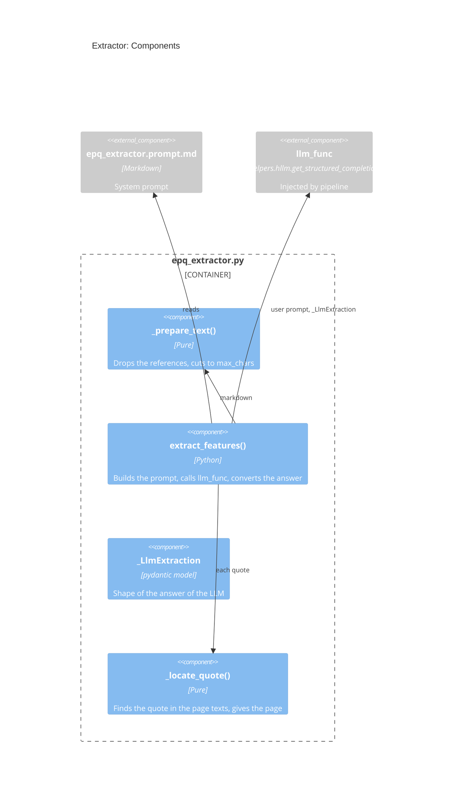

# Design: Extractor

## Goal

- Read the markdown of one paper and return, with one LLM call:
  - The features Performance, Asset class, Theoretical domain, and Mechanism, each
    with a value or `unknown` (PRD `R12`, `R13`)
  - The facts of `R15`: every labeled Sharpe ratio, annual return, volatility, max
    drawdown, sample period, universe, and data needs
  - The affiliations of the authors, for the rating of `rater` (`R16`)
  - A quote and a location for each value (`R14`)
- Check each quote against the text of the PDF and add the page number
- Where it fits: `pipeline` -> `extractor` -> LLM through an injected function
- Overview: `research/Estimate_academic_paper_quality/docs/design.architecture.md`
- Decisions: `research/Estimate_academic_paper_quality/docs/decisions.md`

## Diagram



## Files and Import Graph

- `research/Estimate_academic_paper_quality/epq_extractor.py`
- `research/Estimate_academic_paper_quality/epq_extractor.prompt.md`: the system
  prompt, in its own file so that a review sees each change
- Imports `epq_types` and `pydantic`; it does not import `helpers.hllm`, since
  `pipeline` injects the LLM function
- **Fact**: `helpers_root/helpers/hllm.py` `get_structured_completion(user_prompt,
  response_format, *, system_prompt, model, cost_tracker, ...)` returns the answer
  parsed into `response_format`, through OpenAI or OpenRouter
- **Fact**: the markdown of `fetcher` has no page markers (see
  `research/Estimate_academic_paper_quality/docs/design.fetcher.md`)
- **Decisions**:
  - One structured call per paper for all the values (D-11)
  - Page from the PDF text, and an unverified quote is kept but flagged (D-12)
  - Cut of a long paper (D-13)

## One Request End to End

- `extract_features(md_text, page_texts, *, llm_func, max_chars)`:
  - `_prepare_text()`:
    - Drops the reference list: from a heading `References` or `Bibliography` to
      the next heading of the same level, or to the end
    - If the text is still longer than `max_chars`: keeps the first 60% and the last
      40% of the budget, joined by `[... text cut ...]`, since finance papers often
      put their tables at the end
  - Calls `llm_func(user_prompt=text, response_format=_LlmExtraction,
    system_prompt=<prompt file>)`
  - The prompt asks the LLM to:
    - Copy each quote verbatim from the text, and name its section or table
    - Write `unknown` when the paper does not state a value, e.g., Performance of
      a survey or a method paper
    - Report every Sharpe ratio with the label of the paper (e.g., gross, net of
      costs, in sample, out of sample), with no conversion (e.g., no annualizing)
    - Give each author's top-level institution as written, and its kind:
      `university`, `research_institute`, `central_bank`, `company`, or `none`
    - Classify Theoretical domain (e.g., micro vs. macro) and Mechanism (causal vs.
      associational) as free text with the quote that supports it
  - Converts the answer into `epq_types`, and for each quote calls
    `_locate_quote(quote, page_texts)`
- `_locate_quote(quote, page_texts)`:
  - Normalizes both sides: NFKC (so a ligature glyph matches its letters),
    lowercase, joins words cut by a hyphen at a line end, one space between words
  - Returns the first page whose text contains the quote: the location becomes
    `<section>, p. <N>` and `verified=True`
  - Else returns the section of the LLM and `verified=False`
- Shape of the answer, private to the module:
  ```python
  class _LlmEvidence(pydantic.BaseModel):
      quote: str
      # E.g., "Sec. 4.2", "Table 3".
      section: str

  class _LlmFeature(pydantic.BaseModel):
      # Free text as the paper states it, or "unknown".
      value: str
      evidence: Optional[_LlmEvidence]

  class _LlmLabeledFact(pydantic.BaseModel):
      # E.g., "net of costs, out of sample, 2005 to 2020".
      label: str
      value: str
      evidence: _LlmEvidence

  class _LlmAffiliation(pydantic.BaseModel):
      author: str
      # Top-level institution as written, e.g., "Harvard University".
      institution: str
      # "university", "research_institute", "central_bank", "company", "none".
      kind: str
      evidence: _LlmEvidence

  class _LlmExtraction(pydantic.BaseModel):
      performance: _LlmFeature
      asset_class: _LlmFeature
      theoretical_domain: _LlmFeature
      mechanism: _LlmFeature
      sharpe_ratios: List[_LlmLabeledFact]
      annual_returns: List[_LlmLabeledFact]
      volatilities: List[_LlmLabeledFact]
      max_drawdowns: List[_LlmLabeledFact]
      sample_periods: List[_LlmLabeledFact]
      universe: _LlmFeature
      data_assets: _LlmFeature
      data_frequency: _LlmFeature
      data_fields: _LlmFeature
      affiliations: List[_LlmAffiliation]
  ```

## Configuration, Interfaces, and Known Limits

- Configuration: `max_chars` from `--max_chars` (default `300000`, about 75k
  tokens); the model from `--model`
- Interfaces:
  ```python
  # Same signature as `hllm.get_structured_completion()` once `model` and
  # `cost_tracker` are bound.
  LlmFunc = Callable[..., Any]

  def extract_features(
      md_text: str,
      page_texts: List[str],
      *,
      llm_func: LlmFunc,
      max_chars: int,
  ) -> epqtypes.ExtractionResult:
      """
      :return: features, facts, affiliations, and provenance (model, prompt
          SHA-1, chars sent, whether the text was cut)
      """
  ```
- Known limits:
  - A value read from a table drawn as an image is missing, since the markdown has
    no figures
  - A quote that the PDF text breaks in an odd way (e.g., two columns, a formula)
    stays `verified=False` even if it is right
  - Theoretical domain and Mechanism are judgments of the LLM: the quote lets the
    user check them

## Deliberately Not Built

- A second LLM call to check the first one: the quote check is cheaper and does not
  depend on the LLM
- A score for any feature (`R13`)
- A separate call per feature: it sends the paper many times, for no gain shown yet

## Open Questions

1. What share of the quotes stays `verified=False` on the 20 labeled papers: if it
   is high, add a fuzzy match to `_locate_quote()`
2. Should `report.csv` mark a value whose quote is `verified=False`?
