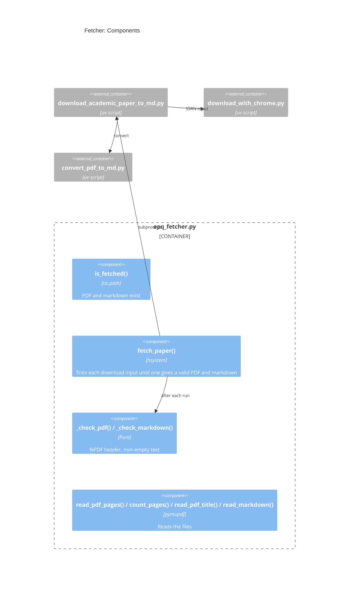

# Design: Fetcher

## Goal

- Own the files of each paper in `<output_dir>/papers/`
  - Create `<BASE>.pdf` and `<BASE>.md` with the existing download tool (PRD `R8`,
    `R9`)
  - Record why a download or a conversion fails, and go on (`R10`)
  - Skip a paper whose PDF and markdown exist (`R11`)
  - Read the PDF for the other components: page texts, page count, title of page 1
- Where it fits: `pipeline` -> `fetcher` -> `download_academic_paper_to_md.py`;
  `resolver` -> `fetcher` for the title of a local PDF
- Overview: `research/Estimate_academic_paper_quality/docs/design.architecture.md`
- Decisions: `research/Estimate_academic_paper_quality/docs/decisions.md`

## Diagram



## Files and Import Graph

- `research/Estimate_academic_paper_quality/epq_fetcher.py`
- Imports `epq_types`, `pymupdf`, `helpers.hsystem`, `helpers.hgit`
- **Fact**: the download tool
  `helpers_root/dev_scripts_helpers/download/download_academic_paper_to_md.py`:
  - Takes `--input` (a local PDF, an SSRN URL, a DOI, an arXiv URL, or a URL) and
    `--output <base path>`, and writes `<base path>.pdf` and `<base path>.md`
  - Runs `summarize` by default, which calls an LLM through OpenRouter
  - Downloads SSRN PDFs through Chrome with `download_with_chrome.py
    --launch_chrome`
  - Saves the body of any `200` answer as the PDF, with no check of the content
    type: a publisher landing page is saved as an HTML file named `.pdf`
  - Converts with `convert_pdf_to_md.py`, whose default actions are `convert`,
    `remove_junk`, and `lint`
- **Fact**: `remove_junk` deletes the `<!-- Page N -->` markers, so the markdown has
  no page numbers
- **Fact**: `lint` runs a Dockerized prettier, so the conversion needs Docker
- **Decisions**:
  - Run the tool as a subprocess, with `--skip_action summarize` (D-8)
  - Pass `--output` with the base name of `resolver` (D-7)
  - Check the `%PDF` header after a download (D-9)

## One Request End to End

- `fetch_paper(paper, papers_dir, *, log_dir)`:
  - No download input: returns `FetchResult(status="no_download_link",
    reason="no public PDF found")`
  - A valid `<BASE>.pdf` exists but no `<BASE>.md`: runs only the conversion, with
    `--clear_actions --action convert` and the PDF as `--input`
  - Else, for each download input in order:
    - Runs
      ```bash
      > download_academic_paper_to_md.py \
          --input "<download input>" \
          --output "<papers_dir>/<BASE>" \
          --skip_action summarize \
          --no_incremental \
          -v INFO
      ```
      with `abort_on_error=False`, and the log in `<log_dir>/<BASE>.download.log`
    - Non-zero exit: keeps the last non-empty line of the log as the reason, and
      tries the next input
    - `_check_pdf()` fails: deletes the file, keeps `not a PDF (HTML page?)`, and
      tries the next input
    - `_check_markdown()` fails (missing, or fewer than 500 chars, e.g., a scanned
      PDF with no text): returns `conversion_failed`
    - Success: returns `FetchResult(status="ok")`
  - All inputs fail: returns `download_failed`, with the reason of each input
- `read_pdf_pages(pdf_path)`: the text of each page with `page.get_text("text")`;
  `extractor` uses it to find the page of a quote (D-12)
- `count_pages(pdf_path)`: `len(pymupdf.open(pdf_path))`, all pages included, per
  `.claude/skills/paper.rules.md` `### Page Length`
- `read_pdf_title(pdf_path)`: the spans of page 1 with the largest font size,
  joined; else the `title` of the PDF metadata; else `""`

## Configuration, Interfaces, and Known Limits

- Configuration: `_MIN_MARKDOWN_CHARS = 500`; the path of the tool comes from
  `hgit.find_file_in_git_tree()`, like the tool finds its own helpers
- Interfaces:
  ```python
  def is_fetched(papers_dir: str, base_name: str) -> bool: ...

  def fetch_paper(
      paper: epqtypes.Paper, papers_dir: str, *, log_dir: str
  ) -> epqtypes.FetchResult: ...

  def read_markdown(md_path: str) -> str: ...
  def read_pdf_pages(pdf_path: str) -> List[str]: ...
  def count_pages(pdf_path: str) -> int: ...
  def read_pdf_title(pdf_path: str) -> str: ...
  ```
- Known limits:
  - Needs Chrome for SSRN and Docker for the `lint` step of the conversion
  - A PDF of the wrong paper (e.g., a mirror that serves another file) passes the
    checks
  - Figures are not extracted (default of the tool), so a table drawn as an image
    is not in the markdown

## Deliberately Not Built

- Bypass of paywalls or access controls (PRD Non-Goals)
- A check that the PDF is the right paper, e.g., by comparing the title of page 1
  with the reference: see Open Questions

## Open Questions

1. Should `_check_pdf()` also compare the title of page 1 with the title of the
   reference, and reject a PDF that does not match?
2. Should the download tool pass `--skip_action lint` to the converter, so the
   pipeline does not need Docker?
