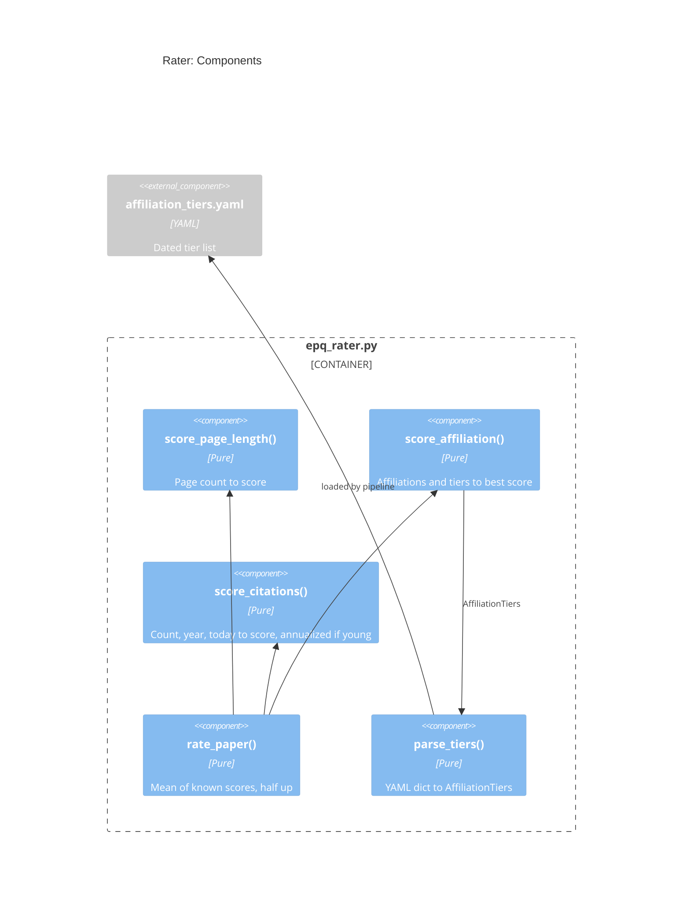

# Design: Rater

## Goal

- Compute the Paper quality rating of one paper from three signals, per
  `.claude/skills/paper.rules.md` `# Paper Rating` (PRD `R16`)
  - Score page length, best affiliation, and citations from 1 to 5, or `unknown`
  - Rate the paper with the mean of the known scores, rounded half up
  - Give the value, the score, and the evidence of each signal, and the source and
    date of the citation count
- Pure code: no network, no LLM, no file I/O
- Where it fits: `pipeline` -> `rater`; its inputs come from `fetcher` (page count),
  `extractor` (affiliations), and `bib_sources` (citation count)
- Overview: `research/Estimate_academic_paper_quality/docs/design.architecture.md`
- Decisions: `research/Estimate_academic_paper_quality/docs/decisions.md`

## Diagram



## Files and Import Graph

- `research/Estimate_academic_paper_quality/epq_rater.py`: imports only `epq_types`
  and the standard library
- `research/Estimate_academic_paper_quality/affiliation_tiers.yaml`: the dated tier
  list, loaded by `pipeline` and passed to `parse_tiers()`
- **Fact**: `.claude/skills/paper.rate/SKILL.md` rates one paper by hand with the
  same rules; this component applies them to a list (PRD Non-Goals)
- **Fact**: Python `round()` rounds half to even (`round(2.5) == 2`), so it breaks
  the rule "rounded half up"
- **Decisions**:
  - Affiliation tiers from a checked-in dated list; the LLM only reads the names
    (D-15)
  - Citations from Semantic Scholar only, else `unknown` (D-16)
  - Round half up with `math.floor(mean + 0.5)` (D-17)

## One Request End to End

- `rate_paper(inputs, tiers)`:
  - `score_page_length(n_pages)`, with the table of the rules:

    | Score | Pages        |
    | :---- | :----------- |
    | 5     | 35 or more   |
    | 4     | 20 to 34     |
    | 3     | 10 to 19     |
    | 2     | 5 to 9       |
    | 1     | fewer than 5 |

  - `score_affiliation(affiliations, tiers)`, for each author, then the best:
    - Normalize the institution: ASCII, lowercase, no punctuation, no leading
      `the`
    - Score 5 or 4 if the name or an alias of a tier entry is in the institution;
      the longest entry wins, so `University of California, Berkeley` does not
      match a shorter entry
    - Else score by the kind that the LLM read: `central_bank` 5,
      `university` or `research_institute` 3, `company` 2, `none` 1
    - No affiliation in the paper: 1, per the rules
    - The evidence is the quote of the best affiliation
  - `score_citations(citations, year, today)`:
    - `None`: `unknown`, with a note
    - Age is `today.year - year`, at least `0.5`
    - Age under 2: `count * 2 / age` before scoring, with a note
    - Bands: 5 for 1000 or more, 4 for 300 to 999, 3 for 50 to 299, 2 for 10 to 49,
      1 for fewer than 10
  - Rating: the mean of the known scores, `math.floor(mean + 0.5)`; no known score
    gives `unknown`
- Example: 12 pages (3), a top 20 university (5), 40 citations after 3 years (2):
  mean 3.33, rating 3
- Shape of the tier list (the entries are illustrative):
  ```yaml
  # Filled by hand from the QS site, never from the memory of an LLM.
  as_of: "2026-10-28"
  source: "QS World University Rankings 2026"
  tier_5:
    - name: "Massachusetts Institute of Technology"
      aliases: ["MIT"]
    - name: "National Bureau of Economic Research"
      aliases: ["NBER"]
    - name: "Google DeepMind"
  tier_4:
    - name: "AQR Capital Management"
  ```

## Configuration, Interfaces, and Known Limits

- Configuration: the score tables are constants copied from
  `.claude/skills/paper.rules.md`; a test checks them against the rules file
- Interfaces:
  ```python
  @dataclasses.dataclass(frozen=True)
  class RatingInputs:
      # None when the PDF cannot be read.
      n_pages: Optional[int]
      affiliations: List[epqtypes.Affiliation]
      citations: Optional[epqtypes.CitationCount]
      year: int
      today: datetime.date

  def parse_tiers(data: Dict[str, Any]) -> epqtypes.AffiliationTiers: ...

  def rate_paper(
      inputs: RatingInputs, tiers: epqtypes.AffiliationTiers
  ) -> epqtypes.QualityRating: ...
  ```
- Known limits:
  - The tier list ages: a new QS edition needs a hand update and a new `as_of`
  - A name that the paper writes in an unusual way (e.g., a department only)
    misses the list and scores 3
  - The kind `central_bank` is a reading of the LLM: the quote lets the user check
    it

## Deliberately Not Built

- A total score or a ranking of the papers (PRD Non-Goals)
- A refresh of the tier list from the QS site: it is a yearly hand task

## Open Questions

1. Who fills `affiliation_tiers.yaml` from the QS site, and which entries go in
   "established industry research group" (score 4)?
