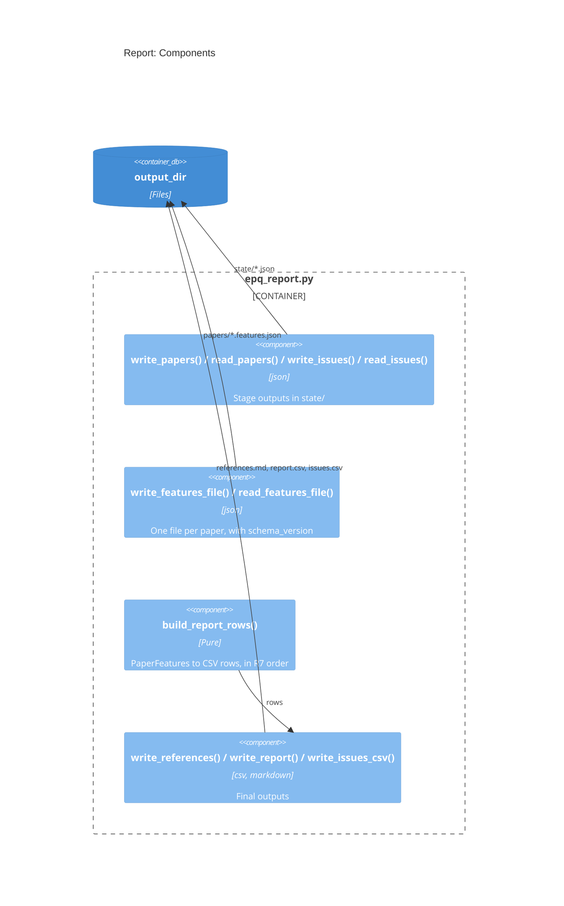

# Design: Report

## Goal

- Write and read every file that the pipeline keeps in `<output_dir>`
  - `references.md`: the normalized list of references (PRD `R2`, `R7`)
  - `report.csv`: one row per paper with a features file (`R18`)
  - `issues.csv`: the unresolved lines and the failed papers, with the reason
    (`R19`)
  - `papers/<BASE>.features.json`: the features, the evidence, the facts, and the
    rating of one paper (`R20`), also the rerun cache of `extract` (`R17`)
  - `state/papers.json` and `state/issues.<stage>.json`: the outputs of the stages,
    so that each stage can run alone
- Where it fits: `pipeline` -> `report` -> files
- Overview: `research/Estimate_academic_paper_quality/docs/design.architecture.md`
- Decisions: `research/Estimate_academic_paper_quality/docs/decisions.md`

## Diagram



## Files and Import Graph

- `research/Estimate_academic_paper_quality/epq_report.py`: imports `epq_types`,
  `csv`, `json`, `dataclasses`
- **Fact**: `.claude/skills/references.rules.md` `# Format for General Text` gives
  the format of a reference and the reverse chronological order
- **Fact**: the download tool writes `<BASE>.short.md`, `<BASE>.structured.md`,
  `<BASE>.up_to_l<N>.md`, and `<BASE>.all.md`
- **Fact**: `.claude/skills/paper.rate/SKILL.md` writes `<BASE>.rating.md`
- The suffix `.features.json` collides with none of them
- **Decisions**:
  - The features file is JSON, read back by the pipeline (D-14)
  - `report.csv` has one row per paper with a features file; the other papers are
    in `issues.csv` (D-19)
  - The normalized list also goes to `references.md` (D-20)

## One Request End to End

- `run_report()` of `pipeline` calls, in order:
  - `read_papers(state_dir)`: the papers, already in `R7` order
  - `read_issues(state_dir)`: the issues of `resolve`, `download`, `extract`
  - `read_features_file()` for each paper that has one
  - `write_references(path, papers)`: one bullet per resolved paper, e.g.,
    ```markdown
    - 2020, Cohen et al., "Lazy Prices" (https://doi.org/<DOI> ???)
    ```
  - `write_report(path, build_report_rows(papers, features))`
  - `write_issues_csv(path, issues)`, by stage, then by line number
- Columns of `report.csv` (`R18`):

  | Column               | Content                                               |
  | :------------------- | :---------------------------------------------------- |
  | `reference`          | The reference of `R2`                                 |
  | `paper_quality`      | Rating 1 to 5, or `unknown`                           |
  | `performance`        | Free text, or `unknown`                               |
  | `recency`            | Publication year                                      |
  | `asset_class`        | Free text, or `unknown`                               |
  | `theoretical_domain` | Free text, or `unknown`                               |
  | `mechanism`          | Free text, or `unknown`                               |
  | `page_length_score`  | 1 to 5, or `unknown`                                  |
  | `affiliation_score`  | 1 to 5, or `unknown`                                  |
  | `citations_score`    | 1 to 5, or `unknown`                                  |
  | `base_name`          | `<BASE>`, to open the PDF and the features file       |

- Columns of `issues.csv` (`R19`): `line_no`, `input`, `base_name`, `stage`,
  `status`, `reason`, `candidates` (joined by ` | `)
  - `status` is one of `unresolved`, `ambiguous`, `no_download_link`,
    `download_failed`, `conversion_failed`, `extraction_failed`
- Shape of a features file (values are illustrative):
  ```json
  {
    "schema_version": 1,
    "base_name": "2020.Cohen_et_al.Lazy_Prices",
    "features": {
      "performance": {
        "value": "Sharpe 1.4, out of sample, 2005 to 2020",
        "evidence": {"quote": "...", "location": "Table 4, p. 21", "verified": true}
      },
      "recency": {
        "value": "2020",
        "evidence": {"quote": "2020", "location": "Semantic Scholar", "verified": true}
      }
    },
    "facts": {"sharpe_ratios": [], "sample_periods": [], "...": "..."},
    "quality": {
      "rating": 4,
      "citations": {
        "value": "512 (Semantic Scholar, 2026-10-28)", "score": 4, "evidence": null
      },
      "...": "..."
    },
    "provenance": {"model": "...", "prompt_sha1": "...", "cost_usd": 0.04}
  }
  ```

## Configuration, Interfaces, and Known Limits

- Configuration: `_SCHEMA_VERSION = 1`; CSV in UTF-8, with `csv.QUOTE_MINIMAL`
- Interfaces:
  ```python
  def write_features_file(path: str, features: epqtypes.PaperFeatures) -> None: ...
  def read_features_file(path: str) -> epqtypes.PaperFeatures: ...
  def build_report_rows(
      papers: List[epqtypes.Paper],
      features: Dict[str, epqtypes.PaperFeatures],
  ) -> List[Dict[str, str]]: ...
  def write_report(path: str, rows: List[Dict[str, str]]) -> None: ...
  def write_issues_csv(path: str, issues: List[epqtypes.Issue]) -> None: ...
  def write_references(path: str, papers: List[epqtypes.Paper]) -> None: ...
  ```
- Known limits:
  - A features file with an old `schema_version` fails to read: `pipeline` records
    an issue that asks for `--force_extract`
  - `report.csv` shows the values only: the evidence is in the features file

## Deliberately Not Built

- An HTML or spreadsheet view: the user sorts the CSV (PRD Non-Goals)
- A merge of user edits: the CSV is written again on each run

## Open Questions

None.
