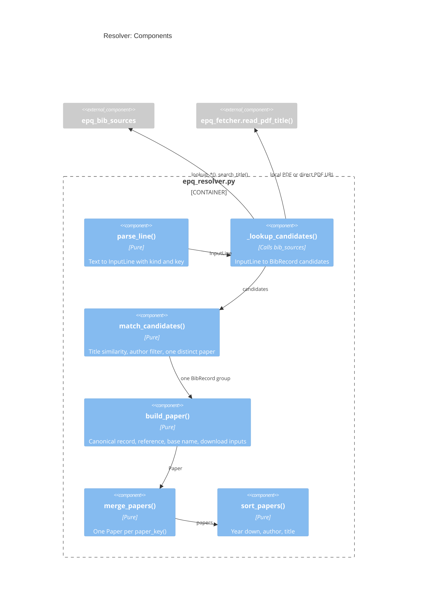

# Design: Resolver

## Goal

- Turn the lines of the input file into one deduped, sorted list of papers
  - Classify each line (PRD `R1`)
  - Match each line to exactly one paper of a bibliographic source, or mark it
    `unresolved` or `ambiguous` with its candidates (`R3`, `R5`)
  - Merge the lines of the same paper (`R6`)
  - Build the reference, the base name, and the ordered download inputs of each
    paper (`R2`, `R4`, `R9`)
  - Sort the papers in reverse chronological order (`R7`)
- Where it fits: `pipeline` -> `resolver` -> `bib_sources`
- Overview: `research/Estimate_academic_paper_quality/docs/design.architecture.md`
- Decisions: `research/Estimate_academic_paper_quality/docs/decisions.md`

## Diagram



## Files and Import Graph

- `research/Estimate_academic_paper_quality/epq_resolver.py`
- Imports `epq_bib_sources`, `epq_fetcher` (only `read_pdf_title()`), `epq_types`,
  and `dev_scripts_helpers.download.download_utils`
- **Fact**: `download_utils.detect_doi()` matches a DOI URL or a bare DOI, and
  `download_utils.get_ssrn_id()` matches an SSRN URL or an SSRN DOI
  `10.2139/ssrn.<id>`
- **Fact**: the download tool checks a local file first, then SSRN, then a DOI,
  then an arXiv ID, then a URL: `parse_line()` keeps this order, so both classify a
  line the same way
- **Fact**: the arXiv regex of the tool, `\d{4}\.\d{4,5}`, also matches inside a
  DOI (e.g., `10.1016/j.jfineco.2019.12345`): checking the DOI first avoids this
- **Fact**: the tool names a file with the private `_format_base_filename()`, which
  takes the last word of the first author (`Jackson, Jr.` gives `Jr.`) and keeps
  `.` and `,` in the title, against `.claude/skills/references.rules.md`
- **Decision**: move it to `download_utils.format_base_filename()`, take the family
  name, drop suffixes like `Jr.` and `III`, and replace `.` `,` `'` with `_` (D-7)

## One Request End to End

- `parse_line(line_no, text)`, the first match wins:

  | Kind        | Test                                                  | Key                |
  | :---------- | :---------------------------------------------------- | :----------------- |
  | skip        | Empty, or starts with `#` or `//`                     | none               |
  | `local_pdf` | `os.path.isfile()` after `~` expansion, ends `.pdf`   | Absolute path      |
  | `ssrn`      | `get_ssrn_id()` is not empty                          | SSRN id            |
  | `doi`       | `detect_doi()` is not `None`                          | DOI                |
  | `arxiv`     | `arxiv.org/abs/` or `/pdf/` URL, or a bare new-style id | arXiv id         |
  | `url`       | Starts with `http://` or `https://`                   | URL                |
  | `title`     | Anything else                                         | Title text         |

  - A `title` line ending with `(...)` gives the author hints: the text in the
    parentheses, split on `;` or `,` (format of
    `research/Estimate_academic_paper_quality/paper_list.md`)
- `_lookup_candidates(input_line)`, by kind:

  | Kind        | Lookups                                                          |
  | :---------- | :--------------------------------------------------------------- |
  | `arxiv`     | arXiv by id, Semantic Scholar `ARXIV:<id>`                       |
  | `doi`       | Semantic Scholar `DOI:<doi>`, Crossref by DOI                    |
  | `ssrn`      | Crossref and Semantic Scholar by DOI `10.2139/ssrn.<id>`         |
  | `url`       | HTML: `citation_doi` or `citation_title` meta tag, then as above; PDF: title of page 1, then as `title` |
  | `local_pdf` | `epq_fetcher.read_pdf_title()`, then as `title`                  |
  | `title`     | Semantic Scholar search (top 5), Crossref `query.bibliographic` (top 5) |

- `match_candidates(query, author_hints, candidates)` (D-3):
  - Normalize the titles: ASCII, lowercase, no punctuation, single spaces
  - Similarity: `1.0` if equal, `0.95` if one is a prefix of the other (a partial
    title, or a missing subtitle), else `difflib.SequenceMatcher.ratio()`
  - Drop a candidate below `_MATCH_THRESHOLD = 0.9`
  - With author hints: drop a candidate that shares no last name with the hints
  - Group the rest by `paper_key()`: one group gives a match; zero gives
    `unresolved`; two or more give `ambiguous`, unless exactly one group has
    similarity `1.0`
  - An id lookup (`arxiv`, `doi`, `ssrn`) that returns a record is a match with no
    similarity test
  - An `Issue` lists up to 3 candidates as references
- `paper_key(record)` (D-2):
  - The normalized title plus the last name of the first author
  - The DOI, the arXiv id, and the Semantic Scholar id are aliases of the key, so
    a preprint and its journal version merge
- `build_paper(group, input_line)` (D-1, D-5, D-6):
  - Canonical record: the Semantic Scholar record, else the Crossref record of type
    `journal-article`, else any Crossref record, else the arXiv record
  - Year, first author, and title come only from the canonical record (`R3`)
  - Download inputs, in order, each kept only if known:
    1. The local PDF of the line
    2. The URL of the line
    3. `https://arxiv.org/pdf/<id>`
    4. The `openAccessPdf` of Semantic Scholar
    5. The `url_for_pdf` of Unpaywall, if `--email` is set
    6. The SSRN abstract URL, for a paper with an SSRN DOI
  - Reference: `<Year>, <Last name> [et al.], "<Title>" (<Link>)`, where the link is
    the first public download input
  - With no public download input: `(<DOI URL> ???)`, or `(???)` with no DOI (`R4`)
- `merge_papers(papers)`: lines with the same `paper_key()` give one `Paper` that
  keeps all the line numbers and the union of the download inputs (`R6`)
- `sort_papers(papers)`: year down, then last name of the first author, then title
  (`R7`)

## Configuration, Interfaces, and Known Limits

- Configuration: `_MATCH_THRESHOLD = 0.9`, `_MAX_CANDIDATES = 5`
- Interfaces:
  ```python
  def parse_line(line_no: int, text: str) -> Optional[epqtypes.InputLine]: ...

  def resolve_lines(
      lines: List[str], sources: epqbibso.BibSources
  ) -> epqtypes.ResolveResult:
      """
      :return: deduped, sorted papers and the issues of the lines
      """
  ```
- Known limits:
  - Old-style arXiv ids (e.g., `hep-th/9901001`) are not detected: they resolve as
    `title` only if the text has a title
  - A `url` line that points to a direct PDF is downloaded once to read its title,
    and once more by the download tool
  - A title of page 1 is the largest text of the page: a PDF with a cover page
    (e.g., a journal cover) can give a wrong title, which then often stays
    `unresolved`

## Deliberately Not Built

- Search by authors only, or by a free-text description
- An LLM to clean the lines: the lookup sources and the similarity test are enough,
  and `R3` forbids the LLM as a source of facts

## Open Questions

1. Is `_MATCH_THRESHOLD = 0.9` right: tune it on the labeled list of the
   Resolution accuracy metric
2. When a preprint and its journal version have different years, which year should
   the reference show: the canonical record decides today (D-1)
