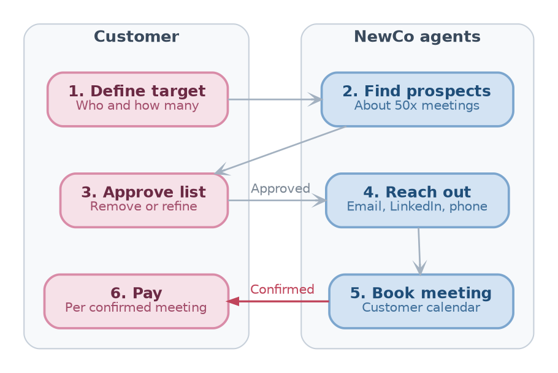
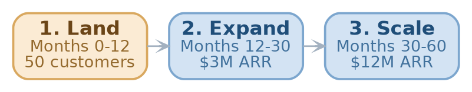
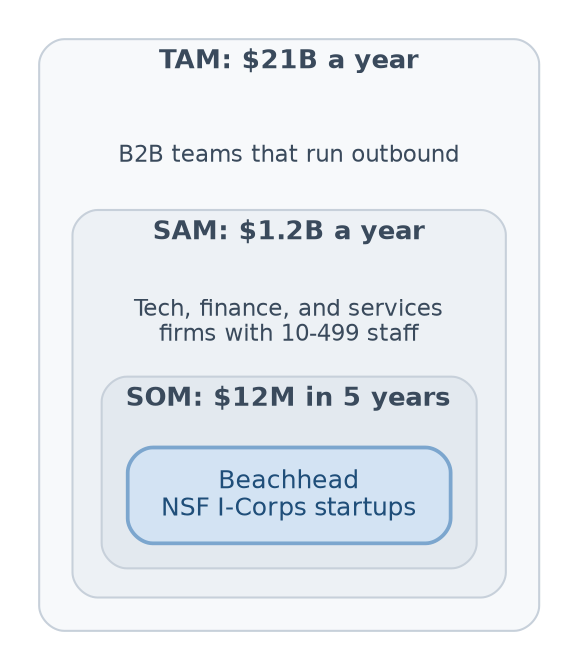

// type=UMD_slides
// course_title=NewCo: Investor Presentation
// lesson_title=Series Seed: Automating outreach for customers and investors with AI
// Authors=GP, Samarth, Vedanshu
// logo=assets/images/NewCo_logo_placeholder.png
// slides_engine=typst

# Elevator Pitch

* NewCo at a Glance

- @Problem@: Any company runs outreach to get meetings with customers, talent, and
  investors
  - Requires specialized expertise that companies don't have
  - Requires effort and it yields very low conversion rate

- @What@: NewCo use AI agents to find and book qualified sales meetings

- @Who pays@: founders and B2B sales teams who need meetings with customers,
  investors, and partners

- @Business model@: pay per _confirmed meeting_ in packs of 10, 50, or 100

- @Edge@: NewCo:
  - Provides meeting-as-a-service to customers so that they don't divert energy
    from core functions
  - Centralizes all the knowledge for finding and booking meetings using AI
  - Carries the cost of failed outreach attempts

- @Raising@: $1M Series Seed round to reach \$1M ARR in 18 months

# Problem and Solution

* Outbound Burns Time, Money, and is Risky for Customers

- @Problem@: Companies need to find and engage with
  - Customers to increase sales
  - Investors to raise money
  - Talent to fuel expansion
  - ...

- @Under 1% hit rate@: 0.45% of cold emails get a reply, 1 in 6,000 a meeting
  (Belkins, 2026)

- @28 hours a week@: reps spend 70% of their time not selling (Salesforce, 2024)

- @Complexities and risks@:
  - Spam flags hurt the domain (e.g., Google pauses accounts for days)
  - LinkedIn restricts profiles
  - Expensive datasets to buy (e.g., Pitchbook, Crunchbase)

- @Specialist work@:
  - Domain warm-up, inbox rotation, bounce control, and spam filters
  - Searching and matching profiles

* Pay Only for Meetings That Happen

- @Without NewCo@: teams stitch together tools (e.g., Sales Navigator,
  PhantomBuster, email finders, and mail merge)
  - Pay for every attempt
  - Need for specialized expertise that teams don't have
  - Inefficiency and lack of expertise bring email yield to < 1%

- @With NewCo@: the customer states who to meet and how many meetings,
  and NewCo finds them and books them on the customer's calendar

- @Advantages for Customers@
  - **Pay on outcome**: only confirmed meetings are billed, never emails sent
    or leads found

  - **Clean accounts**: all outreach runs on NewCo infrastructure, so customer
    domains stay safe

  - **Known cost**: the price per meeting is fixed before the campaign starts

* From Target Profile to Booked Meeting

::: columns
:::: {.column width=60%}
- @Customer in control@: approves every prospect before any outreach
  - E.g., For _"50 meetings with Heads of Growth at Series A US fintech startups"_,
    NewCo lists about 500 prospects to approve in batches

- @Agents do the work@: search LinkedIn, PitchBook, and Crunchbase, then
  email, message, and call

- @Calendar ready@: NewCo handles time zones and confirms attendance

- @Warm handoff@: the customer joins only once the meeting is confirmed
::::
:::: {.column width=40%}


// label=fig:product-flow
// caption=The six steps from target profile to paid meeting, with customer steps in rose and NewCo agent steps in blue.

::::
:::

* Why Now: Agents Got Cheap, Email Got Strict

// TODO(gp): Check the cost math : $80K OTE / 2,000 hours = $40/h, Sonnet 5.5 at $2 / $10 per MTok for 30K tokens in, 1.5K out
- **Agents can do the research**: work that takes a sales rep about 20 minutes
  (about \$13 of pay) costs under \$0.10 of AI tokens
  - Profile each prospect
  - Write a custom email per company

- **Email rules getting stricter**: since February 2024, Gmail requires senders of
  5,000+ emails a day to authenticate and stay under a 0.3% spam rate (Google, 2024)

// TODO(gp): Check the test date of the team prices : Hunter.io list prices (Oct
// 2026) match the range
- **Contact data is a commodity**:
  - E.g., \$0.016 to \$0.03 per email in team tests, \$0.015 to \$0.025 per
    credit at Hunter.io list prices
  - The problem is the "intelligence" now to find the signal in the data

* Pipeline Built and Running Since 2024

- **Track record**: this pipeline helped more than 60 UMD startups raise \$10M
  in seed funding and book more than 6,600 interviews

- **Commercial**: \<MEETINGS\> meetings booked, \<CUSTOMERS\> paying
  customers, \<LOIS\> letters of intent as of \<MONTH_YEAR\>

- **Live since June 2024**: in-house pipeline from Sales Navigator search to
  a custom email per company

- **5 data vendors benchmarked**: PhantomBuster, Hunter.io, Dropcontact,
  Snov.io, and Proxycurl on accuracy, speed, and price

// TODO(gp): Check which target lists are complete : the notes show them as tasks in progress
- **3 verticals targeted**: fintech, sports betting, and ERCOT energy

// TODO(gp): Check I-Corps participation and provide <INTERVIEWS> : only a doc title mentions I-Corps
- **NSF I-Corps**: \<INTERVIEWS\> customer discovery interviews

# Competitive Analysis

* Everyone Else Bills for Effort

// TODO(gp): Check agency domain risk : depends on the agency, some send from domains they set up for the client
// TODO(gp): Check AI SDR domain risk : 11x sets up and warms managed mailboxes, the domains still carry the customer brand
// TODO(gp): Check per-meeting agencies : Belkins (2024) quotes $50 to $500 per appointment, so the title is not true for all agencies
```{=typst}
#styled-table(
  headers: ("Option", "Customer pays for", "Finds prospects", "Who takes domain risk", "Books meeting"),
  rows: (
    ("Manual outreach", "Staff time", "By hand", "Customer", "By hand"),
    ("Hunter.io, Dropcontact, Snov.io", "Each email found", "Emails only", "Customer", "No"),
    ("Sales Navigator, PhantomBuster", "Seats, credits", "Yes", "Customer", "No"),
    ("AI SDRs (11x, Artisan)", "License, $36K+ a year", "Yes", "Shared", "Yes"),
    ("Appointment agencies", "Retainer, $2K-10K a month", "Yes", "Varies", "Yes"),
    ("NewCo", "Confirmed meeting", "AI agents", "NewCo", "Yes"),
  ),
  col-widths: (2fr, 1.4fr, 1fr, 1.1fr, 0.9fr),
  bold-first-col: true,
  width: 100%,
)
```

- **NewCo's edge**: paid only on outcome, while taking on the outreach work
  and the domain risk

// TODO(gp): Check the moat : proposed, the $50 cost per meeting is the estimate on the Pricing slide
- **Moat**: about \$50 per meeting with AI agents vs. \$670 with a human SDR,
  and reply data from every campaign sharpens targeting

* Pricing: \$250 per Confirmed Meeting

// TODO(gp): Check the price : proposed, inside the $150 to $500 market range and about 1/3 of in-house cost
- **Pricing**: \$250 per confirmed meeting, sold in packs of 10, 50, or 100
  - An in-house SDR costs about \$670 per meeting: \$80K median OTE for a
    quota of 10 held meetings a month (Bridge Group, 2025)

// TODO(gp): Check repeat buying : proposed target, no customer data yet
- **Repeat buying**: 3 packs of 10 per customer a year, about \$7,500

// TODO(gp): Check prospects per meeting : proposed 50 (0.5% of emails at 4 emails each), the product doc planned 10
// TODO(gp): Check cost per prospect : data $0.03 + AI $0.08 + inboxes $0.05 + Sales Navigator $0.04 = about $0.20
// TODO(gp): Check cost per meeting : 50 x $0.20 + $15 human review and scheduling + $5 tools, x 1.25 for unbilled no-shows, rounded up to $50
- **Cost driver**: cost per meeting = cost per prospect $\times$ prospects
  contacted per meeting, planned at \$0.20 $\times$ 50
  - Human review and scheduling dominate the cost, so margin stays near 70%
    even at 200 prospects per meeting

// TODO(gp): Check LTV / CAC : $200 gross profit x 30 meetings a year x 2-year life = $12K LTV, $2K CAC
- **Unit economics**
  ```{=typst}
  #styled-table(
    headers: ("Price per meeting", "Cost per meeting", "Gross margin", "LTV / CAC"),
    rows: (
      ("$250", "$50", "80%", "6x"),
    ),
    bold-first-col: false,
  )
  ```

# Target Market

* Land NSF I-Corps Startups, Then Expand

// TODO(gp): Check buyer, channel, and motion: chosen by AI, not in the input
// TODO(gp): Check customers and ARR : proposed, at $7,500 a customer a year, 50 customers = $375K, $3M = 400, $12M = 1,600 (the SOM)

::: columns
:::: {.column width=65%}
- **Beachhead**: NSF I-Corps startups, about 1,400 founded since 2011
  (NSF, 2023)
  - Sold to founders via email and LinkedIn, with a pilot pack of 10 meetings

- **Months 0-12**: win NSF I-Corps startups, reach 50 paying customers

- **Months 12-30**: expand to seed and Series A B2B startups via
  accelerators and VCs, reach \$3M ARR

- **Months 30-60**: scale to small B2B firms via self-serve checkout and CRM
  marketplaces, reach \$12M ARR

// TODO(gp): Check CAC : proposed, $2K / ($6K gross profit a year / 12) = 4 months
- **Target CAC**: \$2,000 per customer, paid back in 4 months
::::
:::: {.column width=35%}


// label=fig:gtm-phases
// caption=The three go-to-market phases from the beachhead to scale, with the beachhead in orange.

::::
:::


* A \$21B Market, Sized Bottom-Up

::: columns
:::: {.column width=60%}
- **TAM \$21B a year**: about 550K B2B teams in the US that run outbound
  $\times$ 120 meetings a year $\times$ \$325 per meeting
  - Inputs: 5.5M US firms (Census BDS), about 10 meetings per rep a month
    (FullEnrich), price range of \$150 to \$500 per booked meeting (Smartlead)

// TODO(gp): Check the SAM filter : NAICS 51 (17K) + 52 (28K) + 54 (112K) firms with 10-499 staff, at NewCo price and pack size
- **SAM \$1.2B a year**: 157K US tech, finance, and services firms with
  10-499 staff (Census SUSB) $\times$ 30 meetings $\times$ \$250

// TODO(gp): Check the SOM : proposed, matches the $12M ARR of the go-to-market plan
- **SOM \$12M in 5 years**: 1% of SAM, about 1,600 customers

// TODO(gp): Check the cross-check: the AI SDR category counts software only, so it is narrower than the TAM
- **Cross-check**: AI SDR software is \$4.12B in 2025, growing 29.5% a year
  (MarketsandMarkets)
::::
:::: {.column width=40%}


// label=fig:market-size
// caption=Nested TAM, SAM, and SOM, with the beachhead segment of the SOM in blue.

::::
:::

# Ask

* Team Behind the Pipeline

// TODO(gp): Check that GP Saggese is a founder and provide <ROLE> : the input names GP as CTO of Causify AI, not of NewCo
- **GP Saggese**, \<ROLE\>: CTO of Causify AI, teaches AI and machine
  learning at the University of Maryland

// TODO(gp): Provide <ROLE> and <CREDENTIAL> : the Project doc lists the name and email only
- **Vedanshu Joshi**, \<ROLE\>: \<CREDENTIAL\>

// TODO(gp): Provide <ROLE> and <CREDENTIAL> : the Project doc lists the name and email only
- **Samarth KaPatel**, \<ROLE\>: \<CREDENTIAL\>

* Raising \$1M for 18 Months

::: columns
:::: {.column width=60%}
// TODO(gp): Check the runway : proposed, $1M / 18 months = about $55K net burn a month
- **The round**: \$1M Series Seed, 18 months of runway

// TODO(gp): Check the milestones : proposed, 130 customers x 30 meetings a year x $250 = about $1M ARR
- **Milestones**
  1. 130 paying customers, 330 meetings a month
  2. Cost per meeting under \$50, gross margin over 80%
  3. \$1M ARR, ready for a Series A
::::
:::: {.column width=40%}
// TODO(gp): Check the use of funds split : proposed, sums to 100%
- **Use of funds**
  ```{=typst}
  #styled-table(
    headers: ("Area", "Share"),
    rows: (
      ("Product", "40%"),
      ("Infrastructure", "15%"),
      ("Sales", "30%"),
      ("Operations", "15%"),
    ),
    col-widths: (1.5fr, 1fr),
    bold-first-col: true,
  )
  ```
::::
:::

* Why Invest in NewCo

- **Common, costly problem**: every founder and sales team needs meetings, and cold
  outreach hits under 1%

- **Outcome pricing**: customers pay only for confirmed meetings

- **Right timing**: agents make research cheap while email rules punish
  careless senders

- **Working pipeline**: built and in use since 2024

- **The ask**: \$1M to reach \$1M ARR in 18 months

* Sources

- **Belkins**: _"What Are B2B Cold Email Response Rates? (2026 Study)"_,
  https://belkins.io/blog/cold-email-response-rates

- **Salesforce**: _"State of Sales"_, 6th ed. (2024),
  https://www.salesforce.com/news/stories/sales-ai-statistics-2024/

- **Bridge Group**: _"SDR Models, Metrics and Compensation"_ (2025),
  https://www.bridgegroupinc.com/research/2025-sdr-models-metrics-report-the-bridge-group

- **Anthropic**: _"Pricing"_ (2026), https://platform.claude.com/docs/en/about-claude/pricing

- **Google**: _"Email sender guidelines FAQ"_ (2024), https://support.google.com/a/answer/14229414

- **Hunter.io**: _"Pricing"_ (2026), https://hunter.io/pricing

- **11x**: _"Alice Pricing"_ (2026), https://www.11x.ai/products/alice/pricing

- **Belkins**: _"B2B Appointment Setting Costs"_ (2024),
  https://belkins.io/blog/appointment-setting-costs-pricing-models

* Sources (Continued)

- **NSF**: _"New NSF effort expands I-Corps Teams training program"_ (2023),
  https://www.nsf.gov/funding/initiatives/i-corps/updates/new-nsf-effort-expands-i-corpstm-teams-training-program

- **Census Bureau**: _"Business Dynamics Statistics"_ via YCharts (2022),
  https://ycharts.com/indicators/categories/nonfinancial_business_statistics

- **FullEnrich**: _"SDR Metrics"_, https://fullenrich.com/content/sdr-metrics

- **Smartlead**: _"What Is B2B Appointment Setting"_ (2026),
  https://www.smartlead.ai/blog/what-is-b2b-appointment-setting

- **Census Bureau**: _"Statistics of U.S. Businesses"_ (2022),
  https://www.census.gov/data/tables/2022/econ/susb/2022-susb-annual.html

- **MarketsandMarkets**: _"AI SDR Market: Global Forecast to 2030"_ (2025),
  https://www.marketsandmarkets.com/Market-Reports/ai-sdr-market-83561460.html

- **UMD startups**: internal slides on pipeline results,
  https://docs.google.com/presentation/d/1eVMExBQyzNP_JJnhJqvf9X7jkL9YK8Rn/edit#slide=id.p17
