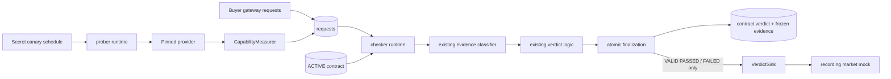

# `PR_S4`: Contract-window Runtime and Market-reporting Boundary

- This document specifies the remaining work in
  [issue #640](https://github.com/gpsaggese/gpsaggese.github.io/issues/640)
- Scope:
  - Close active contract evaluation windows from persisted buyer and canary
    evidence
  - Reuse the existing evidence, statistics, verdict, and persistence logic
  - Publish actionable verdicts through a mocked market-facing `VerdictSink`
- This PR is specification-only; runtime behavior is implemented by the linked
  follow-up PRs
- The implementation is intentionally split into smaller reviewable PRs and
  finishes with one runnable end-to-end demonstration

## Objective

The checker already knows how to classify one request, assess latency and quality,
compute a verdict, and persist final evidence. The missing layer decides when an
active contract has collected enough evidence, invokes those existing components,
and reports an actionable result toward the market.

The completed server-side flow is:

```text
ACTIVE contract
    -> buyer requests and scheduled canaries
    -> collection target or deadline
    -> frozen request evidence
    -> PASSED, FAILED, or INSUFFICIENT
    -> persisted verdict
    -> mocked market-facing report when actionable
```

The runtime must never convert an internal checker failure into a seller penalty.

## Current State

The following behavior already exists and is reused without duplication:

- `gateway/gateway_request_log.py` records provider calls with contract, seller,
  latency, status, canary grade, and attribution fields
- `checker/checker_evidence.py` separates seller evidence from buyer, gateway,
  attribution, and checker failures
- `checker/checker_statistics.py` computes exact and Wilson one-sided upper bounds
- `checker/checker_verdicts.py` returns explained `PASSED`, `FAILED`, or
  `INSUFFICIENT` decisions
- `checker/checker_store.py` loads contract observations and atomically freezes
  evidence, inserts one verdict, and changes the contract state
- `checker/checker_probe_schedule.py` builds secret deterministic probe schedules
- `prober/prober_runtime.py` executes and grades due probes through the normal
  contracted-provider path
- `prober/prober_worker.py` provides retry, shutdown, and an injectable clock

The remaining gap is orchestration and the market-reporting boundary. No new grader
or statistical test belongs in this work.

## Scope Boundaries

### In Scope

- Pure window-readiness logic
- One-contract evaluation orchestration
- One non-blocking pass over active contracts
- A typed `VerdictSink` interface and immutable report payload
- Reuse of the existing prober worker instead of adding a second worker loop
- Per-contract failure isolation and idempotent finalization
- Unit and PostgreSQL-backed integration tests
- Documentation of the completed runtime flow

### Out of Scope

- Creating or activating market contracts
- Implementing `PENDING -> ACTIVE`; real lifecycle activation belongs to `PR_M8`
- Auction matching, pricing, settlement, or balances
- Updating seller reputation, eligibility, cooldown, or probation; those belong to
  `PR_M3`
- Replacing the current confidence-bound logic; replay validation belongs to
  `PR_S6`
- Standalone model monitoring or model-nerfing detection
- A durable message queue, delivery outbox, dashboard, or external alert service

## Architecture Boundaries

The existing dependency direction must remain acyclic:

```text
gateway/  ---> common/
checker/  ---> common/ + gateway status constants
prober/   ---> checker/ + gateway/ + common/
market/   ---> no checker or prober imports
```

`checker/` therefore must not import `prober/` or `market/`.

- `checker/` owns readiness policy, verdict reporting types, evidence evaluation,
  and persistence orchestration
- `prober/` remains the thin coordination layer; its worker runs due probes and then
  invokes one checker closing pass
- `VerdictSink` is defined by the checker and injected by the composition layer
- The mocked sink used here records reports but does not import or mutate the market
- A later market adapter can implement the same sink without changing checker logic



No arrow connects the checker runtime directly to market state.

## Window-readiness Policy

Readiness answers only whether evidence collection should stop. It does not decide
whether the seller passed.

For one active contract:

```python
targets_reached = (
    eligible_buyer_count >= contract.target_requests
    and eligible_canary_count >= contract.target_canaries
)
deadline_reached = now >= contract.window_start + contract.maximum_seconds
ready = targets_reached or deadline_reached
```

- The early-close path requires both collection targets
- The deadline always makes the window ready, so a quiet contract cannot remain
  active forever
- `eligible_buyer_count` counts latency-eligible non-canary observations
- `eligible_canary_count` counts quality-eligible canary observations
- Buyer errors, gateway errors, spend refusals, and attribution mismatches do not
  satisfy collection targets
- Seller timeouts and upstream errors are eligible failure evidence
- Internal probe or grading failures do not satisfy a seller-evidence target

Collection targets and evidence minimums are different:

- Collection targets decide when an otherwise active window may close early
- `WindowPolicy.minimum_requests` and `minimum_canaries` decide whether the frozen
  evidence can support a verdict
- A deadline can therefore produce a valid verdict below the collection target when
  the evidence minimum is still met
- A deadline with too little evidence produces `INSUFFICIENT`

The MVP does not close early on the first conclusive failure. It continues until
both targets or the deadline so the stored record contains the planned evidence.

## Contract-start Boundary

The runtime accepts only a contract with:

- `state == ACTIVE`
- A timezone-aware `window_start`

It does not decide when a contract becomes active. The temporary development path
may continue creating an immediately active contract. `PR_M8` later owns the real
`PENDING -> ACTIVE` transition and the final production rule for setting
`window_start`.

An active contract without `window_start` is a configuration/checker error. It must
be reported operationally and must not produce a seller failure.

## Evaluation and Finalization Flow

For each active contract in stable ID order:

1. Load its immutable contract terms and current request observations
2. Build classified evidence using `checker_evidence.build_evidence()`
3. Count eligible buyer and canary observations
4. Return without mutation when the window is not ready
5. Compute the decision using `checker_verdicts.decide_verdict()`
6. Atomically lock and finalize the contract with `checker_store.finalize_contract()`
7. Publish an actionable report only when finalization returns `True`
8. Continue to later contracts if any one contract fails

The database transaction is the authority on whether finalization happened. Two
workers may evaluate the same snapshot, but only one may persist and publish it.

`CLOSED` is a logical phase inside guarded finalization rather than a separately
committed waiting state. This avoids leaving contracts permanently `CLOSED` if the
process crashes between closing and writing the verdict.

## Verdict Rules Reused by the Runtime

- A sufficiently sampled conclusive latency or quality failure produces `FAILED`
- Failure takes precedence when the other metric is insufficient
- `PASSED` requires sufficient, non-failing evidence for both metrics
- Missing evidence without a conclusive failure produces `INSUFFICIENT`
- Any checker-classification error produces `INSUFFICIENT` with disposition
  `CHECKER_UNHEALTHY`
- The runtime does not recalculate rates or confidence bounds

## `VerdictSink` Contract

The checker exposes a small asynchronous interface:

```python
class VerdictSink(Protocol):
    async def publish(self, report: VerdictReport) -> None:
        ...
```

The immutable report contains:

- Contract and seller identifiers
- Verdict and checker disposition
- Window start and end
- Latency successes, total, observed rate, upper bound, and promised rate
- Quality successes, total, observed rate, upper bound, and promised rate
- Reason codes and excluded-evidence counts
- Checker and canary-bank versions

Publishing rules:

- Persist every `PASSED`, `FAILED`, and `INSUFFICIENT` decision
- Publish only `VALID` `PASSED` or `FAILED` reports to the market-facing sink
- Never publish `INSUFFICIENT` or `CHECKER_UNHEALTHY` as a seller penalty
- Publish only after successful atomic finalization
- Do not publish when another worker already finalized the contract

The implementation PR uses a recording mock. Durable delivery, retry state, and the
real reputation consumer are deferred to `PR_M3`. A sink error is logged and returned
as an operational error; it does not change the persisted contract verdict.

## Proposed Code Changes

| File | Planned responsibility |
| :--- | :--------------------- |
| `checker/checker_models.py` | Immutable readiness, cycle, and report values |
| `checker/checker_windows.py` | Pure readiness and eligible-count logic |
| `checker/checker_sink.py` | `VerdictSink` protocol and recording test sink |
| `checker/checker_runtime.py` | One-contract evaluation and one closing pass |
| `checker/checker_store.py` | Only missing contract/evidence queries; retain atomic finalization |
| `prober/prober_worker.py` | Invoke the checker pass after due probes without a second loop |
| `checker/test/test_checker_windows.py` | Pure readiness boundary cases |
| `checker/test/test_checker_runtime.py` | Evaluation, isolation, idempotency, and sink behavior |
| `prober/test/test_prober_worker.py` | Probe-before-close order, fake clock, retry, and shutdown |

No new external Python dependency is required.

## Implementation PR Breakdown

Issue #640 remains one roadmap component, but the work is divided into this
specification and three sequential implementation PRs:

| Order | Scope | Tracking issue | Pull request | Review base |
| :---- | :---- | :------------- | :----------- | :---------- |
| 0 | Architecture and specification | #640 | #742 | `master` |
| 1 | Window and reporting contracts | #743 | #744 | `master` |
| 2 | Runtime and persistence orchestration | #746 | #747 | PR #744 branch |
| 3 | Worker integration and runnable demo | #748 | #749 | PR #747 branch |

Merge and review in that order. PRs #747 and #749 are stacked so each review
contains only its own conceptual change. They can be retargeted to `master` as
their parent PRs merge.

### Implementation PR 1: Window and Reporting Contracts (#744)

- Add immutable runtime/report models
- Add pure readiness and evidence-count functions
- Add the `VerdictSink` protocol and recording mock
- Add deterministic unit tests
- No database or worker changes

### Implementation PR 2: Runtime and Persistence Orchestration (#747)

- Add one-contract evaluation and one non-blocking active-contract pass
- Reuse existing evidence, verdict, and finalization functions
- Add per-contract error isolation and idempotency tests
- Add PostgreSQL-backed finalization tests
- No market implementation

### Implementation PR 3: Prober-worker Integration (#749)

- Run due probes before evaluating ready windows
- Reuse one clock, shutdown event, and retry boundary
- Verify the mocked market-facing payload
- Add an offline command that demonstrates healthy, slow, weak, and sparse
  contract windows through the real checker logic
- Update checker/prober READMEs, architecture, and progress docs
- Close issue #640 when all acceptance criteria are demonstrated

The PRs are sequential because each imports the public contracts from the previous
one. They must not be opened as independent implementations of the same logic.

## Runnable Demonstration

After PRs #742, #744, #747, and #749 are applied, activate the project virtual
environment and run from the repository root:

```bash
> research/Noesis/scripts/demo_contract_monitoring.py
```

The command uses the production worker composition, readiness rules, evidence
classifier, confidence-bound verdict engine, report builder, and
`RecordingVerdictSink`. OpenRouter and PostgreSQL are replaced with deterministic
in-memory boundaries so the command is free and requires no credentials or local
services.

The output demonstrates:

- healthy evidence -> persisted and published `PASSED`
- conclusively slow buyer evidence -> persisted and published `FAILED`
- conclusively incorrect canaries -> persisted and published `FAILED`
- sparse evidence at the deadline -> persisted `INSUFFICIENT`, not published

The complete command and expected output are documented in
`docs/run_contract_monitoring_demo.how_to_guide.md`, added by PR #749. The demo has
a golden-output regression test. PostgreSQL transaction behavior remains covered
by the real integration tests rather than the in-memory demonstration.

## Failure and Concurrency Behavior

- A failure while evaluating one contract is recorded in the cycle result and later
  contracts continue
- A database-level cycle failure is logged and retried by the existing worker
- Concurrent workers rely on guarded atomic finalization for exactly one persisted
  verdict
- Only the worker whose finalization succeeds calls the sink
- Internal checker errors become non-actionable `INSUFFICIENT` decisions
- Provider timeouts and upstream errors remain attributable seller failures
- Buyer, gateway, spend-cap, and attribution failures remain excluded
- Worker shutdown waits only for the currently bounded pass; it does not interrupt a
  database transaction halfway

## Test Matrix

| Scenario | Expected behavior |
| :------- | :---------------- |
| Before deadline, one target missing | Contract remains `ACTIVE` |
| Both collection targets reached | Window evaluates early |
| Deadline reached below targets | Window evaluates |
| Deadline with insufficient evidence | Persist `INSUFFICIENT`; do not publish |
| Healthy latency and quality | Persist and publish `PASSED` |
| Conclusive slow buyer traffic | Persist and publish `FAILED` |
| Conclusive incorrect canaries | Persist and publish `FAILED` |
| One metric fails and the other is sparse | Persist and publish `FAILED` |
| Buyer or gateway error | Exclude it from target and verdict evidence |
| Seller timeout or upstream error | Count it as failure evidence |
| Canary latency | Exclude it from buyer-latency evidence |
| Missing canary grade after an OK response | `CHECKER_UNHEALTHY`; do not publish |
| Two workers finalize one contract | One verdict and one sink call |
| First contract raises internally | Later contracts still run |
| Revisit a completed contract | No second verdict or sink call |
| Sink raises after finalization | Verdict remains durable; cycle reports error |

## Acceptance-criteria Mapping

- Contract windows collect buyer latency and canary quality evidence:
  existing request logging and prober persistence feed the new runtime
- Seller failures count and non-seller failures are excluded:
  reuse `checker_evidence.py` with integration fixtures
- Completed windows persist an explained verdict:
  reuse guarded `finalize_contract()` from one runtime path
- Checker errors do not penalize sellers:
  suppress sink publication for non-`VALID` and `INSUFFICIENT` outcomes
- Market-facing payload is verified:
  assert the complete immutable report through a recording mock

## Resolved Design Decisions

- Early closure uses eligible evidence rather than raw logged request counts.
- The market-facing sink receives only actionable `VALID` outcomes.
- Durable sink retry belongs with the real `PR_M3` consumer.
- The implementation uses the three sequential PR boundaries listed above.

## Result

- Specification: PR #742
- Pure readiness and report contracts: PR #744
- Atomic runtime and persistence orchestration: PR #747
- Worker integration and runnable demonstration: PR #749
- Verification on 2026-10-25: 82 checker, prober, demo, component-boundary, and
  PostgreSQL integration tests passed
- Remaining scope is intentionally outside #640: paid calibration, offline replay,
  and the real `PR_M3` reputation adapter

