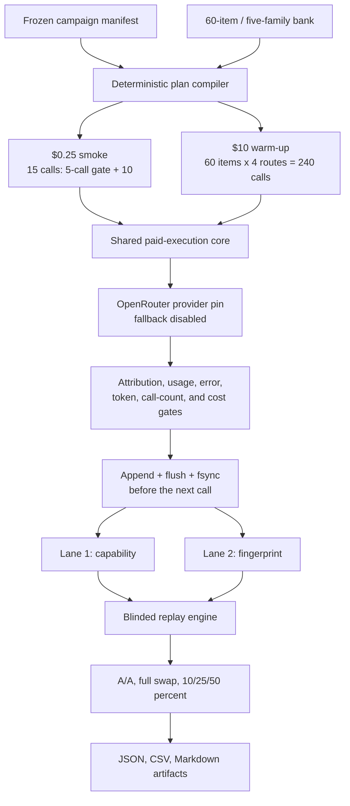

# Model-drift Phase 0 Architecture

## Scope

Phase 0 builds and validates a standalone research monitor. It does not write
orders, contracts, contract verdicts, or reputation. Synthetic and archived
replays validate implementation and estimate sensitivity; they do not prove
that a live provider has changed a model.

## Architecture

The collection boundary records the prompt-bank identity, requested route,
served provider/model, token counts, cost, latency, status, and raw completion.
Lane 1 and Lane 2 consume the resulting observations independently.

## Paid Stages

| Stage | Purpose | Exact plan | Bound |
| :---- | :------ | :--------- | :---- |
| Attribution smoke | Prove route pinning, served-route metadata, usage accounting, and durable writes before a material run | 5 Cloudflare 70B, 4 Cloudflare 8B, 3 Cloudflare 3B, and 3 CoreWeave 70B calls; the first five form a gate | 15 calls, 8 output tokens per call, $0.25 cap, $0.01 reserve per call |
| Controlled warm-up | Collect a balanced Lane 1 sample and exploratory inputs for later detector design | 12 prompts in each of five families crossed with all four routes, deterministically shuffled into four 60-call batches | 240 calls, 512 output tokens per call, $10 cap, $0.04 reserve per call |
| Live fingerprint pilot | Collect independent repeated draws for the Lane 2 A/A, full-swap, and partial-mixture tests | Five prompts x 12 samples in two Cloudflare 70B pools and one Cloudflare 8B pool, deterministically interleaved | 180 calls, 384 output tokens per call, temperature 1.0, $2 cap, $0.01 reserve per call |

All paid runners default to validation only. A live run requires all three of an
exported `OPENROUTER_API_KEY`, `--execute`, and the exact approved cap. The
key is read from the process environment and is never written to an artifact.

The $10 runner accepts only a reviewed JSONL bank with 60 unique items and
exactly 12 items from each approved family. It hashes the ordered prompts and
grader identities, writes that hash into the call plan, and then crosses the
bank with all four routes. The bank format is specified in
`model_drift_warmup_bank_schema.md`.

The live fingerprint runner uses a separately versioned five-prompt bank and
an additive campaign manifest so the completed warm-up manifest remains
reproducible. It collects two independent 70B pools and one 8B pool. A single
collection supports one live A/A test, one full-swap test, and seeded 10, 25,
and 50 percent mixtures. The mixture trials reuse the saved pools and therefore
measure conditional sensitivity, not independent statistical power.

## Decision Log

### Separate collection from evaluation

One completion can be capability-graded and fingerprint-tested without making
two provider calls. This lowers spend, keeps route attribution identical across
lanes, and permits graders and detectors to be rerun without changing evidence.

### Keep the two lanes independent

Lane 1 measures task success with deterministic graders. Lane 2 tests whether
the joint prompt/completion distribution changed. Neither is treated as a
contract verdict. Agreement is stronger research evidence; disagreement is a
diagnostic result rather than something to average away.

### Use a frozen campaign manifest

Routes, precision labels, prompt-bank composition, statistical parameters,
budgets, and stop conditions are serialized and hashed before a campaign. A
change creates a new campaign identity rather than mutating an active one.

### Pin provider routes and disable fallback

The primary controlled routes are Cloudflare 70B, 8B, and 3B. CoreWeave fp16
70B is an independent-provider control. An answered request with missing or
unexpected attribution stops live collection because it cannot support the
intended comparison.

### Use independent A/A samples

The A/A control compares two independent response draws. Reusing the same
completion on both sides would create an artificially easy null control and
understate natural model stochasticity.

### Use exact-count partial substitutions

For a 60-response pool, a 25 percent intervention replaces exactly 15 rows.
The rows are balanced across prompts and selected with a versioned deterministic
seed. This removes mixture-size variance and prevents one prompt from receiving
a disproportionate share of the intervention.

### Keep planted truth evaluator-only

The replay engine returns detector-visible response pools separately from the
selected swap identifiers. The detector never receives scenario labels,
intervention timing, or selected row identifiers.

### Wrap the reference fingerprint implementation

The Model Equality Testing implementation is pinned to Git commit
`fd2ee24d75c9fef87debff8caefa0c04d4a5d374`. Noesis owns only a thin adapter
for character preprocessing and the Hamming-MMD permutation call. The research
repository is not vendored, and its large dataset is not downloaded by default.

### Default to no spend

Offline execution is the default. Live calls require an explicit execution
path, a reviewed call manifest, confirmed persistence, provider attribution,
and an exact command-line approval for the named budget stage.

### Share one safety core across both paid stages

The smoke and warm-up compile into the same immutable call type and use the
same sequential executor. This prevents the inexpensive gate and the larger
run from quietly acquiring different attribution, accounting, persistence, or
halt semantics.

### Use conservative per-call reserves

The smoke reserves $0.01 for every short call and the warm-up reserves $0.04
for every bounded call. The complete reserve must fit below the campaign cap
before execution begins. Route prices must still be rechecked immediately
before a live run because the local guard cannot replace the provider's own
billing controls.

## Evidence Ladder

1. Unit tests validate manifest identity, exact mixtures, blinding boundaries,
   and artifact schemas.
2. Synthetic controls validate end-to-end experiment wiring only.
3. Archived Model Equality Testing samples reproduce a published comparison.
4. A bounded provider-pinned smoke test validates attribution and accounting.
5. A controlled live campaign estimates detection behavior on Noesis prompts.
6. Longitudinal monitoring starts only after A/A stability is established.

Each report states which rung it reached. Results from one rung are not phrased
as evidence from a higher rung.

## Live Stop Conditions

Collection halts before another call after any of the following:

- requested and served route attribution differs or cannot be confirmed;
- the call count, token limit, or approved dollar cap would be exceeded;
- two timeouts occur;
- two consecutive provider errors occur;
- the cumulative error rate exceeds 20 percent;
- a grader crashes;
- an observation cannot be durably persisted;
- successful calls omit required cost or token metadata;
- the runner cannot confirm that collection has stopped.
