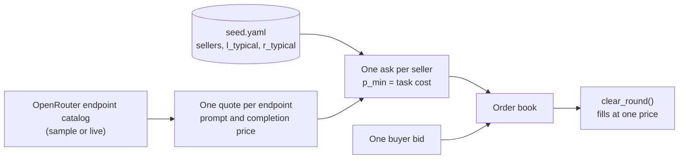

# Run the Market Supply Demo

- Purpose: demo the Noesis market supply subsystem, which turns OpenRouter's
  endpoint prices into one ask per seller and clears them against a bid
- The default run reads a checked-in catalog sample: no API key, no network, no
  charge

## What the Demo Shows



The component diagram is in `design.architecture.md`, under **Supply refresh flow**.

## 1. Prepare the Shell

Follow `onboarding.md` (environment and `PYTHONPATH`). Run the commands below
from the repository root.

## 2. Run on the Catalog Sample

```bash
> research/Noesis/scripts/demo_supply_asks.py
```

Expected output:

```text
1) OpenRouter quotes 11 endpoints for the model:
   deepinfra/turbo              prompt=1.000e-07 completion=3.200e-07 -> task=0.00018192 USD
   novita/bf16                  prompt=1.350e-07 completion=4.000e-07 -> task=0.00023740 USD
   akashml/fp8                  prompt=2.000e-07 completion=5.200e-07 -> task=0.00033312 USD
   parasail/fp8                 prompt=2.200e-07 completion=5.000e-07 -> task=0.00034800 USD
   cloudflare/fp8               prompt=2.930e-07 completion=2.253e-06 -> task=0.00086977 USD
   sambanova-turbo              prompt=4.500e-07 completion=9.000e-07 -> task=0.00068040 USD
   groq                         prompt=5.900e-07 completion=7.900e-07 -> task=0.00079224 USD
   coreweave/fp16               prompt=7.100e-07 completion=7.100e-07 -> task=0.00089176 USD
   google-vertex/us-central1    prompt=7.200e-07 completion=7.200e-07 -> task=0.00090432 USD
   google-vertex                prompt=7.200e-07 completion=7.200e-07 -> task=0.00090432 USD
   together                     prompt=1.040e-06 completion=1.040e-06 -> task=0.00130624 USD
2) Seed sellers (5) matched by endpoint tag:
   coreweave  tag=coreweave/fp16   l_typical=0.26s r_typical=1.0  quoted
   groq       tag=groq             l_typical=0.57s r_typical=1.0  quoted
   deepinfra  tag=deepinfra/turbo  l_typical=1.04s r_typical=1.0  quoted
   together   tag=together         l_typical=1.3s r_typical=1.0  quoted
   novita     tag=novita/bf16      l_typical=2.39s r_typical=1.0  quoted
3) Asks queued on the order book (5):
   coreweave  n_tasks=60 c_level=standard p_min=0.00089176
   groq       n_tasks=60 c_level=standard p_min=0.00079224
   deepinfra  n_tasks=60 c_level=standard p_min=0.00018192
   together   n_tasks=60 c_level=standard p_min=0.00130624
   novita     n_tasks=60 c_level=standard p_min=0.00023740
   second refresh in the same round queued 0 asks
4) Bid 50 tasks at p_max=0.001 -> clear_round():
   tier=standard clearing_price=0.00059096 unfilled_bid=0 unfilled_ask=250
   fill: buyer_demo <- deepinfra n_tasks=50 price=0.00059096
   pending asks after the round: 0
```

- The task price is the per-token price at the D1 caps (1,000 prompt and 256
  completion tokens); sellers are matched to endpoints by tag, and a seller whose
  tag is not in the catalog gets no ask
- The bid clears against the cheapest ask at one price; the book is empty after
  the round, so the next refresh re-posts the asks

## 3. Change the Terms

A buyer that pays at most 0.0002 per task only reaches the cheapest seller:

```bash
> research/Noesis/scripts/demo_supply_asks.py --bid_p_max 0.0002
```

```text
4) Bid 50 tasks at p_max=0.0002 -> clear_round():
   tier=standard clearing_price=0.00019096 unfilled_bid=0 unfilled_ask=250
   fill: buyer_demo <- deepinfra n_tasks=50 price=0.00019096
   pending asks after the round: 0
```

A bid larger than one ask fills across sellers, cheapest first:

```bash
> research/Noesis/scripts/demo_supply_asks.py --bid_n_tasks 150
```

```text
4) Bid 150 tasks at p_max=0.001 -> clear_round():
   tier=standard clearing_price=0.00089612 unfilled_bid=0 unfilled_ask=150
   fill: buyer_demo <- deepinfra n_tasks=60 price=0.00089612
   fill: buyer_demo <- novita n_tasks=60 price=0.00089612
   fill: buyer_demo <- groq n_tasks=30 price=0.00089612
   pending asks after the round: 0
```

## 4. Run on the Live Catalog

```bash
> research/Noesis/scripts/demo_supply_asks.py --live
```

Reads `OPENROUTER_API_KEY` from the environment or `research/Noesis/.env` (see
`onboarding.md`). The call is `GET /models/{model}/endpoints`: read-only, no
charge. The output has the same four sections; the first log line reads
`Catalog source: 'live'`, and prices reflect the current catalog.

## 5. Run the Tests

```bash
> pytest -q research/Noesis/market/test/test_supply_adapter.py \
    research/Noesis/noesis_platform/test/test_supply_feed.py \
    research/Noesis/scripts/test/test_demo_supply_asks.py
```

Expected result:

```text
17 passed
```

The tests use a fixture catalog and `httpx.MockTransport`: no network.
