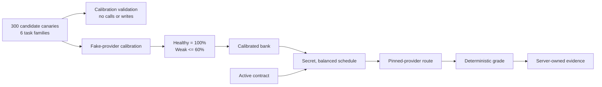

# Run the Model Quality of Service Demo

- Purpose: demonstrate how the Noesis model quality-of-service subsystem tests
  the quality delivered by providers
- The walkthrough covers canary calibration, scheduled probing, deterministic
  grading, and evidence persistence

## What the Demo Shows



The complete component diagram is in `design.architecture.md`, under
**Scheduled capability-measurement flow**.

## 1. Complete the Noesis Setup

Complete the setup in [`onboarding.md`](onboarding.md), then run the commands
below from the repository root with the Noesis Python environment activated.

## 2. Run the Automated Model QoS Demo

Run the focused tests for the production bank, fake-provider calibration, and
one probe through routing, grading, and request logging:

```bash
> pytest -q \
    research/Noesis/checker/test/test_checker_canaries.py::Test_production_canary_bank \
    research/Noesis/checker/test/test_checker_calibration_runtime.py::Test_execute_calibration \
    research/Noesis/prober/test/test_prober_runtime.py::Test_execute_probe
```

Expected result:

```text
6 passed
```

These six tests demonstrate that:

- The committed bank contains exactly 300 reproducible candidate canaries,
  balanced at 50 candidate canaries across each of six families.
- Every committed expected answer passes the versioned deterministic grader.
- Healthy fake targets pass while a weaker fake target fails, causing the
  candidate canary to survive calibration.
- A provider failure becomes incomplete evidence instead of an incorrect
  answer.
- A scheduled probe uses the normal pinned-provider route, and provider-visible
  messages contain no canary marker.
- A model-swap fault is applied, graded as incorrect, and recorded.

## 3. Preview the Live Calibration Plan

The `calibrate` command is validation-only unless `--execute` is present:

```bash
> research/Noesis/prober/prober_cli.py calibrate \
    --healthy groq=meta-llama/llama-3.3-70b-instruct \
    --healthy together=meta-llama/llama-3.3-70b-instruct \
    --weak deepinfra=meta-llama/llama-3.1-8b-instruct
```

Expected output:

```text
Calibration plan: 300 candidate canaries x 3 targets x 3 repetitions = 2700 paid provider calls
Validation only: no database writes or provider calls were made.
Review the plan, then repeat with --execute to run it.
```

This command loads and validates the complete bank and target configuration. It
does not open a database connection or call OpenRouter. The three targets are
examples and require review before execution.

## 4. Exercise PostgreSQL Persistence With Fake Providers

Start the local test database as described in
[`onboarding.md`](onboarding.md#3-setup-macos--linux), then run:

```bash
> pytest -q \
    research/Noesis/checker/test/test_checker_calibration_runtime.py::Test_run_calibration::test1 \
    research/Noesis/prober/test/test_prober_runtime.py::Test_run_due_probes::test2
```

Expected result when PostgreSQL is available:

```text
2 passed
```

The tests use fake providers. They demonstrate that a calibration run stores
every attempt and can activate a passing bank, and that a due probe is
atomically claimed, routed, graded, and attached to one persisted request. If
the test database is not available, the repository marks these tests as
skipped.

## 5. Inspect or Run Scheduled Probing

One real scheduler pass is:

```bash
> research/Noesis/prober/prober_cli.py probe --once
```

Expected output has this form:

```text
Probe cycle: executions=<number> errors=<number>
```

This command requires:

- `OPENROUTER_API_KEY`, `NOESIS_DATABASE_URL`, and
  `NOESIS_CANARY_SCHEDULE_SECRET`;
- an active calibrated bank; and
- at least one active contract with a due probe slot.

Each due probe can make a paid provider call. Omit `--once` only when operating
the recurring worker; stop it with Ctrl-C.

## 6. Execute Live Calibration

Adding `--execute` to the command in Section 3 makes all 2,700 planned provider
calls, persists the observations and decisions, applies the 150-survivor
activation gate, and replaces `docs/findings/calibration.md` with measured
results.

The resulting observations, activation decisions, and report are the evidence
used to establish the active canary bank. The measured run remains the
outstanding part of issue #639.

## Model Quality of Service Subsystem Boundaries

- Closing a completed contract window and sending its verdict to the market
- Updating seller reputation from repeated verdicts
- Detecting model degradation across successive time windows
- Dashboards and alerting

Those are downstream integrations that consume the evidence produced by the
model quality-of-service subsystem.
