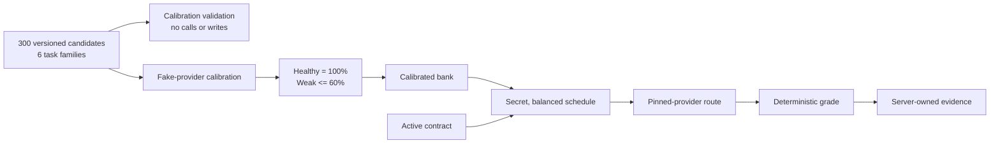

# Run the S11 Canary Calibration and Probing Demo

- Purpose: show the behavior added by `Noesis_PR_S11` without reading the full
  implementation
- Start from the repository root with the Noesis Python environment activated
- The default walkthrough uses fake providers and makes no network calls or
  provider charges

## What the Demo Shows



The complete component diagram is in `architecture.md`, under **Scheduled
capability-measurement flow**.

## 1. Prepare the Shell

Follow `onboarding.md` to install the dependencies, then export the repository
imports:

```bash
> export PYTHONPATH=$PWD/helpers_root:$PWD
```

The commands below must be run from the repository root. They never print or
require an API key unless a section explicitly says otherwise.

## 2. Run the Zero-Cost Reviewer Demo

Run the focused tests for the production bank, fake-provider calibration, and
one probe through routing, grading, and request logging:

```bash
> python3 -m pytest -q \
    research/Noesis/checker/test/test_checker_canaries.py::Test_production_canary_bank \
    research/Noesis/checker/test/test_checker_calibration_runtime.py::Test_execute_calibration \
    research/Noesis/prober/test/test_prober_runtime.py::Test_execute_probe
```

Expected result:

```text
6 passed
```

These six tests demonstrate that:

- The committed bank contains exactly 300 reproducible candidates, balanced at
  50 candidates across each of six families.
- Every committed expected answer passes the versioned deterministic grader.
- Healthy fake targets pass while a weaker fake target fails, causing the
  candidate to survive calibration.
- A provider failure becomes incomplete evidence instead of an incorrect
  answer.
- A scheduled probe uses the normal pinned-provider route, and provider-visible
  messages contain no canary marker.
- A model-swap fault is applied, graded as incorrect, and recorded.

## 3. Preview the Live Calibration Plan Without Spending Money

The `calibrate` command is validation-only unless `--execute` is present:

```bash
> python3 -m research.Noesis.prober.prober_cli calibrate \
    --healthy groq=meta-llama/llama-3.3-70b-instruct \
    --healthy together=meta-llama/llama-3.3-70b-instruct \
    --weak deepinfra=meta-llama/llama-3.1-8b-instruct
```

Expected output:

```text
Calibration plan: 300 candidates x 3 targets x 3 repetitions = 2700 paid provider calls
Validation only: no database writes or provider calls were made.
Review the plan, then repeat with --execute to run it.
```

This command loads and validates the complete bank and target configuration. It
does not open a database connection, call OpenRouter, or incur a charge. The
three targets are the proposed S11 targets and still require review before the
paid run.

## 4. Exercise PostgreSQL Persistence With Fake Providers

Start the local test database described in `onboarding.md`, then run:

```bash
> python3 -m pytest -q \
    research/Noesis/checker/test/test_checker_calibration_runtime.py::Test_run_calibration::test1 \
    research/Noesis/prober/test/test_prober_runtime.py::Test_run_due_probes::test2
```

Expected result when PostgreSQL is available:

```text
2 passed
```

The tests use fake providers, so they still make no network calls and incur no
charges. They demonstrate that a calibration run stores every attempt and can
activate a passing bank, and that a due probe is atomically claimed, routed,
graded, and attached to one persisted request. If the test database is not
available, the repository marks these tests as skipped.

## 5. Inspect or Run Scheduled Probing

One real scheduler pass is:

```bash
> python3 -m research.Noesis.prober.prober_cli probe --once
```

Expected output has this form:

```text
Probe cycle: executions=<number> errors=<number>
```

This is not part of the zero-cost reviewer demo. It requires:

- `OPENROUTER_API_KEY`, `NOESIS_DATABASE_URL`, and
  `NOESIS_CANARY_SCHEDULE_SECRET`;
- an active calibrated bank; and
- at least one active contract with a due probe slot.

Each due probe can make a paid provider call. Omit `--once` only when operating
the recurring worker; stop it with Ctrl-C.

## 6. Paid Calibration Is a Separate Reviewed Operation

Adding `--execute` to the command in Section 3 makes all 2,700 planned provider
calls, persists the observations and decisions, applies the 150-survivor
activation gate, and replaces `docs/findings/calibration.md` with measured
results.

Do not run it merely to review the PR. Before execution, review the healthy and
weak targets, available OpenRouter credit, database destination, concurrency,
and report path. This paid run remains the outstanding part of issue #639.

## What S11 Does Not Demonstrate

- Closing a completed contract window and sending its verdict to the market
- Updating seller reputation from repeated verdicts
- Detecting model degradation across successive time windows
- Dashboards and alerting

Those are downstream integrations rather than hidden work inside S11.
