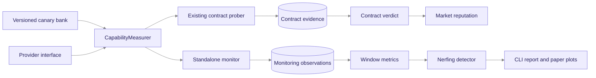

# `PR_S13`-`PR_S16`: Standalone Model-quality Monitoring - Implementation Spec

- This document specifies the standalone monitoring and model-nerfing work requested
  in [issue #684](https://github.com/gpsaggese/gpsaggese.github.io/issues/684)
- Scope:
  - Run Noesis probes without a market order or contract
  - Build a longitudinal record of model quality, availability, latency, and cost
  - Detect and demonstrate material model degradation
- Roadmap position:
  - Builds on `PR_S7`'s provider adapter and `PR_S11`'s capability-measurement tools
  - Does not block the contract checker in `PR_S4` and `PR_S6`
  - Produces evidence that can support a later market integration
  - Requires the reviewed paid calibration before real-provider results are treated
    as evidence, but fake-provider implementation can proceed independently
- This is a specification only: no monitoring runtime described below has been
  implemented

## Problem and Goal

- Existing probing is contract-oriented:
  - `prober_runtime.run_due_probes()` reads active contract windows
  - Probe slots are keyed by `contract_id`
  - Graded observations become contract evidence
- Issue #684 requires an independent monitor:
  - A configured provider and model can be observed without market activity
  - Measurements continue across hours, releases, and model changes
  - A provider cannot be penalized by an experimental monitor
- The goal is one reusable measurement stack with two orchestration paths:
  - Contract checking answers whether one seller fulfilled one contract
  - Standalone monitoring answers whether one provider/model series changed over time

## Current State

- Reusable capability-measurement assets already exist:
  - `checker/checker_canaries.py`: versioned bank validation and balanced selection
  - `checker/checker_grading.py`: deterministic answer normalization and grading
  - `checker/checker_capability.py`: pluggable `CapabilityMeasurer`
  - `checker/checker_calibration_runtime.py`: concurrent provider calibration
  - `gateway/gateway_providers.py`: provider-neutral `Provider` protocol
  - `gateway/gateway_fake_provider.py`: deterministic test provider
- Contract-specific orchestration also exists:
  - `checker/checker_probe_schedule.py`: schedules probes inside contract windows
  - `prober/prober_runtime.py`: claims contract probe slots and writes evidence
  - `prober/prober_worker.py`: repeats due-probe passes with retry and shutdown
  - `checker/checker_store.py`: stores calibration, contract evidence, and verdicts
- Missing behavior:
  - No monitoring target exists without a `contract_id`
  - No standalone run or observation schema exists
  - No model-level time series, baseline, change test, report, or experiment exists

## Design Decisions

### Keep Monitoring Outside the Market Flow

- Decision: the monitor receives an explicit provider/model target and never creates
  or mutates market orders, contracts, verdicts, or reputation
- Why:
  - Monitoring must run when the market has no live traffic
  - Experimental thresholds must not penalize sellers
  - A failure in monitoring must not stop buyer fulfillment
- Enforcement:
  - Monitoring tables do not use `contract_id`
  - Monitoring modules do not import `market/`
  - Tests fail if a market, verdict, or reputation collaborator is invoked
- Alternative: create synthetic contracts for every monitoring run
  - Rejected because synthetic contracts couple research traffic to market state

### Reuse Measurement, Separate Orchestration

- Decision: reuse the bank, grader, capability measurer, and provider interface
- Decision: add monitoring-specific scheduling, persistence, and reporting
- Why:
  - Reusing measurement keeps contract and standalone scores comparable
  - Separate orchestration prevents contract assumptions from leaking into the
    monitor
- Alternative: generalize `prober_runtime.run_due_probes()` immediately
  - Rejected because its contract routing and evidence rules are part of its public
    behavior

### Separate Monitoring Data From Contract Evidence

- Decision: add monitoring-run, monitoring-observation, and monitoring-window records
  rather than overloading checker evidence
- Minimum identities:
  - Series: `(provider, model_id, probe_set_version)`
  - Run: immutable execution identity and configuration snapshot
  - Observation: one provider call, grade, attribution, latency, tokens, and cost
  - Window: one non-overlapping aggregation interval and its metrics
- Why:
  - Contract evidence answers a seller-compliance question
  - Monitoring observations answer a longitudinal model-comparison question
  - Separate records prevent accidental reputation updates

### Require Explicit Live Execution

- Decision: commands validate configuration and print the planned call count by
  default; live provider calls require `--execute`
- Why:
  - Matches the safe calibration command
  - Prevents accidental spend during local review and CI
- CI uses `gateway_fake_provider.py`; live-provider tests remain opt-in

## Target Data Flow

- **Figure `standalone-monitor-boundary`**: measurement code is shared, while
  monitoring persistence and decisions remain separate from market state
- The shared measurement path ends before persistence and policy decisions
- The contract path keeps its existing market-facing behavior
- The standalone path ends at reports in `PR_S16`
- No arrow connects the standalone path to contract verdicts or reputation

## Window Metrics and Detection Contract

- Track non-overlapping windows for one exact series identity
- Compute per window:
  - Quality `q_hat`: correct grades divided by graded responses
  - Availability: non-error responses divided by attempted calls
  - Latency: p50 and p95 over returned responses
  - Token use: mean prompt and completion tokens per attempted task
  - `cost_per_task`: total billed cost divided by attempted tasks
  - `cost_per_correct_task`: total billed cost divided by correct tasks
- Return `INSUFFICIENT` when fewer than `n_min` graded responses exist
- Establish a baseline from pinned onboarding data or the first `K_base` sufficient
  windows
- Never compare across a changed `model_id` or `probe_set_version`
- Flag one window only when both conditions hold:
  - A one-sided quality-drop test has `p < delta`
  - `q_base - q_hat >= Delta_min`
- Return `NERFED` only after `k_consecutive` flagged windows
- Use a one-sided Fisher exact test as the initial method from the existing `PR_S13`
  plan
- Compare Fisher's test with sequential tests and change-point methods before
  treating the initial choice as final

## PR Breakdown

### `PR_S13`: Design and Boundaries

- Change:
  - Add this specification
  - Split the former single `PR_S13` scope into `PR_S13`-`PR_S16`
  - Record the independent-monitoring boundary in `decisions.md`
- Verification:
  - Documentation lint passes
  - No runtime file changes
- Risk: low

### `PR_S14`: Standalone Model Monitor MVP

- Add:
  - `monitor/monitor_models.py`: immutable targets, runs, and observations
  - `monitor/monitor_store.py`: monitoring-only persistence
  - `monitor/monitor_runtime.py`: one non-blocking execution pass
  - `monitor/monitor_cli.py`: validation and explicit live execution
  - `common/migrations/003_monitoring.sql`: standalone monitoring tables
  - Monitoring target and run models
  - Separate PostgreSQL tables for runs and observations
  - One non-blocking execution pass for a configured provider/model target
  - CLI validation mode and explicit `--execute` live mode
- Reuse:
  - `checker_canaries.load_canary_bank()` and balanced selection
  - `DeterministicBenchmarkMeasurer`
  - `Provider.call()` and the fake provider for tests
- Verify:
  - A fixed target and seed produce reproducible canary selection
  - One fake-provider run persists the expected grade, latency, tokens, and cost
  - No contract, verdict, reputation, or market collaborator is called
- Risk: medium because the schema and paid-call boundary are new

### `PR_S15`: Recurring Monitoring Windows and Metrics

- Add:
  - `monitor/monitor_schedule.py`: deterministic slots and call budgets
  - `monitor/monitor_worker.py`: retry and graceful shutdown
  - `monitor/monitor_metrics.py`: pure window aggregation
  - Monitoring-specific schedule and idempotent slot claims
  - Stoppable worker with bounded retries and a per-window call budget
  - Pure aggregation from immutable observations to closed-window metrics
  - Query and CLI output for completed windows
- Verify:
  - Concurrent workers cannot execute one slot twice
  - Sparse windows are `INSUFFICIENT`
  - Provider failures affect availability and do not stop later slots
  - Metric calculations match fixed fixtures
- Risk: medium because time and concurrency behavior require database tests

### `PR_S16`: Nerfing Detection, Reports, and Paper Evidence

- Add:
  - `monitor/monitor_detection.py`: pure baseline comparison and verdicts
  - `monitor/monitor_report.py`: CLI tables and reproducible plot inputs
  - Stored baselines scoped to the exact series identity
  - Pure quality-drop decision logic
  - CLI report and reproducible plots
  - Fixed-seed experiments for healthy, slowed, price-changed, and swapped models
  - Experimental findings and limitations in the probing paper
- Verify:
  - Healthy series stays `OK` at the selected false-alarm target
  - A weak-model swap reaches `NERFED` within the expected windows
  - A small quality change below `Delta_min` stays `OK`
  - A price-only change raises cost metrics without a `NERFED` verdict
  - A probe-set change starts a new baseline
- Risk: medium because thresholds must be justified by measured results

## Interaction with Existing Code

- Existing contract probing remains unchanged through `PR_S14`-`PR_S16`
- Shared code is limited to measurement primitives that have no market state
- `design.architecture.md` and the relevant module README are updated when each new
  runtime component lands
- Existing checker, prober, gateway, market, and platform tests remain regression
  gates for every implementation PR

## Configuration and Secrets

- Reuse:
  - `OPENROUTER_API_KEY` for explicit live calls
  - `NOESIS_DATABASE_URL` for persisted monitoring data
  - `NOESIS_CANARY_SCHEDULE_SECRET` for reproducible secret selection
- Add only after `PR_S14` names and defaults are reviewed:
  - Target provider/model configuration
  - Window duration and call budget
  - Detection thresholds
- Never store API keys or the schedule secret in monitoring records or reports

## Out of Scope

- Market orders, synthetic contracts, settlement, or pricing changes
- Writes to contract verdicts or seller reputation
- Automatic traffic blocking or provider failover after `NERFED`
- Dashboard and alert-delivery integrations
- Replacing deterministic grading with an LLM judge
- Claiming real-provider nerfing before a reviewed longitudinal run exists

## Open Questions for Review

- What live window length and call budget balance detection speed against provider
  spend after paid calibration establishes per-call cost
- Whether the baseline should use pinned onboarding data, the first sufficient
  windows, or both
- Whether a stable provider alias without a disclosed model snapshot should remain
  one series or force a manual re-baseline after a provider release
- Which alternative detection methods should be compared with Fisher's exact test in
  `papers/Noesis_Probing_Model_Quality/paper.pdf`

## Risks and Limitations

- A fixed public bank may become recognizable to providers
  - Later work can rotate bank versions or derive probes from buyer-like formats
- Provider aliases may change the backing model without exposing a new `model_id`
  - The monitor can detect a shift but cannot prove provider intent
- Time-of-day effects can confound release or model-swap effects
  - Reports must retain timestamps and compare matched time windows
- Multiple repeated tests increase false alarms
  - Consecutive-window and practical-effect requirements reduce this risk
- The monitor measures the selected probe distribution, not every buyer workload
  - Paper claims must stay scoped to the probe families and providers tested

## Result (to Fill in Once Implemented)

- Placeholder: record what each implementation PR built, deferred, and changed from
  this specification
