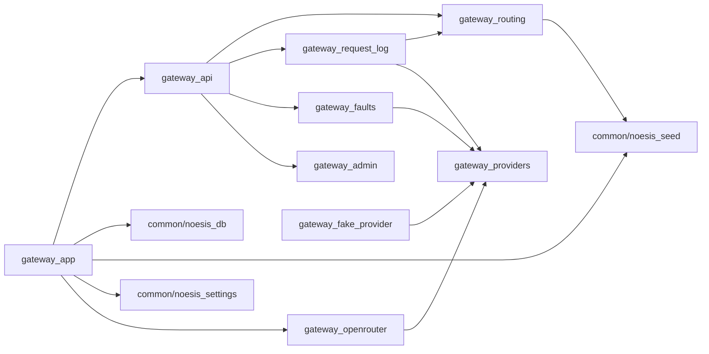

# Gateway

- OpenAI-compatible HTTP server: the MVP's `NoesisServer` front door
- Routes each request to the one provider its contract names, measures it, and logs
  every call for the checker
- Also holds `passthrough_proxy.py`, the legacy in-process proxy that only
  `noesis_platform/` imports
- Design, request flow, and blame rules: `docs/gateway_design.md`

## Structure of the Dir

| Dir     | Description                                                       |
| :------ | :---------------------------------------------------------------- |
| `test/` | Unit and end-to-end tests; `gateway_test_utils.py` runs the app in-process |

## Description of Files

| File                       | Description                                                          | Cluster   |
| :------------------------- | :------------------------------------------------------------------- | :-------- |
| `gateway_admin.py`         | `create_dev_contract()`: ACTIVE contracts by hand until the auction exists | Admin     |
| `gateway_api.py`           | HTTP endpoints: `/v1/chat/completions`, `/v1/models`, `/health`, admin | HTTP      |
| `gateway_app.py`           | App factory (startup: connect, migrate, seed), error handlers, real server | HTTP      |
| `gateway_fake_provider.py` | `FakeProvider`: scripted latency, failures, and answers for tests    | Providers |
| `gateway_faults.py`        | Demo fault injection: per-seller slowdown and model swap             | Faults    |
| `gateway_openrouter.py`    | `OpenRouterProvider`: pinned upstream, no fallbacks, real cost; blame rules | Providers |
| `gateway_providers.py`     | `Provider` interface, `ProviderCall` / `ProviderResult`, statuses    | Providers |
| `gateway_request_log.py`   | One `requests` row per provider call; attribution check              | Logging   |
| `gateway_routing.py`       | API key -> account; contract -> seller -> provider                   | Routing   |
| `passthrough_proxy.py`     | Legacy `Gateway`: in-process proxy with fake providers and a request log | Legacy    |

## Description of Executables

- Serve the gateway (setup in `docs/onboarding.md`)
  ```
  > uvicorn research.Noesis.gateway.gateway_app:build_default_app --factory --port 8000
  ```

## Description of Architecture

- `gateway/` imports `common/` only (`noesis_settings`, `noesis_db`, `noesis_seed`)



- Only `gateway_openrouter.py` knows about OpenRouter. Routing, logging, and faults
  only see the `Provider` interface, so a direct-provider adapter is a new file, not
  a rewrite
- `checker/checker_evidence.py` reads the status constants of `gateway_providers.py`
