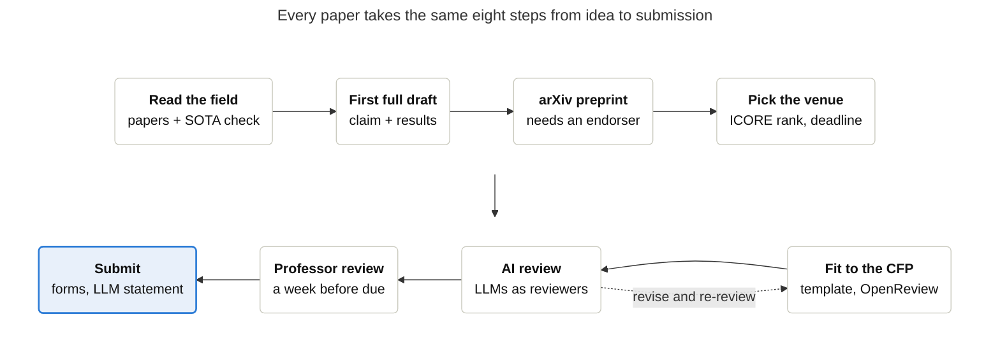

# Paper Publication Pipeline

We go from idea to submitted paper in eight steps. The draft goes through AI review rounds until it's clean, and only then goes to the professor. This doc covers each step, with links, so any team can follow it.

paper pipeline · 8 steps, 1 revise loop

## 1. Research and benchmark check

Before writing, confirm the idea is new and the numbers are competitive.

- **Read current work.** Check recent arXiv listings for your category (e.g. [cs.CV](https://arxiv.org/list/cs.CV/recent), [cs.LG](https://arxiv.org/list/cs.LG/recent)), [Google Scholar](https://scholar.google.com), [Semantic Scholar](https://www.semanticscholar.org) and [Hugging Face Papers](https://huggingface.co/papers/trending). Note the 5–10 closest papers; they become related work and baselines.

- **Check benchmarks.** Find the standard benchmarks and current SOTA for the task. Check [paperswithcode.co](https://paperswithcode.co) (this is one of the websites, you could have your own process or websites), with SOTA badges and benchmark results. Always take baseline numbers from the original papers, not from the leaderboard.

- **Decide the claim.** Write one sentence saying what the paper shows and on which benchmarks. If you can't, the work isn't ready yet.

## 2. Publish the preprint on arXiv

First-time submitters need an **endorsement** for their category. Since 21 Jan 2026, an institutional email alone no longer qualifies ([arXiv blog](https://blog.arxiv.org/2026)).

1.  Create an arXiv account and start a submission in your category (e.g. cs.CV). arXiv emails you an endorsement code.

2.  Ask an endorser. They must have authored enough papers in that category, submitted between 3 months and 5 years ago ([endorsement rules](https://info.arxiv.org/help/endorsement.html)). Ask a co-author or professor first. Otherwise, find a cited paper on arXiv and click "Which authors of this paper are endorsers?" on its abstract page. Email them.

3.  Upload the LaTeX source and pick a license. Postings appear after the next daily announcement.

4.  **Check the venue's preprint policy first.** CVPR allows arXiv posting. Interspeech has an anonymity period starting a month before its deadline ([example](https://interspeech2025.org/paper-submission)). After acceptance, post a v2 with the camera-ready version.

## 3. Choose the venue

Pick the highest-ranked venue whose topic fits and whose deadline you can meet with a finished paper.

- **Ratings.** Use the [ICORE (CORE) conference rankings](https://portal.core.edu.au/conf-ranks/) (A\* \> A \> B \> C; 2026 edition) and [Google Scholar Metrics h5-index](https://scholar.google.com/citations?view_op=top_venues&hl=en&vq=eng_artificialintelligence) for AI. For journals, use the Scholar Metrics subcategory pages.

- **Deadlines.** The Papers with Code deadlines page lives on as Hugging Face's [AI Deadlines](https://huggingface.co/spaces/huggingface/ai-deadlines) tracker. Use it to scan, then confirm every date on the venue's official Call for Papers. Deadlines are usually AoE (UTC−12).

- **Fit.** Read 3–4 accepted papers from the last edition on your topic. If ours would look out of place there, choose a different venue or a workshop.

## 4. Target venues and deadlines

The next open top-tier deadlines are ICML (22 Jan) and Interspeech (9 Feb); NeurIPS 2027 is expected around May.

| Venue                                                                                    | Area    | ICORE      | Next deadline (AoE)                       | Notes                                                               |
|------------------------------------------------------------------------------------------|---------|------------|-------------------------------------------|---------------------------------------------------------------------|
| [CVPR 2027](https://cvpr.thecvf.com/Conferences/2027/CallForPapers)                      | Vision  | A\*        | Closed 16 Nov 2026                        | Our paper: reviews 25 Jan, rebuttal to 1 Feb, decisions 25 Feb 2027 |
| [ICML 2027](https://icml.cc/Conferences/2027/ReciprocalReviewingAndSubmissionQuotas)     | ML      | A\*        | Abstract Jan 14, 2027, paper Jan 22, 2027 | Rio de Janeiro, 31 Jul–6 Aug                                        |
| [Interspeech 2027](https://www.opencurious.com/ai-conference-deadlines/interspeech-2027) | Speech  | see portal | Feb 9, 2027                               | São Paulo, 29 Aug–2 Sep; anonymity period applies                   |
| [ICCV 2027](https://iccv.thecvf.com/)                                                    | Vision  | A\*        | ~8 Mar 2027 (projected)                   | Hong Kong, 2–8 Oct; CFP not out yet                                 |
| [NeurIPS 2027](https://neurips.cc)                                                       | ML      | A\*        | ~May 2027 (not announced)                 | 2026 deadline was early May                                         |
| [ICLR](https://iclr.cc) / [AAAI](https://aaai.org) 2028                                  | ML / AI | A\*        | ~Sep / ~Jul 2027                          | 2027 rounds closed (16 Sep / 28 Jul 2026)                           |

**Journals** (rolling, no deadline): [TMLR](https://jmlr.org/tmlr/) (reviewed on OpenReview), JMLR, IEEE TPAMI, IJCV, and IEEE/ACM TASLP for speech. They're a good home for extended conference papers.

### Finding high-impact, selective journals

We want to target high-impact, highly selective journals.

#### Impact metrics

| Name | Website | What it gives you | Access |
|---|---|---|---|
| Journal Citation Reports | [jcr.clarivate.com](http://jcr.clarivate.com/) | Impact Factor, 5-year impact factor, JCI, quartiles | Subscription (often through your library) |
| Scopus Sources | [scopus.com/sources](http://scopus.com/sources) | CiteScore, SJR, SNIP, percentiles | Free to browse |
| SCImago Journal & Country Rank | [scimagojr.com](http://scimagojr.com/) | SJR, quartiles by field, h-index, trends | Free |
| CWTS Journal Indicators | [journalindicators.com](http://journalindicators.com/) | SNIP (field-normalized) | Free |
| Google Scholar Metrics | [scholar.google.com/citations?view_op=top_venues](http://scholar.google.com/citations?view_op=top_venues) | h5-index, h5-median by field | Free |
| Eigenfactor | [eigenfactor.org](http://eigenfactor.org/) | Eigenfactor, Article Influence | Free (older data) |
| OpenAlex | [openalex.org](http://openalex.org/) | Open citation data for building your own metrics | Free |

#### Selectivity

| Name | Website | What it gives you | Access |
|---|---|---|---|
| Elsevier Journal Insights | Each Elsevier journal's page ("Journal Insights" or "Journal metrics") | Acceptance rate, review speed | Free |
| Springer Nature / Wiley / Taylor & Francis | Each journal's homepage | Acceptance rate, days to first decision (on many journals) | Free |
| Elsevier JournalFinder | [journalfinder.elsevier.com](http://journalfinder.elsevier.com/) | Acceptance rates and turnaround times when you search by topic | Free |
| Springer Journal Suggester | [journalsuggester.springer.com](http://journalsuggester.springer.com/) | Acceptance rates and turnaround times when you search by topic | Free |
| APA Journal Statistics | [apa.org/pubs/journals/statistics](http://apa.org/pubs/journals/statistics) | Rejection rates for psychology journals | Free |
| Cabell's Journalytics | [cabells.com](http://cabells.com/) | Acceptance rates and review times across fields | Subscription |
| Journal "About" page or editor's annual report | The journal's own website | Submission and acceptance numbers | Free |

#### Legitimacy checks

| Name | Website | What it gives you | Access |
|---|---|---|---|
| Clarivate Master Journal List | [mjl.clarivate.com](http://mjl.clarivate.com/) | Whether a journal is indexed in Web of Science | Free |
| DOAJ | [doaj.org](http://doaj.org/) | A vetted list of open-access journals | Free |
| Think. Check. Submit. | [thinkchecksubmit.org](http://thinkchecksubmit.org/) | A checklist for spotting predatory journals | Free |

#### Field ranking lists

| Name | Website | What it gives you | Access |
|---|---|---|---|
| CABS Academic Journal Guide | [charteredabs.org](http://charteredabs.org/) | Business and management journal ratings (1–4\*) | Free with registration |
| ABDC Journal Quality List | [abdc.edu.au](http://abdc.edu.au/) | Business journal ratings (A\*–C) | Free |
| CORE Rankings | [portal.core.edu.au](http://portal.core.edu.au/) | Computing journal and conference ratings | Free |
| Norwegian Register | [kanalregister.hkdir.no](http://kanalregister.hkdir.no/) | Journal levels (Level 1 or 2) across all fields | Free |

## 5. Write, review, revise

Plan for about 3 weeks between the first full draft and the deadline, so there's time for two review rounds.

1.  **Set up for the venue.** Create your account on the venue site, then read its Call for Papers and Author Guidelines end to end. Note the page limit, template, anonymity rules, dual-submission policy, supplementary rules and LLM policy.

2.  **Write in the official template.** Use this order: abstract, intro with a contributions list, related work, method, experiments with ablations, limitations.

3.  **AI review round.** Give the draft to several assistants (Claude, ChatGPT, Gemini) with the venue's review form and ask for a harsh reviewer report. Fix what they agree on, then repeat once. Keep a note of how AI was used, because the LLM statement needs it.

4.  **Professor review.** Send the revised draft to the faculty co-authors with ample time before the deadline, then make their changes.

5.  **Final pass and submit.** Check anonymization (no names, acknowledgements or identifying repo links), references, the checklist and supplementary material. Submit at-least a day early; portals slow down near the deadline. Lower Submission numbers also gets you better reviewers so earlier the better.

6.  **After submission.** Do your assigned reviews, write the rebuttal, prepare the camera-ready version and update arXiv. (This usually comes to people with published papers or PhD in the field).

## 6. Submission checklist

At CVPR 2027, each item below is a desk-reject risk ([Author Guidelines](https://cvpr.thecvf.com/Conferences/2027/AuthorGuidelines)). Start it two weeks before the abstract deadline.

- **OpenReview profile for every author.** Each profile needs to be complete and publicly visible, with name, current position, education and career history, and publications imported from [DBLP](https://dblp.org). Profiles created without an institutional email go through moderation that can take up to two weeks ([CVPR CFP](https://cvpr.thecvf.com/Conferences/2027/CallForPapers), [profile guide](https://cvpr.thecvf.com/Conferences/2027/CompleteYourORProfile)).

- **[Author Enrollment](https://openreview.net/forum?id=MLDeuEmFJW) form,** completed by every author. It includes data-use and AI consent; incomplete enrollment means a desk reject.

- **[Reviewer Enrollment](https://openreview.net/forum?id=C8vusbVSXy) form.** All authors commit to review. A reviewer who misses review deadlines can have all their own papers desk-rejected ([Reviewer Guidelines](https://cvpr.thecvf.com/Conferences/2027/ReviewerGuidelines)).

- **Author list final at the abstract/enrollment deadline.** After it, authors can only be reordered, not added or removed.

- **Reciprocal reviewer.** CVPR and ICML 2027 cap each author at one paper with no eligible reciprocal reviewer (an author with a prior paper accepted at a major venue). Student-only teams should add a faculty co-author ([ICML quotas](https://icml.cc/Conferences/2027/ReciprocalReviewingAndSubmissionQuotas)).

- **LLM Usage Statement** in the submission. At CVPR 2027, leaving it out is grounds for desk rejection.

- **Anonymity and format:** no identifying links, correct template and page limit.