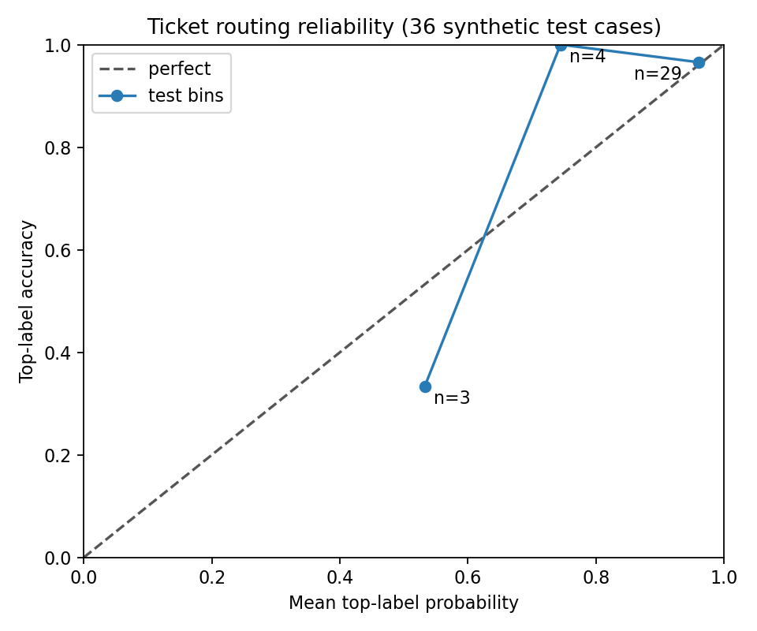
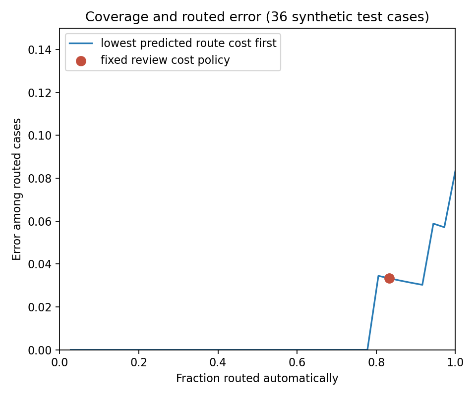

TL;DR: Ask a decision model typed questions, inspect its probabilities, and
choose actions using explicit costs in a runnable 60-minute tutorial.

<!-- more -->

## What Is a System One Decision Model?

Suppose a support ticket says, "My card was charged twice. Please refund the
second charge today." The useful output may be a route, a yes/no judgment
about the refund request, and an urgency rating. Each answer has a defined
type and probability. A prose answer would require another step to recover
those fields.

[Liquid d1-3B](https://huggingface.co/LiquidAI/d1-3B) is a purpose-built
decision model. Its `system_one` interface takes a **state** (the evidence)
and named **questions** (the decisions). It supports `noul` for yes/no,
`choice` for named options, and `score` for ordered levels. Our tutorial uses
the [Q8 GGUF checkpoint](https://huggingface.co/LiquidAI/d1-3B-GGUF) through
llama.cpp's typed `/v1/systemone` endpoint. General text-generating LLMs are
outside this exercise's model comparison.

The [project README](https://github.com/gpsaggese/gpsaggese.github.io/blob/master/research/Implement_System_One_Decision_Models/README.md)
pins the model file, checksum, server commit, and Python dependencies. The
paired [`system-one.API.ipynb`](https://github.com/gpsaggese/gpsaggese.github.io/blob/master/research/Implement_System_One_Decision_Models/system-one.API.ipynb)
and [`system-one.API.py`](https://github.com/gpsaggese/gpsaggese.github.io/blob/master/research/Implement_System_One_Decision_Models/system-one.API.py)
let you work cell by cell or run the lesson as a script. The 60-minute path
starts after the model and server have been installed.

| Time | What to do |
| :--- | :--- |
| 0-10 minutes | Connect to the running server and open the notebook |
| 10-25 minutes | Ask `noul`, `choice`, and `score` questions |
| 25-40 minutes | Inspect multiple answers and try a new schema |
| 40-60 minutes | Route tickets and compare two action policies |

## Ask a Typed Question

The notebook calls a small client that sends `POST /v1/systemone`. Here is a
complete choice request:

```python
from research.Implement_System_One_Decision_Models import system_one_API_utils as api

state = "Customer: My card was charged twice. Please refund the second charge today."
questions = {
    "route": {
        "type": "choice",
        "instructions": "Which team should handle this customer request?",
        "criteria": {
            "billing": "Payments and refunds",
            "shipping": "Delivery and tracking",
            "technical": "Product or account malfunction",
        },
    }
}
answer = api.SystemOneClient().system_one(state, questions)["answers"]["route"]
print(answer["choice"], answer["probabilities"])
```

In our recorded run, `billing` received 0.985 probability, `shipping` 0.005,
and `technical` 0.010, after rounding. The returned keys match the declared
options and the probabilities sum to one. The same state also produced 0.966
for the `noul` question "Does the customer explicitly request a refund?" A
four-level urgency `score` returned an expected level index of 2.064. The
[`probe_results.json`](https://github.com/gpsaggese/gpsaggese.github.io/blob/master/research/Implement_System_One_Decision_Models/probe_results.json)
file records the full values and requests.

You can ask all three questions in one request or change the choice schema
without retraining the client. The notebook also passes a JSON state and
creates a new four-option question. A probability is still an estimate:
normalization alone does not show that the model is calibrated on your data.

## Use Probabilities to Choose an Action

The application asks the same route question for 72 original synthetic
support tickets, with 36 fixed development cases and 36 held-out test cases.
Each split has 12 billing, 12 shipping, and 12 technical labels. The
[`tickets.csv`](https://github.com/gpsaggese/gpsaggese.github.io/blob/master/research/Implement_System_One_Decision_Models/data/tickets.csv)
file and its [provenance notes](https://github.com/gpsaggese/gpsaggese.github.io/blob/master/research/Implement_System_One_Decision_Models/data/README.md)
are included so the task is inspectable.

One policy always selects the most probable route. A second policy compares
expected action costs. Wrong routes cost 5 to 8 illustrative units depending
on the error; sending a ticket to a person costs 1.5 units. For action `a`
and true route `y`, the decision rule is:

$$
\operatorname{cost}(a\mid x) = \sum_y P(y\mid x)\,C(a,y).
$$

The policy chooses the action with the lowest estimated cost, including
`review`. These are example handling costs, not measured business dollars.
The exact table and prompt are fixed in
[`ticket_routing.py`](https://github.com/gpsaggese/gpsaggese.github.io/blob/master/research/Implement_System_One_Decision_Models/ticket_routing.py).
They were committed before the test split was run.

## What the Frozen Test Showed

On 36 synthetic test tickets, the top route matched 33 labels (91.7%). A
majority-route baseline matched 12 (33.3%). The multiclass Brier score was
0.0973, and negative log likelihood was 0.1793. The five-bin top-label
expected calibration error was 0.0488. The underlying probabilities and
metric code are in
[`test_predictions.json`](https://github.com/gpsaggese/gpsaggese.github.io/blob/master/research/Implement_System_One_Decision_Models/test_predictions.json)
and [`evaluate_routing.py`](https://github.com/gpsaggese/gpsaggese.github.io/blob/master/research/Implement_System_One_Decision_Models/evaluate_routing.py).

The reliability plot shows why the ECE needs caution: its three occupied
bins contain only 3, 4, and 29 cases. The plot cannot establish calibration
for a real support queue.



The cost policy reviewed 6 tickets and routed 30 automatically. One of those
30 routes was wrong, giving 83.3% coverage and 3.3% error among routed cases.
Its realized illustrative cost was 16 units across the test set, compared
with 19 units for always taking the top route. The coverage plot ranks cases
by their predicted route cost; the red point marks the fixed policy.



One error remains instructive. A ticket said the order page was stuck before
payment. Its hand label was `technical`, but the model assigned 0.863 to
`billing` and 0.126 to `technical`. The cost policy routed it to billing.
Human review helps only when the model's probabilities make review look
worthwhile.

## Limits and Next Experiment

These short tickets are synthetic, balanced, and hand labeled. A mixed-topic
ticket can have a debatable primary route. We cannot rule out overlap with
the model's undisclosed training examples, and Q8 probabilities can differ
from full precision. The measured accuracy, calibration summary, latency,
and action costs describe this one exercise. See the complete
[evaluation notes](https://github.com/gpsaggese/gpsaggese.github.io/blob/master/research/Implement_System_One_Decision_Models/evaluation/README.md).

A follow-up experiment can hold the tickets, labels, and model fixed while
changing only the decision schema: one multiclass question, several binary
questions, or a hierarchy. Mapping every answer back to the same outcome
space would let us measure how representation changes probability quality and
action cost.

## References

- [Liquid d1-3B model card](https://huggingface.co/LiquidAI/d1-3B)
- [Liquid d1-3B GGUF files](https://huggingface.co/LiquidAI/d1-3B-GGUF)
- [llama.cpp System One endpoint documentation](https://github.com/ggml-org/llama.cpp/blob/8956c769e8ababd9fbd89c81764f241d5f515d68/tools/server/README.md#post-v1systemone-typesafe-compatible-system-one-api)
