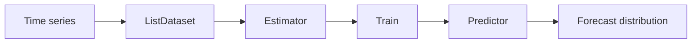

TL;DR: GluonTS is a Python toolkit for probabilistic time-series forecasting.
This tutorial starts with synthetic data, trains DeepAR, SimpleFeedForward, and
DeepNPTS models, and then walks through a historical COVID-19 case study. You
will learn how to read prediction intervals and evaluate forecasts without
treating one holdout result as a universal model ranking.

<!-- more -->

## What you will build

A point forecast gives one estimate for each future time step. A probabilistic
forecast gives a distribution of possible values, so you can inspect both a
central estimate and a range of outcomes.

This tutorial uses GluonTS to:

- prepare a time series as a `ListDataset`;
- train and compare three forecasting estimators;
- read forecast quantiles such as the 10th, 50th, and 90th percentiles;
- evaluate a 14-day forecast on historical COVID-19 data.

The code is pinned to the project environment, which uses
`gluonts[torch]==0.14.0`. The API may differ in newer releases. The complete
project, including Docker setup and notebooks, is in
[`tutorials/GluonTS_COVID19_Prediction`](https://github.com/gpsaggese/gpsaggese.github.io/tree/master/tutorials/GluonTS_COVID19_Prediction).

> **Scope:** The COVID-19 data ends in March 2023. This is a retrospective
> teaching example, not a current public-health forecasting system or policy
> recommendation.

## Start with synthetic data

The project takes a synthetic-data-first approach. In the
[API notebook](https://github.com/gpsaggese/gpsaggese.github.io/blob/master/tutorials/GluonTS_COVID19_Prediction/GluonTS.API.ipynb),
you first forecast a clean repeating signal, then a series with multiple
patterns, and finally a series with a regime change. Synthetic data makes it
easier to see what a model is learning before adding the reporting artifacts and
assumptions in a real dataset.

The core workflow is the same for each series:



Here is a small DeepAR example using a generated daily series. The test dataset
contains the full series; `make_evaluation_predictions` holds out the last
`prediction_length` values for evaluation.

```python
import numpy as np
from gluonts.dataset.common import ListDataset
from gluonts.evaluation import make_evaluation_predictions
from gluonts.torch.model.deepar import DeepAREstimator

rng = np.random.default_rng(42)
t = np.arange(365)
target = 50 + 10 * np.sin(2 * np.pi * t / 30) + rng.normal(0, 1, 365)

prediction_length = 30
train_ds = ListDataset(
    [{"start": "2020-01-01", "target": target[:-prediction_length]}],
    freq="D",
)
test_ds = ListDataset(
    [{"start": "2020-01-01", "target": target}],
    freq="D",
)

predictor = DeepAREstimator(
    freq="D",
    prediction_length=prediction_length,
    context_length=60,
    trainer_kwargs={"max_epochs": 5},
).train(train_ds)

forecast_it, actual_it = make_evaluation_predictions(
    dataset=test_ds,
    predictor=predictor,
    num_samples=100,
)
forecast = next(forecast_it)

lower = forecast.quantile(0.1)
median = forecast.quantile(0.5)
upper = forecast.quantile(0.9)
```

`lower` and `upper` are the 10th and 90th forecast quantiles, forming an 80%
prediction interval. They do not guarantee that the next observation will land
inside the interval. Check calibration across many forecast origins: an interval
labeled 80% should contain about 80% of observations over repeated evaluations.

## Understand the models

The notebooks compare three estimators with different modeling approaches. Treat
this table as a starting point for experiments, not a universal ranking.

| Model             | Approach                                           | Useful comparison question                             |
| :---------------- | :------------------------------------------------- | :----------------------------------------------------- |
| DeepAR            | Autoregressive recurrent model                     | Does sequential structure help on this series?         |
| SimpleFeedForward | Maps a recent context window to a forecast horizon | Is a simpler baseline competitive?                     |
| DeepNPTS          | Neural non-parametric time-series model            | Does this estimator improve the forecast distribution? |

The best choice depends on the dataset, forecast horizon, covariates, and
evaluation setup. Train candidate models on the same split and compare their
forecasts against simple baselines.

## Apply the workflow to historical COVID-19 data

The
[example notebook](https://github.com/gpsaggese/gpsaggese.github.io/blob/master/tutorials/GluonTS_COVID19_Prediction/GluonTS.example.ipynb)
loads U.S. case and death counts and Google mobility data, aggregates them
nationally, and builds a daily series. Its target is the seven-day moving
average of new cases. The default model uses three dynamic features: the
seven-day moving average of deaths, cumulative deaths, and a cumulative
case-fatality ratio. The source data also contains mobility measures, but they
are not part of the default minimal feature set.


_Notebook figure from the historical example. The mobility series is carried
forward after its last available observation, so inspect feature coverage before
using it._

To run the notebooks, use the project’s
[README](https://github.com/gpsaggese/gpsaggese.github.io/blob/master/tutorials/GluonTS_COVID19_Prediction/README.md).
It documents the pinned requirements and Docker/Jupyter setup; the COVID example
downloads its data files when needed.

!!! warning "Illustrative results, not a point-in-time benchmark"

    The saved `test_ds` includes observed values for dynamic features during
    the 14-day forecast window. That gives models using those features access
    to future death-derived values that would not be available at forecast
    time. The table below records one notebook run, but it is not a leakage-free
    model comparison and should not be used as a benchmark or estimate of
    real-world accuracy. A point-in-time feature strategy and a rerun are
    needed before drawing those conclusions.

The saved notebook run reports the following errors on its 14-day holdout:

| Model             |    MAE |   RMSE |   MAPE |
| :---------------- | -----: | -----: | -----: |
| DeepAR            | 12,492 | 13,133 | 36.57% |
| SimpleFeedForward |  4,465 |  5,267 | 13.38% |
| DeepNPTS          |  5,150 |  5,740 | 15.30% |

In that run, SimpleFeedForward had the lowest error on all three reported
metrics. This is one saved run on one split, not evidence that it is generally
the best model. Training is stochastic, and results depend on the data, split,
features, and settings. MAE and RMSE are in the target's units; MAPE is a
percentage error and can be unstable when actual values are near zero.

## Read forecasts and evaluate them

A forecast object exposes both point summaries and the simulated sample paths:

```python
forecast.mean                 # mean forecast at each time step
forecast.quantile(0.5)         # median forecast
forecast.quantile(0.1)         # lower end of an 80% prediction interval
forecast.quantile(0.9)         # upper end of an 80% prediction interval
forecast.samples              # sampled future paths
```

Use MAE or RMSE to compare point forecasts. To assess the forecast distribution,
also inspect quantile loss and interval coverage. A model can have low point
error while giving poorly calibrated intervals, so one metric is not enough.

For a fair time-series evaluation, preserve time order: train on observations
before the forecast origin, then evaluate on later observations. Repeat this at
multiple forecast origins when possible. Also verify that every feature used
during the forecast would have been available at that time.

## Important limits in the COVID-19 example

The notebook is useful for learning the GluonTS workflow, but its outputs need
careful interpretation:

- The data is historical and ends in March 2023; it cannot inform current case
  levels.
- The example evaluates one 14-day holdout. A single window says little about
  performance across different waves or forecast dates.
- The holdout supplies observed dynamic features over the forecast period. A
  real forecast needs feature forecasts or covariates known in advance; the
  warning above explains why the saved scores are illustrative.
- The scenario routine is exploratory. The default feature set is `minimal`,
  which does not include mobility inputs, so its mobility adjustments do not
  affect the default model. Even with mobility features, changing correlated
  inputs does not estimate the causal effect of an intervention.

These are useful checks to make before adapting a tutorial model to a real
decision. A predictive association is not a causal estimate, and forecast
intervals do not account automatically for every source of data or model
uncertainty.

## Try it yourself

1. Start with `GluonTS.API.ipynb` and compare the three models on the same
   synthetic split.
2. Run `GluonTS.example.ipynb` to inspect the data pipeline and historical
   holdout results.
3. Change one modeling choice at a time: the forecast horizon, context length,
   feature set, or training epochs.
4. Re-evaluate on multiple time-based splits and compare against a simple
   baseline.
5. If using dynamic features, make their future values realistic and available
   at each forecast origin.

### References

- [GluonTS documentation](https://ts.gluon.ai/)
- [GluonTS source repository](https://github.com/awslabs/gluonts)
- [DeepAR paper](https://arxiv.org/abs/1704.04110)
- [GluonTS paper](https://arxiv.org/abs/1906.05264)
- [Tutorial README and data notes](https://github.com/gpsaggese/gpsaggese.github.io/blob/master/tutorials/GluonTS_COVID19_Prediction/README.md)
